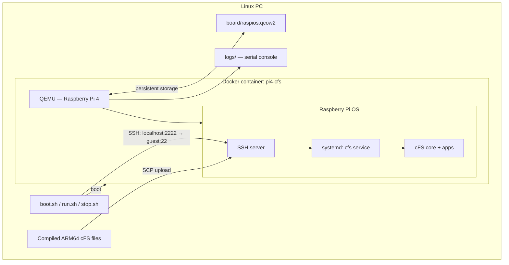

# Raspberry Pi 4 cFS emulator

Run cFS on Raspberry Pi OS inside QEMU and Docker.

> Draft: scripts are still changing. This README describes the current workflow.

## Architecture



## Start

Requires Linux, Bash, Git, Docker Engine without `sudo`, and the OpenSSH client
(`ssh`, `scp`, and `ssh-keygen`). Linux AMD64 is tested. A Linux environment in
WSL2 is an untested option; macOS is not supported here. Booting the platform
does not require the optional cFS submodules or personal GitHub SSH keys.

```bash
git clone https://github.com/Raiagues/cfs_emulator.git
cd cfs_emulator

./build.sh   # Required until the public image is available; optional afterward.
./boot.sh    # Boot Linux in the background.
./logs.sh    # Follow boot logs. Ctrl+C stops following.
```

**Public image publication is pending.** Both build and boot use the single
image name in `config/image`: `ghcr.io/raiagues/cfs_emulator:latest`. Once it is
published and public, Docker downloads it automatically if it is missing
locally. Public GHCR images require no Docker login. A local build uses the
same tag and is used by boot directly. [GitHub Container registry documentation](https://docs.github.com/en/packages/working-with-a-github-packages-registry/working-with-the-container-registry)

On Ubuntu/Debian, `./setup.sh` can set up Docker. Log out and back in if it adds
you to the Docker group. Install the OpenSSH client separately if needed.

The image prepares Linux networking, SSH, and the disabled cFS service during
the build. The first local boot creates a dedicated SSH key, copies the
prepared disk and matching boot files to `board/`, and installs the public key.
Subsequent boots reuse them and skip the copy and guestfish preparation. This
keeps an existing guest's kernel and disk together when the Docker image changes.
Linux can boot without any cFS binaries.

GHCR stores the downloadable image; QEMU and Linux still run on your machine.
The initial image download is required unless you build locally.

## Run cFS

Provide a compiled ARM64 payload containing `core-cpu1` and `cf/`, either at
`cFS/build-rpi_linux/exe/cpu1/` or in a directory passed to `run.sh`. The
[ARM64 toolchain](cFS/sample_defs/toolchain-aarch64-linux-gnu.cmake) is available
after fetching the optional cFS submodule with the required repository access.
You can instead supply a build from elsewhere. `build.sh` builds only the
Docker image; `run.sh` does not compile anything.

```bash
./run.sh   # Upload the existing build, start cFS, and follow its logs.
# Or: ./run.sh /path/to/cpu1
```

`run.sh` checks for the `core-cpu1` file and `cf/` directory before contacting
the guest. It checks for a complete SSH login for up to five minutes, stopping
early if the container exits and continuing as soon as SSH is ready. The script
has no fixed boot delay. It stops `cfs.service`, uploads the files with SCP
transfer progress in the terminal, starts that same service, and follows its
journal. An upload failure stops the script before starting cFS. Matching files
are overwritten; other files already in the guest remain.

```mermaid
sequenceDiagram
    actor User
    participant Run as run.sh (PC)
    participant OS as Raspberry Pi OS
    participant CFS as cFS service
    User->>Run: ./run.sh
    Run->>OS: Wait for SSH
    Run->>OS: Stop cFS
    OS->>CFS: Stop service
    Run->>OS: Upload core-cpu1 and cf/ with SCP
    Run->>OS: Start cFS
    OS->>CFS: Start service
    OS-->>User: Stream cFS logs through run.sh
    Note over User,CFS: Ctrl+C stops the log view; cFS keeps running
```

Look for `CFE_ES_Main entering OPERATIONAL state`. After rebuilding cFS, run
`./run.sh` again. Start cFS this way after each Linux boot.

## Useful commands

Run these from the repository root:

| Command | Action |
| --- | --- |
| `./logs.sh` | Follow container output, including first preparation and the serial console. |
| `ssh -F config/ssh.conf pi4-cfs` | Open a guest shell. |
| `ssh -F config/ssh.conf pi4-cfs journalctl -u cfs.service -f` | Follow cFS logs. |
| `ssh -F config/ssh.conf pi4-cfs systemctl stop cfs.service` | Stop cFS; keep Linux running. |
| `./stop.sh` | Shut down Linux cleanly. |
| `./boot.sh --interactive` | Boot with an interactive serial console and local root login. |

`./boot.sh` is detached by default. Ctrl+C in `./logs.sh` stops following output
and leaves Linux running. Serial logs remain in `logs/`, with `logs/latest.log`
pointing to the latest run. cFS output is stored in the guest journal.

`./stop.sh` asks Linux to flush the persistent disk and power off. Wait until
`pi4-cfs` disappears from `docker ps` before booting again. Rebuilding or pulling
a Docker image does not update the configuration in an existing guest disk.
Never use guestfish on a disk QEMU is using; shut down Linux completely first.

The scripts share `config/ssh.conf` and a dedicated `.ssh/id_ed25519` generated
on first use. Personal `~/.ssh` keys and an SSH agent are unnecessary. Only the
public key is mounted into the container; the client private key stays on the
host. SSH accepts key authentication at `127.0.0.1:2222` only.

The first localhost connection trusts the guest host key and records it in
`.ssh/known_hosts`; `StrictHostKeyChecking accept-new` then rejects changed
keys. If you intentionally replace the disk, confirm the replacement before
removing the old entry with
`ssh-keygen -f .ssh/known_hosts -R '[127.0.0.1]:2222'`.

Keep `.ssh/` and `board/` together when backing up or moving the
checkout. Both are ignored by Git, along with `logs/`. If the private key is
missing while the disk exists, boot stops and asks you to restore `.ssh/`;
a newly generated key would not unlock the existing disk.

## Local build troubleshooting

If Docker's bridge network cannot resolve download hosts during a build, try
`./build.sh --network=host` on Linux. This was required on the tested host;
the default bridge-network build has not passed there.

## Publish the image

The manual `.github/workflows/image.yml` workflow publishes `linux/amd64`
images tagged `latest` and with the commit SHA. Once the workflow is on the
default branch, open **Actions → Publish emulator image → Run workflow** and
select that branch. The publish job runs only on the default branch.

It uses GitHub's automatic `GITHUB_TOKEN` with package write permission, so no
personal access token or user-created token secret is needed. After the first
successful publication, change the package's visibility to **Public** in its
settings so users can pull without logging in. Repository visibility alone
does not make the package public. [GitHub package visibility documentation](https://docs.github.com/en/packages/learn-github-packages/configuring-a-packages-access-control-and-visibility)

The workflow derives the image name from its repository. A fork publishes
under that fork's owner and repository name; update `config/image` to its
`ghcr.io/<owner>/<repository>:latest` to use that image for boot and local builds.

GitHub currently lists Container registry image storage and bandwidth as
free. See the current terms in [GitHub Packages billing](https://docs.github.com/en/billing/concepts/product-billing/github-packages).
