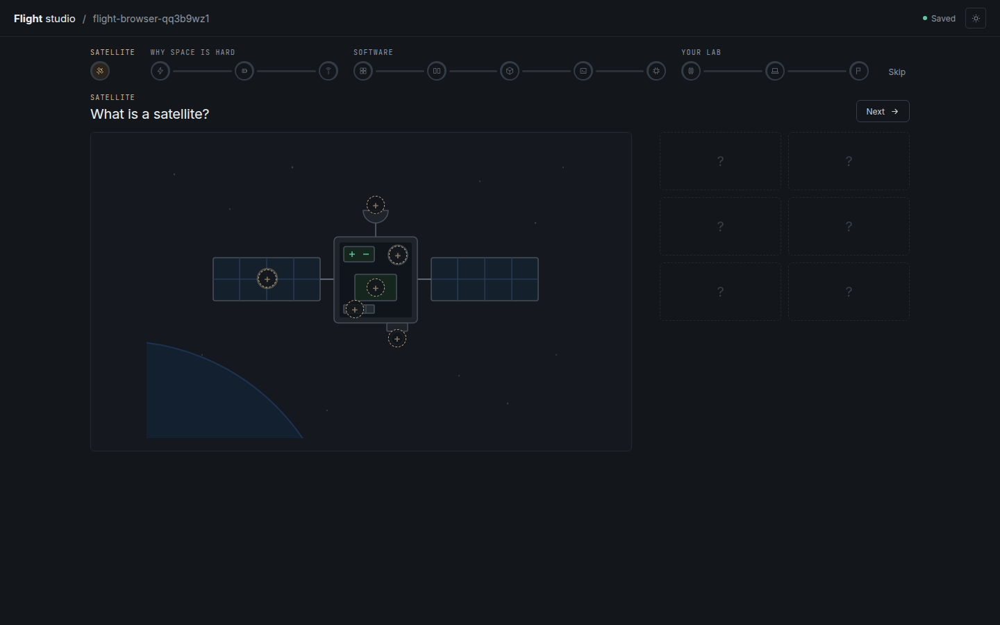
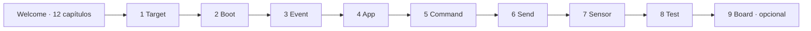
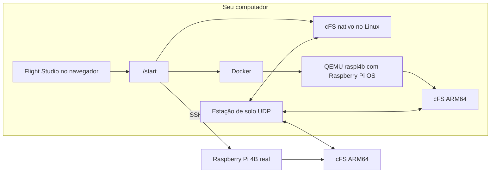
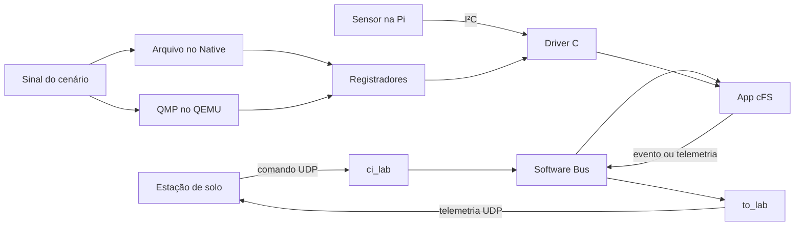

# Flight Studio

## O que é

Flight Studio é um laboratório local para aprender e desenvolver software com o **core Flight System (cFS) da NASA**. Nunca use o laboratório em voo.
No primeiro percurso você compila o cFS, escreve um comando em C, envia esse comando à sua app e confere a resposta e a leitura de um sensor.



## Começar em 5 minutos (Native)

Em um computador Linux com navegador, instale Python 3 e Git pelo terminal. A primeira compilação e os downloads dependem da máquina e da conexão.

| Distribuição | Comando no computador |
| --- | --- |
| Debian ou Ubuntu | `sudo apt-get update && sudo apt-get install -y python3 git` |
| Fedora | `sudo dnf install -y python3 git` |
| Arch Linux | `sudo pacman -Syu --needed --noconfirm python git` |
| openSUSE | `sudo zypper --non-interactive install python3 git` |

No terminal, em uma pasta onde você possa criar o projeto, execute

```sh
git clone -b first-flight-flow https://github.com/Raiagues/cfs_emulator.git
cd cfs_emulator
./start
```

Abra **http://127.0.0.1:8765**. Em **Welcome**, o anel indica qual parte do satélite explorar. Para ir direto à bancada, use **Skip**, selecione **Native** e aguarde as verificações. Clique no **+** de cada item ausente para instalar o compilador ou baixar as fontes oficiais. Quando tudo estiver pronto, use **Continue · first boot** e **Start first boot**. O console mostra o cFS chegando a `OPERATIONAL`.

Se a porta estiver ocupada, execute na raiz do repositório e abra **http://127.0.0.1:8766**.

```sh
./start --ui --port 8766
```

## O primeiro voo

| Passo | O que você faz | O que você vê | Onde isso existe no cFS |
| --- | --- | --- | --- |
| 1 · Target | Escolhe o alvo e resolve os itens ausentes. | Verificações do compilador, Python e fontes no Native. | Ferramentas de compilação e checkout oficial. |
| 2 · Boot | Inicia a compilação e acompanha a partida. | Marcos do log até `CFE_ES_Main entering OPERATIONAL state`. | Executive Services (ES), OSAL e pacote de suporte à plataforma (PSP). |
| 3 · Event | Conecta a estação, informa o destino da telemetria e envia um NOOP, comando sem efeito sobre a missão. | Evento de `sample_app` e contador de comandos +1. | Entrada em `ci_lab`, distribuição pelo Software Bus, registro em EVS e saída em `to_lab`. |
| 4 · App | Dá nome à sua app e confirma os arquivos. | A nova app aparece na missão. | Código C, alvo CMake e lista de inicialização do ES. |
| 5 · Command | Segue sete paradas, escreve a linha do tratador e compila. | Código de função, mensagem, despacho e resultado do compilador. | Cabeçalhos e implementação da sua app. |
| 6 · Send | Executa a nova versão, digita uma taxa e envia SET_RATE. | Sua app responde com a taxa escolhida e o contador sobe. | Tratador C, evento EVS e telemetria periódica da app. |
| 7 · Sensor | Liga um TMP105 à app, recompila e inicia a leitura. | Uma amostra confirma o caminho até a telemetria. | Driver, registradores I²C e leitor agendado por `sch_lab`. |
| 8 · Test | Executa um cenário. | Leituras, faixa e resultado de cada verificação. | Mesmo protocolo de registradores usado pelo driver C. |
| 9 · Board, opcional | Verifica SSH, escolhe **Use this board**, compila e executa. | A própria Pi registra `OPERATIONAL`. | Mesma missão Linux, compilada para ARM64. |



Você pode rever uma etapa concluída pela barra superior. As marcas registram observações do alvo escolhido.

## Três alvos



O Linux local, a Pi emulada e a Pi física executam o mesmo código da missão.

| Alvo | O que precisa | Como preparar | Como executar | Limites |
| --- | --- | --- | --- | --- |
| Native | Linux, compilador C, CMake, Make e fontes da NASA | Escolha Native e instale os itens indicados. | Build cFS → Run cFS. | Registradores em arquivos locais. Não há pinos físicos. |
| Emulator | Docker com Buildx, OpenSSH e espaço para imagem e disco | Escolha Emulator, prepare imagem e chave. | Start emulator → Build cFS → Run cFS. | O QEMU simula a CPU e os dispositivos implementados. A emulação de ARM em x86 é lenta. |
| Board | Pi 4B com Raspberry Pi OS de 64 bits, SSH e rede IPv4 | Informe host, usuário e identidade. Verifique a conexão e use a placa. | Build cFS no computador → Run cFS por SSH. | Requer a placa e os sensores ligados ao barramento indicado. |

No Linux, use Docker Engine e um usuário com acesso ao daemon. No macOS com Docker Desktop ou no Linux do WSL2 com integração Docker, prepare o Emulator no terminal desse ambiente. A imagem corresponde à arquitetura da máquina. No Windows, mantenha o checkout no sistema de arquivos Linux do WSL2.

## Como os dados circulam



O Software Bus entrega mensagens dentro do cFS. QMP é o canal de controle do QEMU usado para escrever nos registradores emulados.

No Native, cada dispositivo tem um arquivo de registradores em `hardware/.runtime/devices/`. O simulador escreve pelo barramento e endereço configurados, e o próximo pacote da app confirma a leitura pelo driver C.

## Usar só pelo terminal

Execute os exemplos na raiz do repositório. Os comandos abaixo usam a mesma infraestrutura que os botões. Nome da app, endereço e taxa são escolhas do operador. Os exemplos usam `demo_app`, `127.0.0.1` e `17`.

| Ação na bancada | Exemplo na raiz | Última linha esperada |
| --- | --- | --- |
| Preparar as fontes | `./start --no-ui source install` | `NASA cFS ready · a4d305dc06fb7d468f5b45214d9f730b97d4bd77` |
| Escolher o alvo | `./start --no-ui target native` | `native` |
| Instalar e verificar | `./start --no-ui setup --target native`, depois `./start --no-ui setup --target native --check` | `Checks passed` |
| Compilar | `./start --no-ui build --target native` | `build · native · succeeded` |
| Executar e ver o estado | `./start --no-ui run --target native`, depois `./start --no-ui status --target native` | PID e hora do último OPERATIONAL |
| Conectar a estação | `./start --no-ui ground connect` | `Connected · 127.0.0.1` |
| Ligar a telemetria | `./start --no-ui ground send to_lab ENABLE_OUTPUT --arg dest_IP=127.0.0.1` | Identificador de ENABLE_OUTPUT |
| Observar a resposta | `./start --no-ui ground send sample_app NOOP` | Evento de sample_app e `CommandCounter 0 → 1` no primeiro envio |
| Ouvir pacotes ou testar NOOPs | `./start --no-ui ground listen --count 1` ou `./start --no-ui ground test --all-noop` | Pacote decodificado ou resposta do último serviço |
| Parar a missão | `./start --no-ui stop --target native` | `stop · native · succeeded` |
| Criar app e biblioteca | `./start --no-ui app new demo_app` e `./start --no-ui library new filters` | `app new · demo_app` e `library new · filters` |
| Ligar o driver à app | `./start --no-ui project link-hal demo_app temp --device temp` | Configuração do leitor e dos arquivos gerados |
| Aplicar um sinal | `./start --no-ui simulate temp --target native --steps 8` | Oitava amostra do TMP105 |
| Testar o modelo ou o cenário | `./start --no-ui simulate-preview --model tmp105` ou `./start --no-ui simulate-preview --device temp --scenario orbit` | `simulate-preview · native · succeeded` |
| Ver o progresso | `./start --no-ui journey --target native` | Estado de Board, última etapa |
| Preparar o emulador | `./start --no-ui emulator image` e `./start --no-ui emulator key` | Referência da imagem e caminho da chave do checkout |
| Iniciar ou desligar o emulador | `./start --no-ui emulator start` e `./start --no-ui emulator stop` | `boot · qemu · succeeded` e `shutdown · qemu · succeeded` |

Para confirmar cada alteração de SET_RATE e escrever a linha do tratador, execute na raiz após criar a app e parar o cFS.

```sh
(
  set -e
  for etapa in Code Struct Prototype Dispatch Events; do
    ./start --no-ui project command-step demo_app --target native --confirm "$etapa"
  done
  ./start --no-ui project command-step demo_app --target native --line 'DEMO_APP_Data.Rate_Hz = Rate_Hz;'
  ./start --no-ui build --target native
  ./start --no-ui run --target native
  ./start --no-ui ground connect
  ./start --no-ui ground send to_lab ENABLE_OUTPUT --arg dest_IP=127.0.0.1
  ./start --no-ui ground send demo_app SET_RATE --arg Rate_Hz=17
)
```

A última linha inclui `Rate set to 17 Hz` e a variação do contador. O catálogo vem da missão compilada. Para deixar a bancada livre, execute na raiz

```sh
./start --no-ui ground stop
./start --no-ui stop --target native
```

**Outras ações.** `app` e `library` oferecem `list`, `rename`, `remove` e `delete`. A ação `remove` retira o módulo da missão e `delete` apaga seu código próprio. `project` reúne barramentos, dispositivos, modelos, comandos e telemetria. `signals` guarda a seleção de sensores, formas de onda e órbita. `logs` abre o console do alvo. `first-boot` executa as fases guiadas. `journey --reset` reinicia o percurso do alvo. Na placa, `setup` aceita host, usuário, porta e identidade SSH, e `connect` verifica a conexão. Compilar, executar e parar aceitam `--target physical` ou `--target qemu`. Consulte as opções na raiz.

```sh
./start --no-ui --help
./start --no-ui project --help
./start --no-ui signals --help
./start --no-ui ground --help
./start --no-ui setup --help
```

**Configuração local.** As variáveis a seguir têm prefixo `FLIGHT_STUDIO_`. `RUNTIME`, `NATIVE_DEVICES` e `EMULATOR_KEYS` escolhem diretórios. `CONTAINER`, `BUILDER` e `PLATFORM` selecionam o contêiner, a imagem de compilação e sua arquitetura. `HTTP_PORT`, `LOOPBACK`, `GUEST_HOST`, `SSH_PORT`, `QMP_PORT`, `COMMAND_PORT`, `GUEST_SSH_PORT`, `GUEST_QMP_PORT` e `GUEST_COMMAND_PORT` configuram a rede. `BOOT_TIMEOUT` e `SENSOR_TIMEOUT` definem limites em segundos. [Valores padrão](project/defaults.py)

## Fazer o mesmo sem o Flight Studio

Abra outro terminal em uma pasta vazia. Use o bundle oficial da NASA na mesma revisão que a bancada. O Makefile e as definições da missão já vêm no checkout.

```sh
git clone https://github.com/nasa/cFS.git
cd cFS
git checkout a4d305dc06fb7d468f5b45214d9f730b97d4bd77
git submodule update --init --recursive
make native_std.prep
make native_std.install
cd build-native_std/exe/cpu1/
./core-cpu1
```

Deixe esse processo aberto até aparecer `CFE_ES_Main entering OPERATIONAL state`. A partir da raiz desse checkout da NASA, em um segundo terminal, compile o emissor oficial e envie um NOOP à sample_app.

```sh
cd tools/cFS-GroundSystem/Subsystems/cmdUtil
make
./cmdUtil --host=127.0.0.1 --port=1234 --pktid=0x1882 --cmdcode=0
```

O console da CPU mostra o evento `SAMPLE: NOOP command`. A estação gráfica oficial permite ligar a telemetria e acompanhar o contador. Use **Start Command System**, **Enable Tlm**, informe o endereço da estação e abra **Start Telemetry System**. Encerre a CPU com Ctrl+C ao terminar. [Guia do cFS-GroundSystem](https://github.com/nasa/cFS-GroundSystem/blob/main/Guide-GroundSystem.md)

Para iniciar Raspberry Pi OS diretamente, use uma versão do QEMU com a máquina `raspi4b`. O script do repositório mostra as opções na ordem em que são usadas.

| Linhas | O que reproduzir em seu ambiente |
| --- | --- |
| 6–25 | Crie uma cópia gravável do disco qcow2. Instale a chave pública da sua conta no guest. Separe kernel ARM64, initramfs e DTB da mesma imagem. |
| 27–30 | Prepare a árvore de dispositivos (DTB) e os modelos I²C da missão. |
| 31–39 | Inicie `qemu-system-aarch64` com `-M raspi4b`, o kernel, a DTB, o initramfs, o cartão SD virtual e o console serial. |
| 40–42 | Abra QMP, associe `usb-net` a uma rede de usuário e encaminhe uma porta TCP local para o SSH 22 do guest. Encaminhe a porta UDP de comandos para `ci_lab`. |

No guest, o destino de telemetria deve alcançar a estação de solo. O laboratório usa o endereço do host visto pela rede de usuário. [Script completo](scripts/emulator.sh) · [Configurações de compilação da NASA](https://github.com/nasa/cFS/tree/a4d305dc06fb7d468f5b45214d9f730b97d4bd77)

## Estrutura do repositório

| Caminho | Responsabilidade |
| --- | --- |
| `start`, `scripts/` | Entrada de terminal, setup, compilação e partida da máquina virtual. |
| `project/`, `mission/` | Configuração do Studio, geradores, definições de compilação e produtos de cada alvo. |
| `cFS/` | Checkout da NASA. Ao criar uma aplicação, um HAL ou uma biblioteca, o Studio grava os fontes em `cFS/apps/<nome>` ou `cFS/libs/<nome>`. Os módulos distribuídos pela NASA aparecem ao lado como referência. |
| `hardware/` | Verificações e execução em Linux, QEMU e Pi física. |
| `ground_station/` | Catálogo de comandos, transporte UDP, eventos e decodificação de pacotes. |
| `sensors/` | Sinais, órbita, cenários e transporte para os dispositivos. |
| `jobs/`, `journey/` | Tarefas com log e registro de evidências por alvo. |
| `interface/server.py`, `interface/backend/` | Camada HTTP, proteção da sessão e adaptação das chamadas à infraestrutura. |
| `interface/static/` | Parte gráfica, rotas, telas e animações. |
| `docs/design-pack/` | Referência de navegação, desenho, auditoria e resultados. |

## Testes

Na raiz, com Node.js e npm instalados, prepare o navegador. O Playwright controla Chromium e lê o estado real da página.

```sh
npm ci
npx playwright install chromium
./scripts/test
```

Para executar os grupos separadamente, na raiz, use

```sh
./scripts/test --unit
./scripts/test --browser
./scripts/test --follow-highlight
./scripts/nav-map --check
```

Para explorar os protótipos na raiz, execute o servidor abaixo e abra **http://127.0.0.1:8000/Welcome.html**. Os sete arquivos HTML são navegáveis.

```sh
python3 -m http.server --bind 127.0.0.1 --directory docs/design-pack/design/preview 8000
```

[Critérios de aceite](docs/design-pack/09_ACCEPTANCE_TESTS.md) · [Resultados e capturas](docs/design-pack/RESULTS.md)

## Problemas comuns

| Sintoma | Causa provável | Como resolver |
| --- | --- | --- |
| A interface diz que a porta está em uso. | Outro processo escuta na mesma porta. | Inicie na porta 8766 conforme a seção inicial. |
| O programa oficial pede PyQt5 ou pyzmq. | A interface gráfica da NASA usa essas bibliotecas. | Para o programa da NASA, instale as dependências do guia oficial. A estação do Studio usa UDP da biblioteca padrão do Python. |
| Docker dá erro de permissão após a instalação. | A sessão de login ainda tem os grupos antigos. | Saia da conta Linux e entre novamente antes de verificar Emulator. |
| O emulador demora para subir. | Em um PC x86, o QEMU traduz instruções ARM em software. | Acompanhe o console serial. A primeira preparação da imagem pode levar dezenas de minutos. Os tempos medidos neste ambiente estão nos resultados. |
| A chave SSH mudou após recriar o disco. | O guest novo tem outra identidade. | Pare e inicie o emulador deste checkout. O Studio verifica a chave do próprio contêiner e atualiza `board/known_hosts`. Em uma Pi física, confirme a impressão digital na placa. |
| Enviei um comando e a telemetria não chegou. | Destino incorreto, receptor desconectado ou firewall na porta UDP. | Conecte a estação, informe em ENABLE_OUTPUT o endereço exibido e permita a telemetria na porta UDP 2234. Repita ao reiniciar o cFS. |
| A compilação diz que o cFS já está rodando. | O processo usa os binários que seriam substituídos. | Use **Stop cFS**, depois **Build cFS** e **Run cFS**. |
| O disco enche ao preparar a imagem. | Docker, o disco da Pi e o cache de compilação precisam de espaço. | Libere espaço no volume do Docker e no checkout ou use Native. Preserve os discos que contêm seu trabalho. |
| O console mostra erro de fila ou de bind de CI_LAB. | Limites POSIX de filas ou outra CPU usando a porta de comando. | Confira a primeira linha de erro no console. Pare a CPU que ocupa a porta ou corrija o limite de filas da sua conta. Depois use **Retry first boot**. |

## Licença e créditos

O Flight Studio e os componentes cFS da NASA usam Apache 2.0. A simulação usa QEMU e a imagem Linux do projeto Raspberry Pi OS. Cada componente conserva seus avisos e sua própria licença. [Licença do repositório](LICENSE) · [NASA cFS](https://github.com/nasa/cFS) · [QEMU](https://www.qemu.org/) · [Raspberry Pi OS](https://www.raspberrypi.com/software/)
