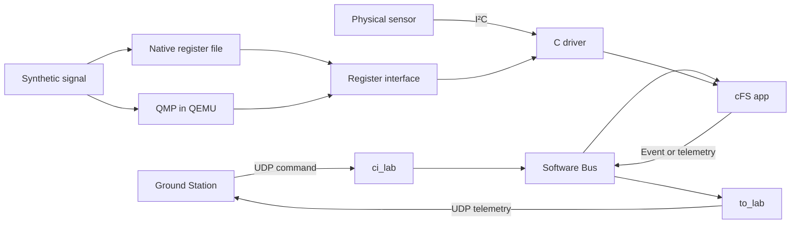

# Flight Studio

Flight Studio is a local laboratory for learning and developing software with NASA's **core Flight System (cFS)**. It is not flight-qualified software. The guided workflow builds cFS, adds a command in C, sends it to an application and checks its response and sensor telemetry.

## Getting started on Linux

Install Python 3 and Git. Download and first-build times depend on your computer and connection.

| Distribution | Command on your computer |
| --- | --- |
| Debian or Ubuntu | `sudo apt-get update && sudo apt-get install -y python3 git` |
| Fedora | `sudo dnf install -y python3 git` |
| Arch Linux | `sudo pacman -Syu --needed --noconfirm python git` |
| openSUSE | `sudo zypper --non-interactive install python3 git` |

Run these commands in a directory where you can create the project:

```sh
git clone -b master https://github.com/Raiagues/cfs_emulator.git
cd cfs_emulator
./start
```

Open **http://127.0.0.1:8765**. Follow **Welcome**, or use **Skip** to open the workbench. Select **Native** and wait for the checks. Use the **+** beside a missing prerequisite to install the compiler or download the official NASA sources. When the checks pass, select **Continue · first boot**. Preparation starts automatically, and the console reports when cFS reaches `OPERATIONAL`. Builds default to **one worker**.

Running `./start` again reuses the Studio server for this workspace and port. Stop the web server with:

```sh
./stop.sh
```

This stops only the Studio server; it does not contact SSH or stop a running cFS mission. Repeating it is safe. To use a different port, start and stop the matching instance as follows:

```sh
./start --ui --port 8766
./stop.sh --port 8766
```

The alternate URL is **http://127.0.0.1:8766**. If an unrelated process occupies the selected port, choose another port or stop that process yourself.

## Sources, templates and validation

[Templates and script index](project/README.md#templates-and-script-index) · [Technical validation protocol and results](validation/README.md) · [Official NASA checkout and local mission](project/README.md)

NASA cFS is downloaded during source setup, rather than distributed in this repository or embedded in an emulator image. The platform keeps its generators outside the checkout and creates requested apps and libraries inside the local `cFS/apps/` and `cFS/libs/` directories. A new workspace has no user apps or linked sensors.

## First flight

| Step | Action | Evidence | cFS component |
| --- | --- | --- | --- |
| 1 · Target | Select a target and install missing prerequisites. | Compiler, Python and source checks for Native. | Build tools and official checkout. |
| 2 · Boot | Follow the automatic build and startup. | `CFE_ES_Main entering OPERATIONAL state`. | Executive Services, OSAL and PSP. |
| 3 · Event | Connect Ground Station, enable telemetry and send NOOP. | A `sample_app` event and an increased command counter. | `ci_lab`, Software Bus, EVS and `to_lab`. |
| 4 · App | Name your app and confirm its files. | The app appears in the mission. | C sources, CMake target and ES startup entry. |
| 5 · Command | Follow the code steps, implement the handler and build. | Function code, packet definition, dispatch and compiler output. | App headers and implementation. |
| 6 · Send | Run the new build and send SET_RATE. | The selected rate and increased command counter. | C handler, EVS event and housekeeping. |
| 7 · Sensor | Link a TMP105, rebuild and start acquisition. | A sample reaches telemetry. | I²C driver and scheduled reader. |
| 8 · Test | Run a scenario. | Readings and individual checks. | The register protocol used by the C driver. |
| 9 · Board, optional | Check SSH, select the board, build and run. | The Pi reports `OPERATIONAL`. | The same Linux mission compiled for ARM64. |

Completed steps remain accessible from the top bar. Progress records observations for the selected target. The introductory workflow starts on Native; the later tutorial stages introduce the emulator and physical board.

## Targets and data flow

| Target | Requirements | Run sequence | Scope |
| --- | --- | --- | --- |
| Native | Linux, C compiler, CMake, Make and NASA sources | Build cFS → Run cFS | Local register files; no physical pins. |
| Emulator | Docker with Buildx, OpenSSH and space for the image and guest disk | Prepare image and key → Start emulator → Build cFS → Run cFS | ARM CPU and supported device models in QEMU. ARM emulation on x86 is slow. |
| Board | Pi 4B, 64-bit Raspberry Pi OS, SSH and IPv4 | Configure SSH → Build cFS → Run cFS | Physical hardware and sensors on the configured buses. |

All three targets use the same mission sources. On Linux, the current user needs access to Docker Engine. With Docker Desktop on macOS or Docker integration in WSL2, prepare Emulator from that environment's terminal. On Windows, keep the checkout in the WSL2 Linux filesystem.



The Software Bus delivers messages inside cFS. QMP controls QEMU's device properties. Native register files live in `hardware/.runtime/devices/`; an app's telemetry confirms that its C driver acquired a value.

## Command-line workflow

Run the following commands from the repository root. They use the same infrastructure as the interface. App names, addresses and rates are operator choices; these examples use `demo_app`, `127.0.0.1` and `17`.

| Action | Command |
| --- | --- |
| Download official sources | `./start --no-ui source install` |
| Select Native | `./start --no-ui target native` |
| Install and check prerequisites | `./start --no-ui setup --target native`, then `./start --no-ui setup --target native --check` |
| Build | `./start --no-ui build --target native` |
| Run and inspect status | `./start --no-ui run --target native`, then `./start --no-ui status --target native` |
| Connect Ground Station | `./start --no-ui ground connect` |
| Enable telemetry | `./start --no-ui ground send to_lab ENABLE_OUTPUT --arg dest_IP=127.0.0.1` |
| Send NOOP | `./start --no-ui ground send sample_app NOOP` |
| Receive packets or check NOOP responses | `./start --no-ui ground listen --count 1` or `./start --no-ui ground test --all-noop` |
| Stop cFS | `./start --no-ui stop --target native` |
| Create an app and library | `./start --no-ui app new demo_app` and `./start --no-ui library new filters` |
| Link an existing device | `./start --no-ui project link-hal demo_app temp --device temp` |
| Apply a signal | `./start --no-ui simulate temp --target native --steps 8` |
| Preview a model | `./start --no-ui simulate-preview --model tmp105` |
| Inspect progress | `./start --no-ui journey --target native` |
| Prepare the emulator | `./start --no-ui emulator image` and `./start --no-ui emulator key` |
| Start or shut down QEMU | `./start --no-ui emulator start` and `./start --no-ui emulator stop` |

After creating `demo_app` and stopping cFS, confirm the SET_RATE integration steps and implement its handler:

```sh
(
  set -e
  for step in Code Struct Prototype Dispatch Events; do
    ./start --no-ui project command-step demo_app --target native --confirm "$step"
  done
  ./start --no-ui project command-step demo_app --target native --line 'DEMO_APP_Data.Rate_Hz = Rate_Hz;'
  ./start --no-ui build --target native
  ./start --no-ui run --target native
  ./start --no-ui ground connect
  ./start --no-ui ground send to_lab ENABLE_OUTPUT --arg dest_IP=127.0.0.1
  ./start --no-ui ground send demo_app SET_RATE --arg Rate_Hz=17
)
```

The response includes `Rate set to 17 Hz` and the command-counter change. The packet catalog comes from the compiled mission. To release the receiver and stop cFS:

```sh
./start --no-ui ground stop
./start --no-ui stop --target native
```

`app` and `library` provide `list`, `rename`, `remove` and `delete`. Removing a module from a mission preserves its sources; deleting a user module removes its sources. `project` manages buses, devices, models, commands and telemetry. `signals` saves sensor selections and waveforms. `logs` follows a target's console, `first-boot` runs the guided stages, and `journey --reset` resets that target's progress. Target operations also accept `--target qemu` and `--target physical`.

```sh
./start --no-ui --help
./start --no-ui project --help
./start --no-ui signals --help
./start --no-ui ground --help
./start --no-ui setup --help
```

Local environment variables use the `FLIGHT_STUDIO_` prefix. `RUNTIME`, `NATIVE_DEVICES` and `EMULATOR_KEYS` select directories. `CONTAINER`, `BUILDER` and `PLATFORM` select the container, builder image and architecture. `HTTP_PORT`, `LOOPBACK`, `GUEST_HOST`, `SSH_PORT`, `QMP_PORT`, `COMMAND_PORT`, `GUEST_SSH_PORT`, `GUEST_QMP_PORT` and `GUEST_COMMAND_PORT` configure networking. `BOOT_TIMEOUT` and `SENSOR_TIMEOUT` are limits in seconds. See [defaults.py](project/defaults.py).

## Running NASA cFS directly

In a separate empty directory, obtain the official bundle at the revision used by the workbench:

```sh
git clone https://github.com/nasa/cFS.git
cd cFS
git checkout a4d305dc06fb7d468f5b45214d9f730b97d4bd77
git submodule update --init --recursive
make native_std.prep
make native_std.install
cd build-native_std/exe/cpu1/
./core-cpu1
```

Wait for `CFE_ES_Main entering OPERATIONAL state`. In another terminal, starting from that NASA checkout's root, build the official sender and send NOOP:

```sh
cd tools/cFS-GroundSystem/Subsystems/cmdUtil
make
./cmdUtil --host=127.0.0.1 --port=1234 --pktid=0x1882 --cmdcode=0
```

The CPU console reports `SAMPLE: NOOP command`. NASA's graphical Ground System can enable telemetry and display the counter; follow its [Ground System guide](https://github.com/nasa/cFS-GroundSystem/blob/main/Guide-GroundSystem.md). Stop the CPU with Ctrl+C.

For a direct Raspberry Pi OS boot, [scripts/emulator.sh](scripts/emulator.sh) shows the writable disk, public key, ARM64 kernel, initramfs, DTB, `raspi4b` machine, serial console, QMP and user-network forwarding used by the platform. The guest telemetry destination must be reachable from QEMU's network.

## Repository layout

| Path | Responsibility |
| --- | --- |
| `start`, `stop.sh`, `scripts/` | CLI, Studio lifecycle, setup, builds and emulator startup. |
| `project/` | Platform configuration, templates and mission generators. |
| `cFS/`, `mission/` | Ignored local NASA checkout, mission definitions and build outputs. |
| `hardware/` | Checks and execution on Native, QEMU and physical Pi. |
| `ground_station/` | Packet catalog, UDP transport, events and decoding. |
| `sensors/` | Signals, scenarios and device injection. |
| `jobs/`, `journey/` | Logged operations and observed tutorial progress. |
| `interface/server.py`, `jobs/service.py` | HTTP routes, session protection and infrastructure adapters. |
| `interface/static/` | Browser views, navigation and animation. |
| `interface/tests/` | Automated unit and browser regression checks. |
| `validation/` | Technical evaluation procedures, raw observations and published results. |

## Tests

Run Python regression checks from the repository root. JavaScript unit checks use Node.js and do not launch a browser:

```sh
python3 -m unittest discover -s interface/tests -p 'test_*.py'
node --experimental-default-type=module --test --test-concurrency=1 interface/tests/*.mjs
```

For browser navigation checks, install the pinned development dependencies and Chromium first:

```sh
npm ci
npx playwright install chromium
./scripts/nav-map --check
./scripts/nav-map --verify-routes
```

`scripts/nav-map` prints an inventory derived from current sources and rendered controls. Use `--output PATH` to save it outside the source tree. Browser inventory checks require an installed NASA checkout and use an isolated temporary mission. The [validation guide](validation/README.md) separates regression checks from measured technical results and links the reproducible evidence.

## Troubleshooting

| Symptom | Action |
| --- | --- |
| Studio's port is occupied by another application | Choose another port with `./start --ui --port 8766`. An existing Studio for this workspace is reused. |
| Docker reports permission denied | Log out and back in after adding your account to the Docker group. |
| QEMU starts slowly | Follow the serial console. ARM software emulation and initial image preparation can take several minutes. |
| Guest SSH identity changed after recreating its disk | Restart this checkout's emulator so Studio can verify its container's key. On a physical Pi, verify the fingerprint on that board. |
| No telemetry after a command | Connect the receiver, use the displayed return address in ENABLE_OUTPUT and permit UDP telemetry. Repeat after restarting cFS. |
| Build reports that cFS is running | Stop cFS on the selected target before replacing its binaries. `./stop.sh` only stops the web server. |
| Image preparation runs out of disk space | Free space in Docker storage and the checkout, preserving disks that contain your work. |
| cFS reports a queue or CI_LAB bind error | Inspect the first console error, check POSIX queue limits and stop any other CPU using the command port before retrying. |

## License and credits

Flight Studio and NASA cFS use Apache 2.0. QEMU, Raspberry Pi OS and bundled dependencies retain their own notices and licenses. [Repository license](LICENSE) · [NASA cFS](https://github.com/nasa/cFS) · [QEMU](https://www.qemu.org/) · [Raspberry Pi OS](https://www.raspberrypi.com/software/)
