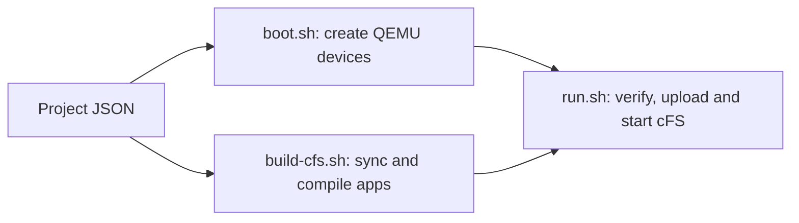

# Raspberry Pi 4 cFS emulator

Run commands on your Linux PC, from this repository. Supported hosts:
Ubuntu 24.04+ or Debian 13+, AMD64, with Git for the initial clone.

## First use

```bash
git clone https://github.com/Raiagues/cfs_emulator.git
cd cfs_emulator
./scripts/setup.sh
```

Setup installs missing tools, configures SSH outside the repository, downloads
the emulator image and builds cFS when needed. It requests sudo when necessary.
If it adds your user to the Docker group, sign out and back in before continuing.

```bash
./boot.sh
./run.sh
```

Boot shows the live Linux log and returns when SSH works. Run checks the build
and sensors, loads the guest I2C interface, uploads cFS and follows its log.
Look for `CFE_ES_Main entering OPERATIONAL state` and `tmp105: 23.500 C`.
Ctrl+C closes the log view; the emulator and cFS keep running.

## Configuration

The project starts with `thermal_app` and a TMP105 on `i2c-bus.1`, address `0x48`.
`project/config.json` stores hardware and app bindings. cFS app manifests store
message IDs, commands and telemetry. Stock apps, including `sample_app`, are
protected by the project commands.



```bash
./scripts/project.sh devices
./scripts/project.sh list
./scripts/project.sh locate thermal_app
```

See [project commands](project/README.md) to create apps, sensors, commands and
telemetry. The same JSON and commands can be used by a future GUI.

## Update and control

After changing app code or configuration:

```bash
./scripts/build-cfs.sh
./run.sh
```

Adding or changing QEMU devices also requires `./stop.sh` followed by `./boot.sh`
before running cFS. The run command reports mismatches before stopping cFS.
Changing sensor values does not require rebuilding or restarting.

| Command | Action |
| --- | --- |
| `./scripts/project.sh values` | Apply sensor values from the JSON. |
| `./scripts/project.sh simulate` | Run the Python sensor waveforms; Ctrl+C stops them. |
| `./logs.sh` | Follow Linux boot and serial output. |
| `./boot.sh --interactive` | Boot with a Linux terminal attached. |
| `./stop.sh` | Shut down the emulator normally. |

The guest disk persists in `board/`. No Docker rebuild is needed for app,
sensor configuration or simulator changes. All scripts locate the repository.

## Python sensor simulation

With Linux and cFS running, open another terminal:

```bash
./scripts/project.sh simulate
```

To update only one configured device, select its ID from `project/config.json`:

```bash
./scripts/project.sh simulate tmp105 --interval 0.5
./scripts/project.sh simulate tmp105 --interval 1 --steps 30
```

Edit [sensors/tmp105.py](sensors/tmp105.py) or
[sensors/lsm303dlhc_mag.py](sensors/lsm303dlhc_mag.py) to change the simulation.
Each file has amplitude/period constants and a `sample(elapsed_s, initial_values)`
function. `elapsed_s` is real elapsed time on the PC, in seconds.
The project's `values` supply each device's waveform center/axis offsets;
model defaults apply to properties omitted from the JSON. Set amplitude to zero
for a constant value, or replace `sample()` with your own Python calculation:

```python
def sample(elapsed_s, initial_values):
    return {"temperature": 30000 if elapsed_s < 10 else 20000}
```

Return integer QEMU properties: `temperature` in millidegrees Celsius, or
`mag-x`, `mag-y`, `mag-z` in thousandths of a microtesla. The runner validates
every sample before sending a tick through QMP. TMP105 readings reach cFS through
I²C; the default sensor resolution is 0.5 °C, so readings quantize the waveform.
The magnetometer can be simulated in QEMU but does not yet have a cFS driver.

Restart only `simulate` after editing Python; no build or emulator restart is
needed. Ctrl+C (or `--steps`) leaves the last values in the sensors. Run
`./scripts/project.sh values` to restore the JSON values. Run one simulator for
the chosen devices at a time to avoid competing writers.

`sensors/` contains only runtime code: model calculations, the simulation loop,
hardware integration and the QMP client. Tests live in `tests/`:

```bash
PYTHONDONTWRITEBYTECODE=1 python3 -m unittest discover -s tests -v
```
