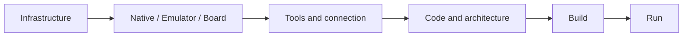
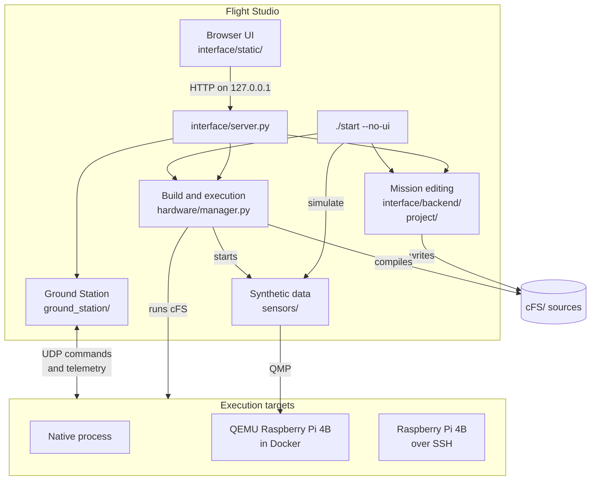

# Flight Studio

Flight Studio is a local workspace for developing NASA cFS flight software. It edits
the mission's C sources and draws each app's command and telemetry routes from those
same sources. It builds cFS and runs it on this computer, in a Raspberry Pi 4B
emulated by QEMU, or on a physical Raspberry Pi 4B. Its Ground Station uses the NASA
cFS-GroundSystem modules to send commands to the running build and to decode its
telemetry. In QEMU, Python functions can also set the readings of emulated I²C
sensors, which the flight software reads through its Linux drivers.


## Requirements

Every target needs Linux, Git, Python 3.10 or later and the packages listed in
[`ground_station/requirements.txt`](ground_station/requirements.txt), which the NASA
Ground Station modules import. Native builds also need CMake, Make and a C compiler.
The emulator and builds for the board need Docker 23 or later with Buildx and an
OpenSSH client. [`scripts/setup.sh`](scripts/setup.sh) checks these and installs what
is missing on Ubuntu 24.04 or later and Debian 13 or later, on AMD64. The emulated
Raspberry Pi keeps its disk in `board/raspios.qcow2`, which takes about 3 GB.

## Install

```sh
git clone --recurse-submodules https://github.com/Raiagues/cfs_emulator.git
cd cfs_emulator
python3 -m venv .venv
. .venv/bin/activate
python3 -m pip install -r ground_station/requirements.txt
```

The `cFS` submodule is the [official NASA cFS repository](https://github.com/nasa/cFS).
Mission edits change files in `cFS/sample_defs/` and create apps and libraries in
`cFS/apps/` and `cFS/libs/`, as described in [Project and mission](project/README.md).

## First run

The checked-in project selects a Raspberry Pi 4B with Raspberry Pi OS and one emulated
TMP105 temperature sensor on I²C bus 1, address 0x48. The four steps below start the
interface, the emulator, cFS and the Ground Station separately. Each step ends with
the sign to look for before going on. Native execution, which needs no Docker, is
described after them.

### 1. Interface

```sh
./start
```

Open http://127.0.0.1:8765. The server only accepts connections from this computer,
and `./start --ui --port 8766` selects another port. **Infrastructure** opens first:
choose Native, Emulator or Physical board, configure access and press **Check**.
Preparation commands run in the page's terminal. **Open workspace** opens the CPU1
startup script and mission architecture. The toolbar's settings button returns to
Infrastructure.



### 2. QEMU

Run the setup script once. It checks Docker, Buildx and OpenSSH, initializes missing
submodules, creates the emulator's SSH key in `~/.ssh/cfs-emulator/` and downloads the
emulator image. When the download fails, it builds the image locally. It asks for
sudo when it has to install packages, start Docker or add your user to the `docker`
group, and a group change takes effect after you sign in again.

```sh
./scripts/setup.sh
```

Until setup has run, the toolbar shows Set up QEMU in place of Start QEMU + Linux.
In the toolbar, choose Emulator and press Start QEMU + Linux. The first boot copies
the Raspberry Pi OS disk to `board/` and adds this computer's SSH key to it. Linux is
ready when the terminal prints `Sensor values applied.` and then
`Raspberry Pi ready.`. Stop QEMU powers Linux off and waits for the emulator to exit.
From a terminal, the same steps are `./start --no-ui boot` and
`./start --no-ui shutdown`.

### 3. cFS

Press Build cFS and then Run cFS. Builds for the emulator use the `cfs-builder:local`
Docker image with the ARM64 cross compiler, which the first build creates. Run uploads
the build to the guest, starts `cfs.service` and shows its output in the terminal. A
running service only means that the process started. cFE has finished its startup
sequence when the output shows `CFE_ES_Main entering OPERATIONAL state`, and apps that
fail to start report their errors in the same output.

```sh
./start --no-ui build
./start --no-ui run     # follows the output; Ctrl+C stops following, not cFS
./start --no-ui stop
```

### 4. Ground Station

Open Ground station in the left rail and press Connect. Flight Studio reads the
command and telemetry definitions of the running build, starts a UDP receiver and
asks TO_LAB to send telemetry to this computer. The status reads `QEMU · Connected`
once the receiver is listening, and telemetry is arriving when the packet counters
grow.

To check the command path, choose `sample_app` as the application, select
`SAMPLE_APP_NOOP_CC` and press Send command. The Activity tab then lists the command
under Sent, which only means that the UDP datagram left this computer. SAMPLE_APP
processed it when Activity shows `SAMPLE: NOOP command` under Events and the
`CommandCounter` field of the next `SAMPLE_APP_HkTlm_t` packet, in the Telemetry tab,
has gone up by one. The [Ground Station guide](ground_station/README.md) shows this
sequence step by step.

### Native execution

Select **Native** to build with the host compiler and run `core-cpu1` on this
computer. Board/OS selectors are hidden and the workbench shows the local computer.
The board and sensor configuration stays saved for Emulator and Board mode.
Build cFS, Run cFS and Ground Station use the native build; Ground Station connects
to 127.0.0.1.

```sh
./start --no-ui profile --native
./start --no-ui build
./start --no-ui run --no-follow
./start --no-ui logs
./start --no-ui stop
```

A physical Raspberry Pi 4B uses Board instead of Emulator, and Connect board takes the
place of Start QEMU + Linux. [Execution targets](hardware/README.md) describes the
one-time authorization the board needs.

## How the parts connect

The browser and `./start --no-ui` call the same Python code, so both work on the same
project, builds and running targets. Only one build or runtime operation runs at a
time in a checkout.



## Documentation

- [Interface](interface/README.md) covers the views, mission editing, terminals and
  keyboard shortcuts.
- [Project and mission](project/README.md) covers apps, libraries, devices, drivers and
  the cFS files they change.
- [App generator](project/appgen/README.md) covers generated code and which files are
  yours to edit.
- [Execution targets](hardware/README.md) covers builds, QEMU, the physical board and
  deployment.
- [Synthetic sensor data](sensors/README.md) covers the Python functions and the path
  of a value from QMP to the flight software.
- [Ground Station](ground_station/README.md) covers definitions, UDP transport and what
  each status confirms.

`./start --help` lists the commands, and `./start --no-ui COMMAND --help` shows the
options of one command.
