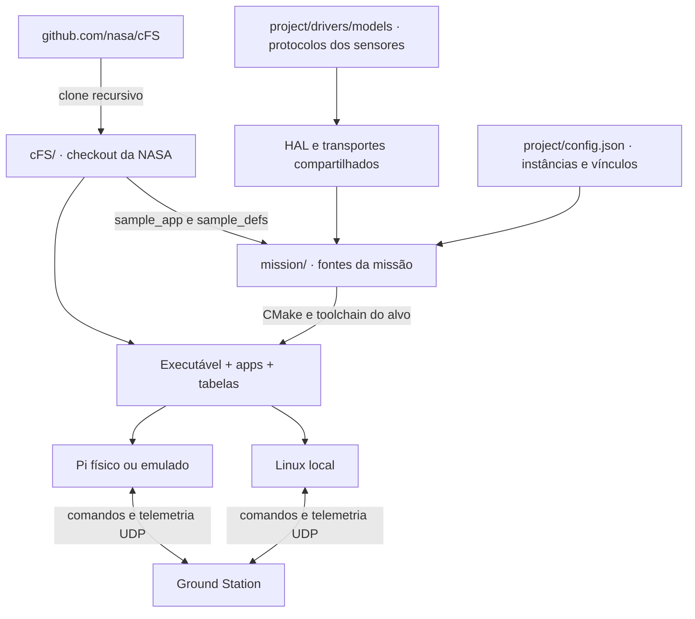
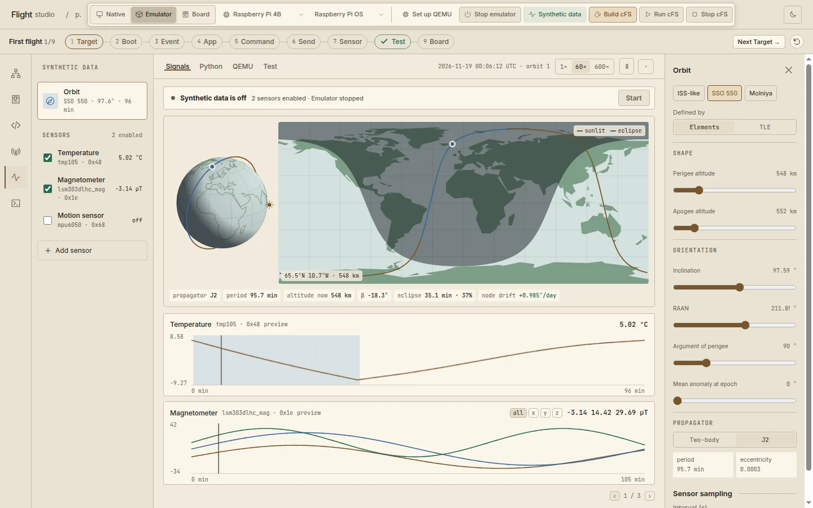

# Flight Studio

O Flight Studio é uma bancada local para desenvolver missões com o **NASA core Flight System (cFS)**. Você escolhe um alvo Linux, vê o hardware e a arquitetura da missão, edita C, compila e conversa com a aplicação pela Ground Station. O projeto inicial mantém as aplicações da distribuição da NASA e começa sem sensores conectados ou apps criadas no Studio.


## Começar pelo computador

Você precisa de Linux, Git e Python 3.10 ou superior para abrir a configuração. Esta versão do primeiro voo está na branch `first-flight-flow`. Na raiz do checkout dessa branch, execute como seu usuário normal.

```sh
./start
```

A plataforma e o código de voo têm origens separadas. A configuração baixa o segundo dentro do projeto. [Repositório da plataforma](https://github.com/Raiagues/cfs_emulator) · [Repositório oficial do cFS](https://github.com/nasa/cFS)

1. Abra **http://127.0.0.1:8765** e escolha **Native** para a primeira execução.
2. Acompanhe **Compiler**, **Python** e **Source**. A seleção inicia os comandos em sequência. Clique em um grupo para ver a saída. Se faltar o checkout, clique no **+** de **Source** para baixar o cFS oficial e seus submódulos. O terminal inferior acompanha a instalação. O Studio repete a verificação ao terminar.
3. Quando os três grupos passarem, clique em **Continue · first boot**. O Studio compila a missão e inicia o cFS. Na tela **First boot**, clique nas camadas para ver o que está carregando e abra o console para localizar `CFE_ES_Main entering OPERATIONAL state`.
4. Em **Next → Ground Station**, clique em **Connect**. Envie o comando de **to_lab** para habilitar a saída de telemetria no endereço já preenchido. Aguarde o primeiro pacote e a amostra inicial do contador de **sample_app**. Envie **SAMPLE_APP_NOOP_CC**. O evento com a mensagem NOOP e o aumento de `CommandCounter` confirmam a resposta.
5. Clique em **App** na barra **First flight** e em **Create your first app**. Dê um nome, confira os arquivos de C e as entradas de build e startup. Confirme em **Create** para gravar a proposta. **Next → add a command** abre a atividade no editor dessa app.


Para instalar pelo terminal, os mesmos passos de preparação são `./scripts/install-cfs.sh` e `./scripts/setup-native.sh`. O instalador nativo verifica os programas e módulos Python antes de solicitar pacotes. Tem rotas para APT, DNF, Pacman e Zypper. Em um Linux com outro gerenciador, instale Git, CMake, Make, compilador C/C++, Python, PyQt5 e pyzmq. Para usar Python em ambiente virtual, ative-o **antes** de executar o instalador e o Studio. Veja quais dependências faltam com `./scripts/setup-native.sh --check`.

O modo Native dispensa Docker e placa. Se a porta já estiver ocupada, por exemplo, use `./start --ui --port 8766`. Encerre o servidor com Ctrl+C no terminal de onde ele foi iniciado. Use **Stop cFS** quando quiser encerrar a missão.

## Onde cada ação acontece

| Tela | O que você faz ali |
| --- | --- |
| Configuração inicial | Escolher **Native**, **Emulator** (QEMU) ou **Board** (placa física), preparar ferramentas e gravar a conexão. O nome Flight Studio no workspace leva de volta à configuração. |
| Primeiro boot | Acompanhar compilação, implantação e estados do cFE até OPERATIONAL. Selecionar uma camada revela sua função e as apps do startup local. |
| Hardware | Inspecionar o CAD, alternar 3D/2D, consultar pinagem e conectar dispositivos. No modo Native o hardware de execução é o computador local. |
| Arquitetura | Explorar apps, bibliotecas, Software Bus, serviços cFE, OSAL e PSP. Abrir um módulo leva às suas funções e ao código. Os controles da seção gerenciam a missão. |
| Código | Navegar na árvore de arquivos e alterações Git, consultar declarações e saltar à linha de origem. Editar arquivos da missão e sincronizar o código que você controla. |
| Ground Station | Montar um comando do catálogo compilado. Em **Round trip**, configurar os passos esperados e verificar os eventos e campos recebidos. Em **System overview**, alternar entre comandos e telemetria por componente. |
| Dados sintéticos | Selecionar um sensor e configurar sinais em unidades físicas. A prévia local funciona com o emulador desligado. A execução no QEMU alimenta o dispositivo que o cFS lê. |

## Como os arquivos se relacionam



- **`cFS/`** é um repositório independente, ignorado pelo Git da plataforma. O Studio consulta suas fontes e reserva os nomes oficiais da NASA. A configuração do Studio aparece fora desse checkout.
- **`mission/apps/` e `mission/libs/`** contêm os módulos próprios do projeto. **`mission/sample_defs/`** é a cópia de trabalho das definições usadas pelo CMake. Os builds ficam em **`mission/build-native/`** e **`mission/build-flight/`**.
- **`project/config.json`** descreve a placa, o sistema, os dispositivos e suas associações às apps. **`project/drivers/models/`** descreve os chips. **`sensors/`** implementa os sinais sintéticos.
- **`hardware/.runtime/`** guarda a seleção local, conexão, estado de builds e execução. **`ground_station/`** lê o catálogo do build e usa os componentes oficiais do cFS-GroundSystem para o transporte.

### Criar e renomear um módulo

Na arquitetura, use **New** na seção desejada. O Studio prepara os arquivos antes de aplicar a criação. **Edit** permite renomear um módulo criado no projeto. O novo nome se propaga pelos símbolos e arquivos próprios, declarações, dependências e startup. Os nomes dos módulos da NASA pertencem ao checkout. Ao retirar uma app da missão, ela sai do startup. A exclusão do código próprio é uma operação separada.

No terminal, a partir da raiz:

```sh
./start --no-ui app new acquisition
./start --no-ui library new filters
./start --no-ui app list
./start --no-ui library list
```

Uma **nova compilação** é necessária quando os insumos da missão mudam depois de um build. O primeiro build aparece como **Build cFS**. Preferências visuais e valores transitórios da simulação não alteram o executável.

### Do handler ao primeiro comando

Em **New command**, escolha a app de missão e dê um nome ao comando. A etapa **Struct** abre a estrutura C do payload. Os sete passos do editor levam ao código de função, à estrutura da mensagem, ao protótipo, ao despacho, aos eventos, ao handler e ao teste. Abra o handler, implemente o efeito esperado e salve o C. Um handler que emite um evento com um valor do payload permite verificar aquele valor pelo downlink. Você pode continuar explorando arquivos pelo ícone **Code** da barra lateral.


Em **Test → Open Ground Station**, o Studio leva o comando selecionado até o alvo. Se uma versão anterior estiver rodando, use **Stop previous build**, **Build cFS** e **Start cFS**. O formulário abre quando o catálogo do binário em execução contém o comando. Os controles de compilação do cabeçalho também ficam disponíveis. Em **New test**, escolha as observações que confirmam a execução, por exemplo um evento da app e o aumento de um campo de housekeeping. Aguarde pelo menos uma amostra do campo antes de medir um aumento. Envie o comando com o teste selecionado. As observações recebidas aparecem no histórico da ida e volta.


### Ligar um sensor a uma app

No alvo **Emulator**, abra **Hardware → Add bus** e selecione **I²C 1**. Clique em **Connect sensor**, escolha **TMP105** e dê à instância o nome `probe`. Use **Link HAL** para criar ou selecionar a app que lerá o sensor e dê ao leitor o nome `temperature`. A mesma operação pode ser repetida no terminal depois de criar `acquisition`:

```sh
./start --no-ui profile --board raspi4b --os raspios
./start --no-ui project add-bus i2c-bus.1
./start --no-ui project add-device tmp105 --id probe --model tmp105 --bus i2c-bus.1 --address 0x48
./start --no-ui project add-sensor acquisition temperature --device probe
./start --no-ui project check
```

Um **modelo** descreve o chip. Uma **instância** é o componente conectado a um endereço. Um **leitor** liga a app a essa instância. É possível usar o mesmo modelo em mais de um componente, respeitando os endereços do barramento.

Para acrescentar um chip, comece pelo modelo declarativo ou pelo template de driver C em `project/drivers/templates/`. Preencha identidade, inicialização, registradores, unidades e escala em `models/<id>/model.json`. A HAL comum executa a aquisição. O transporte implementa a transação de barramento. Quando o protocolo exigir uma sequência peculiar, implemente a operação no driver daquele modelo. Os três exemplos são TMP105, LSM303DLHC magnetômetro e MPU6050. Consulte [o guia de sensores e exemplos de protocolo](project/drivers/README.md).

As apps partem do `sample_app` do checkout instalado. Marcadores `@studio.begin` e `@studio.end` delimitam os trechos que o Studio redescobre quando você adiciona um leitor ou comando. Você pode mover esses trechos junto com seus marcadores. Alterações manuais fora deles são preservadas. Um conflito dentro de um trecho gerenciado interrompe o plano antes de sobrescrever o trabalho. Use `@brief`, `@unit`, `@range` e `@check` nos comentários C para navegar pela interface do módulo. Veja [o contrato das regiões, os arquivos de usuário e um exemplo comentado](project/appgen/README.md).

### Experimentar um sinal localmente

Em **Synthetic data**, selecione um dispositivo conectado. Para temperatura orbital, escolha o tamanho do satélite, a massa, as propriedades da superfície e a potência interna. A prévia calcula a temperatura ao longo da órbita, incluindo a passagem pela sombra. Em **Python → Dry run** você pode amostrar o sinal no computador. **Test** exercita uma órbita, a entrada no eclipse ou a perda e a recuperação do dispositivo. Com o emulador ligado, **Send to QEMU** e o interruptor **Synthetic data** do cabeçalho controlam a mesma sessão de escrita nos sensores selecionados. A aba **QEMU** permite comparar o valor enviado com a leitura que chegar da app pelo downlink.



## Emulador e Raspberry Pi física

| Alvo | Preparar | Executar |
| --- | --- | --- |
| Emulador QEMU | Docker Engine 23+, Buildx 0.10+, OpenSSH e espaço para a imagem e o disco do guest. **Install emulator image** ou `./scripts/setup.sh` prepara imagem e chave local. | **Start emulator**, **Build cFS**, **Run cFS**. Ao terminar, use **Stop cFS** e **Stop emulator** para desligar o guest. |
| Placa física | Inicialize a Pi 4B com Raspberry Pi OS de 64 bits, SSH habilitado e acesso à rede. Informe host ou IP, usuário e identidade SSH na configuração. Use **Check connection** para verificar acesso e permissões do serviço. | **Build cFS** compila ARM64 no host. **Run cFS** envia a missão e inicia o serviço na placa selecionada. A Ground Station usa a rota IPv4 entre o computador e a placa. |

A imagem tem seu próprio identificador para os modelos de registradores. Ao alterar um modelo emulado, prepare a imagem correspondente e reinicie o guest para aplicar a alteração. O disco persistente do guest está em `board/`. Interromper a visualização do log deixa a execução em andamento.

Para diagnóstico, `./start --no-ui status` mostra o alvo e os estados locais. Se SSH por nome falhar, teste o IP da própria placa. Se o envio de comandos aparecer sem resposta, confira o log de startup e o estado da conexão de telemetria. [Detalhes do hardware, serviço e permissões](hardware/README.md) · [Catálogo e transporte da Ground Station](ground_station/README.md).

## Testes e documentação

```sh
python3 -m unittest discover -s interface/tests -v
node --experimental-default-type=module --test interface/tests/*.mjs
./scripts/setup-native.sh --check
```

Com cFS em estado operacional e a app oficial `sample_app` carregada, o teste a seguir conecta a estação, envia um NOOP e espera o evento de resposta pelo downlink. Use `--target qemu` ou `--target physical` para exercitar um desses alvos.

```sh
python3 interface/tests/live_ground.py --target native --port 8765
```

[Resultados e capturas das telas](docs/validation.md) · [Regras de design](docs/design.md) · [Arquitetura do backend e contrato da API](docs/backend.md) · [Configuração da missão](project/README.md).
