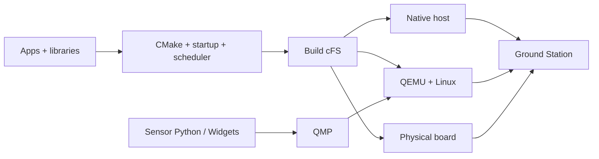

# Flight Studio

Develop NASA cFS with a source editor, block diagrams, terminals and Ground Station.
Run on the local computer, in QEMU or on a physical Raspberry Pi. The browser and
command line use the same project and execution controls.

## Start

Linux host, Python 3.10+, CMake, Make and a C/C++ compiler.

```sh
git clone --recurse-submodules https://github.com/Raiagues/cfs_emulator.git
cd cfs_emulator
python3 -m venv .venv
. .venv/bin/activate
python3 -m pip install -r ground_station/requirements.txt
./start
```

Open **http://127.0.0.1:8765**. `./start --ui --port 8766` selects another port.
The initial workspace shows CPU1 startup beside the mission architecture.

The `cFS/` submodule uses the [official NASA repository](https://github.com/nasa/cFS).
A new project has no selected board, sensors or custom drivers. **Native** builds
and runs the upstream mission on the host:

```sh
./start --no-ui build
./start --no-ui run
./start --no-ui stop
```

`run` follows output; Ctrl+C closes the reader. Use `run --no-follow` to return
immediately and `logs` to open output later.

## Board and emulator

Select the board and operating system in the toolbar, then choose **Emulator** or
**Board**. This prepares the native toolchain and mission configuration.

```sh
./start --no-ui profile --board raspi4b --os raspios
./start --no-ui setup --target qemu
./start --no-ui build --target qemu
./start --no-ui boot --target qemu
./start --no-ui run --target qemu
./start --no-ui stop --target qemu
./start --no-ui shutdown --target qemu
```

**Start QEMU + Linux** boots the emulator; **Stop QEMU** stops it. For a powered-on
physical board, use **Connect board** or:

```sh
./start --no-ui connect --target physical --host raspberrypi.local
./start --no-ui build --target physical
./start --no-ui run --target physical
./start --no-ui stop --target physical
```

## Edit and test

Enter **Edit** in Architecture to create, configure, add or remove app/library
blocks. Library chips show dependencies. Changes update native CMake, startup
and scheduler sources; **Build cFS** compiles them.

```sh
./start --no-ui app new attitude_app --wakeup-hz 2 --hk-hz 0.25 --preview
./start --no-ui app new attitude_app --wakeup-hz 2 --hk-hz 0.25
./start --no-ui library new payload_lib
./start --no-ui app disable attitude_app
./start --no-ui app remove attitude_app
./start --no-ui app delete attitude_app
```

**Disable** changes startup. **Remove** excludes a module from the mission while
preserving its files. **Delete** also removes a project-created module's sources.

In **Synthetic data**, Widgets and Code edit the sensor's Python configuration.
Custom functions live in `sensors/<model>.py`. **Test code** prints samples in a
terminal without starting QEMU:

```sh
./start --no-ui simulate-preview --model lsm303dlhc_mag
python3 -m sensors.tmp105 --steps 5
```

**Terminal → + → New terminal** opens a shell in this repository.



- [Interface](interface/README.md): editor, architecture and terminals.
- [Project](project/README.md): apps, libraries, drivers and native configuration.
- [Hardware](hardware/README.md): targets, build and deployment.
- [Sensors](sensors/README.md): functions, widgets and synthetic samples.
- [Ground Station](ground_station/README.md): commands and telemetry.

Use `./start --help` or `./start --no-ui COMMAND --help` for command options.
