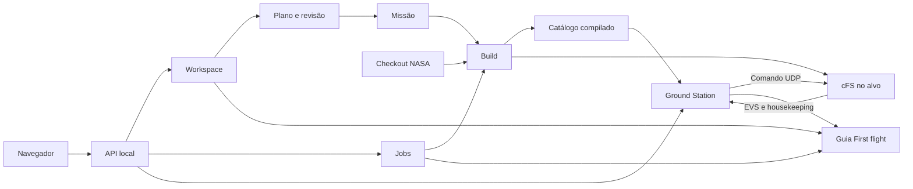

# Backend e API local

O servidor iniciado por `./start` vincula a interface e a API ao endereço `127.0.0.1`. O projeto é a unidade de trabalho. O clone oficial da NASA fica em `cFS/`. Definições de missão e módulos do usuário ficam em `mission/`, com a configuração declarativa em `project/`. Os artefatos do build identificam a aplicação e o formato dos pacotes que a estação poderá realmente decodificar.



## Contrato HTTP

Leia `GET /api/session` ao abrir o cliente. Envie o valor de `token` em **X-Studio-Token** em cada POST, inclusive em prévias, verificações e leituras de PTY. Use um objeto JSON e `Content-Type: application/json`. O token pertence ao processo do servidor. Alterações de arquivos e de missão usam a revisão devolvida pela leitura. Se houver conflito, recarregue o recurso e mostre a diferença antes de repetir a gravação.

| Recurso | Leitura | Operação |
| --- | --- | --- |
| Infraestrutura | `GET /api/infrastructure` | `POST /api/infrastructure` salva o alvo e seus parâmetros. `POST /api/infrastructure/check` executa verificações. |
| Primeiro voo | `GET /api/journey?target=native`, `GET /api/first-boot?target=native` | `POST /api/job` com `action: "first-boot"` e `options.target`. |
| Jobs | `GET /api/jobs` | `POST /api/job` devolve um `id`. `POST /api/job/cancel` recebe esse identificador. |
| Missão | `GET /api/workspace` | `POST /api/mission/draft`, `/api/mission/save`, `/api/mission/app`, `/api/mission/library`, `/api/mission/rename`. |
| Arquivos | `GET /api/tree?path=flight`, `/api/files/search?root=flight&q=...`, `/api/file?path=...` | `POST /api/file` recebe `path`, `content` e `expected_hash`. Os caminhos são relativos ao projeto. As linhas começam em 1. |
| Bancada | `GET /api/hardware`, `/api/hardware/device?id=...` | `POST /api/mutate` altera a topologia. `/api/hardware/model` registra um modelo. `/api/hardware/device` atualiza a instância. |
| Dados sintéticos | `GET /api/simulation` | `POST /api/simulation` grava `settings` com `expected_hash`. `POST /api/simulation/orbit` calcula uma prévia. |
| Estação | `GET /api/ground/catalog?target=native`, `/api/ground`, `/api/ground/source` | `POST /api/ground/start`, `/api/ground/send`, `/api/ground/stop`. |
| Testes da estação | `GET /api/ground/tests` devolve planos e `revision`. `/api/ground` inclui `runs`. | `POST /api/ground/tests` grava o plano com sua revisão. Envie `test_id` em `/api/ground/send`. `/api/ground/tests/cancel` encerra a espera. |
| Terminal | `POST /api/terminal/read` recebe `id` e `cursor`. | `create`, `input`, `resize` e `close` sob `/api/terminal/` controlam um PTY com as permissões do usuário do Studio. |

Uma requisição de origem ou sessão inválida recebe HTTP 403. Erros de parâmetros e de revisão trazem uma mensagem no campo `error`. As operações longas usam jobs ou PTYs de instalação. Fechar uma visualização permite continuar acompanhando o processo ao voltar. [Rotas e validação](../interface/server.py) · [Terminal](../interface/backend/terminal.py)

## Verificar e iniciar um destino

1. Use os identificadores `native` para o computador, `qemu` para o emulador e `physical` para a placa. `GET /api/infrastructure` retorna o inventário, os perfis e os comandos de `check_plan`. Adicione `?verify_source=1` para validar a origem, a revisão Git e os submódulos do checkout.
2. Ao carregar o setup, o cliente lê o inventário. O clique no cartão de destino inicia as verificações, uma por vez. O atalho do guia para a placa também seleciona explicitamente esse destino. Por exemplo, envie `{"target":"native","label":"git"}` a `POST /api/infrastructure/check`. O resultado inclui comando, estado, saída resumida, duração e código de saída quando disponível. Uma troca de destino cancela a sequência anterior. Clientes de CLI podem enviar apenas o alvo e pedir `Accept: application/x-ndjson` para acompanhar o plano inteiro.
3. A reparação usa `POST /api/terminal/create` com `target` e `setup_action`. As ações aceitas são `clone-cfs`, `native-tools`, `dependencies`, `emulator-image`, `board-key` e `board-service`. A interface acompanha saída e porcentagens emitidas, espera o código de término e repete a verificação. Alterações de host, porta e identidade são tratadas na configuração do destino.
4. Com o alvo salvo e os requisitos verificados, envie `{"action":"first-boot","options":{"target":"native"}}` a `POST /api/job`. O servidor usa a operação exclusiva de build e deploy, congela o catálogo associado ao binário e inicia o cFS. No emulador, ele também inicia ou verifica o guest. Na placa, acompanha o upload e a ativação do serviço.
5. Leia `GET /api/first-boot?target=native`. A resposta contém `job.phase`, `job.build_percent` quando disponível, `apps`, `flight.states`, `flight.initialized`, `running`, `stopped` e o final do log em `lines`. O build fornece a porcentagem. O script instalado fornece a lista de módulos. O estado do ES e os registros EVS vêm do processo ou da invocação systemd do voo.

O parser reconhece a identificação de espaçonave, processador, aplicação e evento a partir da linha EVS. Um módulo listado no startup pode continuar com o indicador de inicialização pendente quando sua mensagem de inicialização não é publicada por EVS. A sequência temporal de `trace` guarda os instantes de progresso do build e das transições observadas no processo. O replay lê essa sequência localmente. Ao parar o cFS, o registro de OPERATIONAL ainda comprova que aquele voo aconteceu. Em Native, o snapshot consulta o processo do projeto. Em QEMU e Board, ele confirma o processo principal e o identificador da invocação systemd que produziu o log. O cabeçalho e a tela de boot compartilham essa consulta por até três segundos. Uma falha de comunicação produz o estado **Unverified**. [Pré-requisitos](../hardware/infrastructure.py) · [Primeiro boot](../interface/backend/first_boot.py) · [Execução](../hardware/manager.py)

## Evidência do guia

`GET /api/journey` retorna o alvo e `steps`, indexado pelos identificadores abaixo. Cada entrada contém `done` e `observed_at` em segundos Unix. O navegador usa o instante do último **Start over** para reapresentar a jornada. A ação de reinício preserva a missão, os builds e os testes registrados. [Derivação da jornada](../interface/backend/journey.py)

| Etapa | Observação necessária |
| --- | --- |
| `target` | Destino salvo, checkout instalado e todos os comandos de sua configuração verificados. |
| `boot` | Log do alvo selecionado contém a entrada do ES em OPERATIONAL. |
| `event` | A sessão da estação recebeu o evento EVS INFO de um NOOP enviado pelo usuário a `sample_app` ou a uma app de missão. |
| `app` | Uma app declarada no projeto tem módulo registrado em `mission/apps/`. |
| `command` | O arquivo de códigos de função dessa app contém um comando na região gerenciada `command.codes`. |
| `send` | Um teste do comando de missão passou com as observações de ida e volta. |
| `sensor` | Um dispositivo ligado a uma app tem amostra enviada e confirmada na sequência de dados sintéticos. |
| `test` | Um cenário local de sinal terminou com resultado registrado. |
| `board` | O ES da placa física atingiu OPERATIONAL. O comprovante corresponde à conexão da placa. |

## Criar uma app e um comando

Leia `mission.source.hash` em `GET /api/workspace`. Para a primeira etapa do assistente, envie `kind: "app"`, `mode: "create"`, `name`, `settings` e esse valor em `expected_hash` a `POST /api/mission/draft`. O campo `files` descreve os arquivos propostos. `preview` contém os endereços de mensagens, a linha de startup e a instrução de build. Alterações de prioridade, pilha ou frequência exigem uma nova prévia.

Em `POST /api/mission/save`, envie os dados de `draft` junto com `expected_hash` e `plan_hash` da proposta apresentada. A resposta identifica os arquivos gravados em `changed`. Os checks do assistente correspondem a essa resposta. A operação de renomear um módulo criado no Studio atualiza seus artefatos e referências de missão em conjunto. Módulos da NASA conservam os identificadores do checkout.

Ao adicionar um comando, a geração procura os limites `@studio.begin` e `@studio.end` no código da app. A assinatura da região detecta uma edição manual antes de sincronizar. O índice de fontes liga o código de função a estrutura, protótipo, despacho, eventos e handler. O teste de execução usa o catálogo do novo build. [Transações da missão](../interface/backend/workspace.py) · [Regiões gerenciadas](../project/appgen/source_tags.py)

## Primeiro contato e testes de solo

Na primeira conexão o receptor fica pronto para ouvir UDP. O catálogo fornece a identificação do comando de habilitação do `to_lab`. O cliente preenche `dest_IP` com o endereço de retorno da sessão. Envie o comando e aguarde a primeira telemetria válida. Depois de receber housekeeping de `sample_app`, envie seu NOOP usando o identificador devolvido pelo catálogo. Este exemplo usa o identificador padrão da distribuição em `POST /api/ground/send`.

```json
{"target":"native","command_id":"SAMPLE_APP_NOOP_CC","values":{}}
```

O registro de envio identifica os bytes transmitidos. O cliente acompanha `first_flight` em `GET /api/ground`. `telemetry` indica um pacote recebido. `event` confirma o retorno EVS associado ao NOOP. `answer` exige ainda o aumento de `CommandCounter` em relação à amostra anterior da mesma app. Depois desse primeiro evento, uma reconexão pode habilitar a saída automaticamente. [Sessão](../ground_station/station.py) · [Primeiro contato](../ground_station/first_event.py)

Os testes configuráveis declaram o comando e os passos esperados no catálogo. O backend avalia as observações recebidas após o envio. O comprovante de teste aprovado registra alvo, impressão digital do build, comando, instantes e identificadores das observações. O editor usa essa associação ao apresentar a etapa **Test**. [Planos e observações](../ground_station/round_trip.py)

## Sensores e órbita

Primeiro selecione um barramento de `catalog.available_buses`. Envie a `POST /api/mutate` a ação `add-bus`, o barramento em `payload.bus` e a revisão em `expected_hash`. Depois de adicionar o dispositivo, `link-hal` recebe a app, o nome do leitor e a instância em `payload.app`, `payload.name` e `payload.device`. Com `new_app: true`, a transação também cria uma app a partir de `sample_app` e atualiza o startup. Em projetos anteriores ao campo `buses`, o Studio recupera os barramentos dos dispositivos existentes.

Para obter a prévia, envie `elements` ou `tle`, um `cycle` a partir de zero e opcionalmente `materials` a `POST /api/simulation/orbit`. A resposta traz 361 pontos para a órbita, período em segundos, fração em eclipse, deriva do nó e curvas em `thermal`. Um perfil térmico contém `size` (1U, 3U ou 6U), `mass` em kg, `alpha` (0,10–0,95), `emissivity` (0,05–0,95) e `power` em watts (0–5). Este exemplo calcula uma revolução com uma estrutura 1U de 1,3 kg.

```json
{"cycle":0,"materials":[{"size":"1U","mass":1.3,"alpha":0.45,"emissivity":0.82,"power":1.5}]}
```

O modelo `orbit.thermal` integra o balanço entre radiação solar direta, albedo, infravermelho terrestre, dissipação interna e emissão térmica. A integração usa Kelvin. Os resultados `values`, `minimum`, `maximum`, `steady_sun` e `steady_shadow` usam °C. O modelo anterior `orbit.sunlight` continua disponível para sinais existentes. Prévia, sessão Python e amostras para QMP usam a mesma órbita e o mesmo material. [Modelo físico](../sensors/orbit.py)

Use `simulate-preview` em `POST /api/job` para amostras locais. Para um cenário local, acrescente `options.device` e `options.scenario` com `orbit`, `eclipse` ou `dropout`. O teste prepara os registradores virtuais e mede a saída pela implementação C do HAL. Ao enviar com `simulate` no alvo `qemu`, a cadeia mostra a escrita confirmada pelo monitor QMP. A leitura de voo aparece quando é possível associar um campo de telemetria recebido ao sinal. [Cenários e HAL](../sensors/scenarios.py) · [Sessão](../sensors/session.py)
