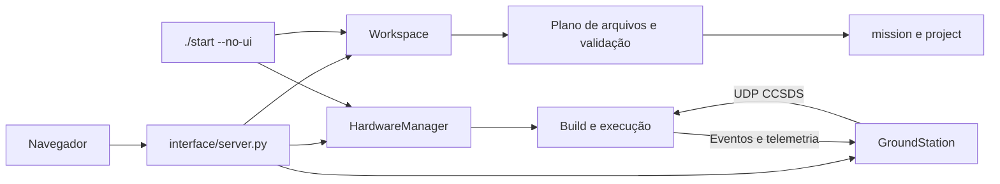

# Backend e API local

O processo iniciado por `./start` serve os arquivos da interface e a API em `127.0.0.1`. A interface, o terminal e a CLI trabalham na mesma pasta de projeto. A CLI também funciona com o navegador fechado.



## Como chamar

Leia `GET /api/session`. Envie o valor de `token` no cabeçalho `X-Studio-Token` de cada POST, com corpo JSON e `Content-Type: application/json`. O token pertence à instância do servidor. O servidor restringe host e origem ao endereço local. O terminal abre um PTY com as permissões do usuário que iniciou o Studio.

| Recurso | Leitura | Alteração |
| --- | --- | --- |
| Infraestrutura | `GET /api/infrastructure` lista alvo, checkout, arquitetura, ferramentas e acesso | `POST /api/infrastructure` salva o alvo. `POST /api/infrastructure/check` verifica os requisitos. |
| Missão e arquitetura | `GET /api/workspace` retorna apps, libs, serviços, arquivos e revisões de build | `POST /api/mission/draft` calcula uma proposta. `POST /api/mission/save` aplica a proposta aprovada. |
| Módulos | A revisão está em `mission.source.hash` | `/api/mission/app`, `/api/mission/library` e `/api/mission/rename` recebem a revisão e a operação. |
| Arquivos | `GET /api/tree?path=flight`, `/api/files/search?root=flight&q=...`, `/api/file?path=...` | `POST /api/file` recebe `path`, `content` e o `expected_hash` da leitura. Arquivos C oferecem anotações com número de linha. |
| Hardware e sensores | `GET /api/hardware`, `/api/hardware/device?id=...` | `POST /api/hardware/model` registra um modelo. `/api/mutate` altera os barramentos, dispositivos e leitores. `/api/hardware/device` salva endereço, barramento e pinos da instância. |
| Dados sintéticos | `GET /api/simulation` | `POST /api/simulation` salva configuração com `expected_hash`. A execução usa um job de simulação. |
| Operações | `GET /api/jobs` retorna progresso, saída e código de término | `POST /api/job` recebe `action` e `options`. `POST /api/job/cancel` recebe `id`. |
| Ground Station | `GET /api/ground/catalog?target=native`, `/api/ground`, `/api/ground/source` | `POST /api/ground/start`, `/api/ground/send`, `/api/ground/stop` controlam uma sessão. |
| Testes de ida e volta | `GET /api/ground/tests` devolve definições e revisão. `GET /api/ground` inclui o histórico de execuções em `runs`. | `POST /api/ground/tests` salva a definição com sua revisão. Envie `test_id` junto com o comando em `/api/ground/send`. `/api/ground/tests/cancel` interrompe a espera por observações. |
| Terminal | `POST /api/terminal/read` recebe `id` e cursor | `create`, `input`, `resize` e `close` sob `/api/terminal/` operam sobre um PTY. |

Para traçar uma órbita em **Signals**, `POST /api/simulation/orbit` aceita os `elements` de `settings.orbit` e um número de revolução `cycle` começando em zero. Opcionalmente, `tle` importa os elementos de duas linhas. A resposta contém os elementos validados, período em segundos, fração em eclipse, deriva do nó em graus por dia e 361 pontos. Cada ponto contém longitude, latitude, altitude em km, iluminação solar, longitude e latitude subsolares e ângulo beta. O modelo de sinal `orbit.sunlight` soma o desvio configurado ao valor de base quando o satélite está iluminado. O parâmetro opcional `response_time`, em segundos, aplica uma resposta exponencial de primeira ordem. Em `POST /api/simulation/orbit`, o campo `responses` solicita as curvas correspondentes. A gravação usa `POST /api/simulation` com a revisão da sessão.

`GET /api/infrastructure` entrega o inventário local e o `check_plan` de cada alvo. Cada entrada identifica a etapa em `label` e o comando em `probe`. O inventário pode indicar `installed` para um checkout presente no disco. `GET /api/infrastructure?verify_source=1` verifica a origem, a revisão e os submódulos do cFS.

Para executar uma etapa, envie, por exemplo, `{"target":"native","label":"git"}` em `POST /api/infrastructure/check`. A resposta contém o resultado, o comando executado, a duração e o código de saída. Se o processo não pôde iniciar ou excedeu o tempo limite, `exit_code` é nulo. O cliente usa a ordem de `check_plan` para avançar ao término de cada etapa.

Para executar o plano inteiro em uma requisição, envie apenas `target`. Com `Accept: application/x-ndjson` cada linha JSON traz a lista de requisitos e o estado de cada um (`pending`, `running`, `passed` ou `failed`). A última linha tem `status: "complete"`. A resposta padrão em JSON contém o resultado final.

Para instalar dependências com saída interativa, envie `setup_action` e `target` em `POST /api/terminal/create`. As ações aceitas são `native-tools`, `dependencies` e `emulator-image`. A leitura do terminal informa o código de saída do instalador. O usuário pode iniciar uma nova verificação depois da instalação.

No snapshot de `/api/workspace`, `catalog.available_buses` descreve os conectores suportados pela placa e `project.buses` lista os escolhidos para a missão. Para conectar um barramento, envie `action: "add-bus"`, `payload: {"bus":"i2c-bus.1"}` e a revisão da missão a `POST /api/mutate`. Depois de adicionar o dispositivo, a ação `link-hal` recebe `app`, `name` (leitor) e `device` (instância). Com `new_app: true`, a mesma transação cria a app a partir de `sample_app`, gera o leitor e atualiza o startup. Em projetos antigos sem o campo `buses`, o Studio recupera os barramentos já usados por dispositivos.

Por exemplo, com `sample_app` em execução, leia o catálogo do alvo, conecte a estação e envie este corpo a `POST /api/ground/send`.

```json
{"target":"native","command_id":"SAMPLE_APP_NOOP_CC","values":{}}
```

A resposta contém hora e bytes enviados. O evento em `/api/ground` com `values["PacketID.AppName"] == "SAMPLE_APP"` e a mensagem NOOP confirma que a aplicação processou o comando.

## Regras para extensões

1. Obtenha nomes de módulos, endereços, símbolos e comandos a partir do checkout, do modelo e do catálogo compilado. Um caminho exibido no editor é relativo à raiz do projeto. Linhas do editor começam em 1.
2. Separe fonte da NASA, código do usuário e trechos gerenciados. Uma alteração de sensor é validada pelo mesmo modelo quando chega da CLI ou da interface. Encaminhe alterações pelos serviços existentes em `project/` e `interface/backend/`.
3. Para criar uma app ou biblioteca, obtenha a revisão da missão, gere a proposta e envie `expected_hash` e `plan_hash` no salvamento. Uma revisão desatualizada pede nova leitura. Renomear altera os artefatos da missão e suas referências em conjunto.
4. Mantenha compilações, clone, deploy e operações demoradas em jobs. Use a trava de operação para impedir edições durante o build. O estado do botão Build vem da impressão digital das fontes para o alvo selecionado.
5. Diferencie “comando enviado”, “pacote recebido” e “código executado”. A última confirmação vem do próprio cFS, por evento ou contador. Dados de uma execução antiga têm de ser associados ao catálogo daquela compilação.
6. Responda com JSON. Erros de entrada e conflitos recuperáveis retornam uma mensagem em `error`. Origem ou sessão inválida retorna HTTP 403. Rotas desconhecidas retornam 404. Retorne o erro ao controle que iniciou a operação e mantenha o log detalhado no terminal.

O roteamento completo está em [interface/server.py](../interface/server.py). As operações da missão estão em [workspace.py](../interface/backend/workspace.py), o ciclo de execução em [manager.py](../hardware/manager.py) e o estado da estação em [station.py](../ground_station/station.py).
