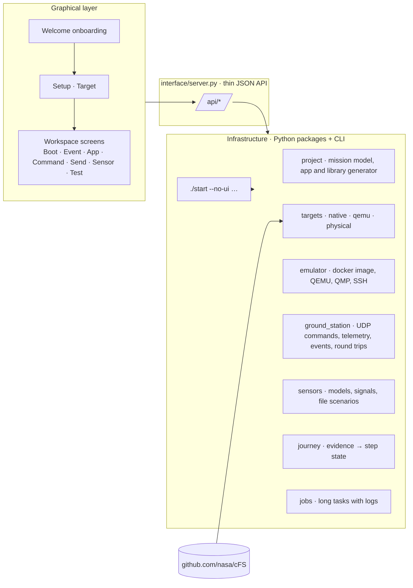

# Target architecture

Flight Studio has two halves that must stay separate:

- **Infrastructure**: everything that fetches, builds, runs, deploys, emulates, feeds sensors and talks to cFS. It is Python and shell, has no knowledge of HTML, and is fully usable from the terminal.
- **Graphical layer**: the HTTP server and the browser UI. It teaches, guides and shows. It never runs a command the CLI cannot run, and it never computes a result the infrastructure did not report.



## Rules for the boundary

1. No module outside `interface/` imports from `interface/`. Today `interface/backend/journey.py`, `first_boot.py`, `workspace.py` and others hold logic that the CLI also needs; move that logic into the core packages (`project/`, `hardware/`, `ground_station/`, `sensors/`, or a new `journey/` package) and leave `interface/backend/` with only request/response adaptation.
2. Every UI action has a CLI twin with the same name and options. Example: the toolbar "Build cFS" calls the job `build`; `./start --no-ui build --target qemu` runs the exact same code path and prints the same log lines.
3. Long tasks are jobs. A job has an id, a status (`queued`, `running`, `succeeded`, `failed`, `cancelled`), a log stream, and a result object. The UI follows jobs through one endpoint; the CLI prints the same stream. No polling with sleeps inside the core; the HTTP layer streams.
4. Journey state is computed on the server from evidence only (see below). The browser never decides that a step is done.
5. Configuration lives in one place (`project/config.json` and the runtime folder). No hard-coded ports, IPs or paths outside a single `defaults.py`, and every value there can be overridden by an environment variable documented in the README.

## Decisions from the audit (binding)

- **Routes are pure views.** Opening any URL, clicking a step pill, or pressing Back/Forward never starts a job, saves a setting, regenerates sources or opens a dialog. Mutations come only from labelled buttons. GET endpoints are idempotent (today `GET /api/first-boot` starts a log job and mounting Boot starts a build).
- **One concept, one endpoint.** Target selection only through `POST /api/hardware/target`; profile only through `POST /api/mission/profile`; one clone path; one batch-check API (ndjson). `/infrastructure` is removed; Setup is `/`.
- **One default target**, defined in one function. A fresh clone has no target until the person chooses one (Welcome or Setup).
- **Locks per concern**: a workspace write lock, a per-target runtime lock, a catalog lock. Editing files or sending a command never fails because a build is running.
- **No blocking work in request threads.** A background monitor refreshes status with a TTL; the UI subscribes to `GET /api/events` (Server-Sent Events) and reads job logs with a cursor.
- **The ground station is a small UDP sender and decoder** inside `ground_station/`, without importing the PyQt5 desktop tool. PyQt5 and zmq stop being runtime requirements.
- **Typed runtime state** (one store with dataclasses and a schema version) replaces the ad-hoc JSON files read through private members.
- **The editor can only write inside the mission tree**; the terminal is local-only and off by default when the server listens beyond loopback.

## Directory layout (keep names, tighten responsibilities)

You may keep the current top-level folders; the change is about what goes where.

```
start                      # CLI entry: ./start (UI) and ./start --no-ui <command>
project/                   # mission model, config, app/library generator, drivers, qemu device generator
hardware/                  # targets: native, qemu (docker + QEMU + SSH), physical (SSH); builds; deploy; checks
ground_station/            # UDP link, command catalog from the build, telemetry decode, events, round-trip tests
sensors/                   # sensor models, signals, orbit, scenarios from files, QMP writer
journey/                   # NEW: evidence collection and the step state machine (moved from interface/backend/journey.py)
interface/server.py        # HTTP only: routing, auth token, host checks, JSON, streams
interface/backend/         # thin adapters only (request → core call → response)
interface/static/          # UI: router, screens, shared design system
scripts/                   # thin shell wrappers that call ./start --no-ui (no duplicated logic)
docs/design-pack/          # this pack
```

## Front-end structure

- One router module (`interface/static/router.js`) owns all URLs. Every screen registers `{route, mount(el, ctx), unmount()}`. Nothing else writes `location`, `history` or `href` for navigation. Today navigation is spread across `app.js`, `journey.js`, `workspace-route.js`, `first-boot.js`, `infrastructure.js`, `sensor-designer.js` and inline `href`s; consolidate it.
- One API client (`interface/static/api.js`). Today `app.js` and `infrastructure.js` each define their own `api()`; keep one.
- One design system stylesheet (`design.css`) with the tokens and components from `05_ANIMATION_SPEC.md`; screen stylesheets may only lay out, never redefine buttons, chips, colours or animations.
- Split `app.js` (about 1,500 lines with many lines longer than 400 characters) into screen modules. No line longer than 140 characters in hand-written code.

## URL and screen map

| Route | Screen | Notes |
| --- | --- | --- |
| `/welcome` | Welcome onboarding (12 chapters) | Shown automatically on first launch until finished or skipped. Always reachable from the brand menu. |
| `/` and `/#target` | Setup · Target | Pick Native, Emulator or Board; checks run and fix themselves. |
| `/?target=physical#board` | Setup · Board | The last step. |
| `/studio#boot` | First boot | |
| `/studio#event` | Ground station in Event mode | First event: to_lab ENABLE_OUTPUT, then sample_app NOOP. |
| `/studio#app` | Architecture with Create your first app | |
| `/studio#command` | Code with the add-a-command guide | |
| `/studio#send` | Ground station in Send mode | Send the new command. |
| `/studio#sensor` | Synthetic data, Signals tab | |
| `/studio#test` | Synthetic data, Test tab | |
| `/studio#architecture`, `#bench`, `#code`, `#ground`, `#simulation` | Free rail views | Do not change the current step. |

A step route that is not reachable yet redirects to the current step route. A free rail view never redirects.

## Journey state machine (server-authoritative)

Steps, in order: `target`, `boot`, `event`, `app`, `command`, `send`, `sensor`, `test`, `board`.

- `evidence[step]` comes from real observations, as `journey.py` already does: verified checks for target, the OPERATIONAL log line for boot, the first NOOP event and CommandCounter increase for event, the app's CMakeLists for app, a new `*_CC` code in the app's function codes for command, a passed round trip of that command for send, a confirmed QMP write to a linked device for sensor, a passed scenario run for test, an OPERATIONAL boot on the physical target for board.
- `done[step] = evidence[step] and done[previous step]`. Credit is never given out of order.
- `current` is the first step that is not done. `reachable[step] = done[previous step]`.
- Reset is a server action (`POST /api/journey/reset`) that stores a cutoff time in the runtime folder; evidence older than the cutoff is ignored. Today the reset is a `localStorage` value in one browser, so other tabs and the server disagree; remove that.
- `GET /api/journey?target=…` returns `{target, steps: {id: {done, observed_at, reachable}}, current, next_route}`. The step bar renders only from this response. The URL decides which screen is open, never which step is current.

## API contract

Keep the existing endpoints (they are consistent with the front end today), plus:

| Method and path | Purpose |
| --- | --- |
| `GET /api/journey?target=` | Journey state as above. |
| `POST /api/journey/reset` | Server-side reset. |
| `GET /api/jobs/stream?id=` | ndjson stream of one job's log and status (replaces repeated polling of `/api/jobs`). |

Existing endpoints, for reference: `GET` journey, session, workspace, tree, files/search, file, hardware, first-boot, infrastructure, simulation, hardware/device, jobs, ground/catalog, ground/tests, ground, ground/source. `POST` file, infrastructure, infrastructure/check (supports ndjson), mutate, mission/app, mission/library, mission/rename, mission/draft, mission/save, mission/profile, simulation/orbit, simulation, hardware/target, hardware/model, hardware/device, job, job/cancel, terminal/create, terminal/read, terminal/input, terminal/resize, terminal/close, ground/start, ground/stop, ground/send, ground/tests, ground/tests/cancel.

Keep the protections that exist today: the per-session token on every POST, Host and Origin checks, the static path traversal check, the content security policy.

## What belongs to which layer (quick reference)

| Concern | Layer | Today | Target |
| --- | --- | --- | --- |
| Clone nasa/cFS, prepare mission sources | Infra | `scripts/install-cfs.sh`, `project/nasa_source.py` | Same, called by `./start --no-ui source install` |
| Native build and run | Infra | `hardware/run.py`, `scripts/build-cfs.sh` | `./start --no-ui build|run|stop|status --target native` |
| Emulator image (Docker, QEMU with sensor devices, Raspberry Pi OS) | Infra | `Dockerfile`, `scripts/setup.sh`, `scripts/emulator.sh`, `boot.sh` | `./start --no-ui emulator image|start|stop|status` |
| Deploy to QEMU or Pi over SSH | Infra | `hardware/emulator_ssh.py`, `hardware/run.py`, `cfs.service` | `./start --no-ui run --target qemu|physical` |
| Sensor data from files and models | Infra | `sensors/*`, `project/sensor_models.py` | `./start --no-ui simulate …` (no UI needed) |
| Ground link (UDP 1234 commands, 2234 telemetry) | Infra | `ground_station/*` | `./start --no-ui ground send|listen|test` |
| Journey evidence | Infra | `interface/backend/journey.py` | `journey/` package + `./start --no-ui journey` |
| Teaching, guidance, animations | UI | `interface/static/*` | Screens from this pack |
