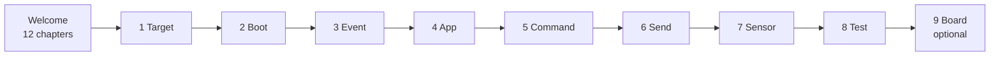

# First-run flow and navigation map

This is the journey a new person takes, from opening Flight Studio for the first time to running their own command and sensor test. Each step names its screen, the design file that defines it, the single highlighted action at each moment, what moves on screen, the API call, the evidence that completes it, and where Next goes.

Design files: `design/source/Welcome.dc.html` (onboarding), `Main.dc.html` (Target), `Boot.dc.html` (Boot), `Lesson.dc.html` (Event and Send), `Mission.dc.html` (App), `AddCommand.dc.html` (Command), `Ground.dc.html` (Sensor and Test). Clickable versions: `design/preview/<name>.html`. Run `node design/tools/follow-highlight-first-steps.js` to watch the expected sequence on the designs.

## The step bar (every screen after Welcome)

- Nine stops, numbered, with the label under or beside the number. Done stops show a drawn check (`fsDraw`). The current stop has the soft ping (`fsPing2`). Lines between two done stops turn green.
- The count shows `done/9` from `GET /api/journey`.
- A stop is a link only when it is reachable (`reachable` in the journey response). Unreachable stops are plain text, not links.
- **Next** appears on the right only when the current step is done and the next step's screen is not the screen already open. It carries the coach ring. It goes to `next_route` from the journey response.
- The reset icon asks nothing; it calls `POST /api/journey/reset`, then navigates to the Target route.
- The bar never decides progress from the URL. Opening a free rail view (Architecture, Hardware, Code, Ground station, Synthetic data) does not change the current stop.
- Board is optional: its stop has a dashed outline. When Test is done and no physical target was verified, the bar shows a quiet completed state ("First flight done") instead of Next.

## 0 · Welcome (`/welcome`)

Shown on first launch until finished or skipped; reachable later from the brand menu. Twelve chapters in four groups, with a progress rail of grouped icons. Full spec in `04_WELCOME_SPEC.md`.

- Back and Next in the title row. Next carries the `ready` pulse when the chapter's task is complete; it is never blocked.
- Skip (top right) goes to `/#target`.
- The last chapter's button is **Start** and goes to `/#target` with the target chosen in "Pick where it runs" preselected (`?target=native|qemu|physical`).
- Revisiting a chapter replays it from the beginning (its state is reset); completed chapters keep their check in the rail.

## 1 · Target (`/#target`, design `Main.dc.html`)

| Moment | Highlighted | User does | On screen | API |
| --- | --- | --- | --- | --- |
| Arrive | The three cards (nothing preselected unless the person chose a target in Welcome's "Pick where it runs") | Pick Native, Emulator or Board | Card lifts with border; three checks start for that target (Compiler, Python, Source for Native; Docker, image, SSH key for Emulator; host, user, key for Board) with spinning rings, one after another | `POST /api/hardware/target`, then `POST /api/infrastructure/check` with `Accept: application/x-ndjson` (streamed results) |
| A check is missing | The first missing check's "+" button | Tap "+" | Ring fills while it installs; Details opens the installer's terminal over the page | `POST /api/terminal/create {target, setup_action}` (existing installer sessions: the action names come from the check, e.g. `clone-cfs`) |
| All pass | **Continue · first boot** | Tap | Page leaves to Boot | Evidence: verified checks receipt for the selected target |

Completion evidence: verified checks for the selected target. Next route: `/studio?target=…#boot`.

## 2 · Boot (`/studio#boot`, design `Boot.dc.html`)

Reloading the page reattaches to the running boot; it never starts a new build. If cFS exits before OPERATIONAL (for example `CFE_PSP: Exiting cFE`, `OS_QueueCreate` errors, CI_LAB bind failure), the job ends as failed at once, the phase card turns red with the real log line and its one-line meaning, and Retry first boot is highlighted. Evidence once observed is kept: restarting or stopping cFS later never unticks a done step.

| Moment | Highlighted | On screen | API |
| --- | --- | --- | --- |
| Arrive | Nothing (watch) | Three phase cards: Build cFS, Start (emulator or process), Start cFS. The layer column (Apps, cFE, OSAL, PSP, OS, board) lights up from the bottom as the real log reaches each milestone. Each milestone appears only when its real log line is observed. | `POST /api/job {action:'boot'}` then `{action:'build'}`, `{action:'run'}` as the target needs; `GET /api/first-boot?target=` stream |
| Milestone observed | Nothing | A milestone card can be tapped to freeze the layer view at that moment; Resume returns to live | — |
| `CFE_ES_Main entering OPERATIONAL state` | **Next · Event** in the step bar | "cFS is running" with a drawn check | Evidence: OPERATIONAL observed for this target |
| Failure | **Retry first boot** | The failed phase card turns red with the last log line; Open console shows the full log | `POST /api/job` again |

## 3 · Event (`/studio#event`, design `Lesson.dc.html`)

The ground station in Event mode shows only what the first event needs: the three step cards (Telemetry on, First command, Answer), the command list with only to_lab and sample_app, the command form, the Send button, a simple path diagram with only the nodes on the current path, and the telemetry panel. No "System overview" grid in this step (see `06_DESIGN_FIX_PROMPT.md`).

| Moment | Highlighted | User does | On screen | API |
| --- | --- | --- | --- | --- |
| Ground not connected | **Connect** | Tap | The link line between Ground and cFS animates (`fsDash`) | `POST /api/ground/start {target}` |
| Connected, telemetry off | `to_lab · ENABLE_OUTPUT` row, then the empty dest_IP field (placeholder 127.0.0.1), then **Send** | Select, type the address, Send | A packet pill travels Ground → ci_lab → to_lab; to_lab lights; then telemetry starts: the first housekeeping packet flies back to the ground panel, and sample_app's CommandCounter appears at its real value | `POST /api/ground/send {app:'to_lab', command:'ENABLE_OUTPUT', args:{dest_IP}}` |
| Telemetry on | `sample_app · NOOP` row (not auto-selected), then **Send** | Select, Send | Packet pill Ground → ci_lab → Software Bus → sample_app; the real INFO event line appears in the log ("SAMPLE: NOOP command …" as printed by the build); CommandCounter animates +1 | `POST /api/ground/send {app:'sample_app', command:'NOOP'}` |
| Event observed and counter increased | **Next · App** | — | Step card 3 gets its check | Evidence: ground session connected, NOOP event observed, CommandCounter increased |

Flight Studio never sends commands on the person's behalf during the first run (today it sends ten `TO_LAB_ADD_PKT_CC` and re-enables output silently). If to_lab needs its subscription table, configure it in the build's to_lab table, or show the command in the log as "sent by Flight Studio". The command list keeps only the apps of the current step; the full catalog of about 400 commands belongs to the free Ground station view. The event log shows the person's own replies first; housekeeping noise (AddPkt, FLYWHEEL) is collapsed into one line.

Errors: if telemetry never arrives within the expected time, the Telemetry card turns red and shows the one fix (check dest_IP and Send again). Never a generic error banner.

## 4 · App (`/studio#app`, design `Mission.dc.html`)

| Moment | Highlighted | User does | On screen | API |
| --- | --- | --- | --- | --- |
| Arrive | **Create your first app** | Tap | Wizard opens | — |
| Wizard · name | Name field (focused), then **See its files** | Type a name (identifier rules shown only if broken) | Live preview of the folder name | `POST /api/mission/draft {kind:'app', name, settings, expected_hash, mode:'create'}` |
| Wizard · files | **Create <name>** | Tap | The files appear one by one in a tree preview, then the build entry and the startup entry light up | `POST /api/mission/save {…, plan_hash}` |
| Created | **Next · Command** | — | The new app appears in "Your apps" and in the mission map with `fsPop` | Evidence: the app's CMakeLists.txt exists |

## 5 · Command (`/studio#command`, design `AddCommand.dc.html`)

Seven guided stops in the editor: Code, Struct, Prototype, Dispatch, Events, Handler, Test. Stops whose code is generated show "written for you" and just need Next. The Handler stop is "your turn": the person writes (or accepts the ghost text of) the one line that stores the value.

| Moment | Highlighted | User does | API |
| --- | --- | --- | --- |
| Stops 1 to 5 | **Next** | Read the highlighted lines, tap Next | Files are written through `POST /api/mutate` as each stop is confirmed |
| Stop 6 · Handler | **Accept** (or Tab on the ghost text) | Write or accept the line | `POST /api/file` with `expected_hash` |
| Stop 7 · Test | Nothing new; the Rate slider demo shows the effect | Try values | — |
| Code complete | **Next · Send** | — | Evidence: the new `*_CC` code exists, the handler no longer returns `CFE_STATUS_NOT_IMPLEMENTED`, and a build containing it has succeeded. Naming the command alone never completes the step. Stops 4 to 6 block Next until their code compiles in a quick check. |

## 6 · Send (`/studio#send`, design `Lesson.dc.html` in Send mode)

| Moment | Highlighted | User does | API |
| --- | --- | --- | --- |
| Running cFS does not contain the new command | **Build cFS**, then **Run cFS** in the toolbar | Tap each | `POST /api/job {action:'build'}`, `{action:'run'}` |
| Ready | `<your_app> · SET_RATE` row (the new command, tagged NEW), then **Send** | Select, set Rate_Hz, Send | `POST /api/ground/send {app, command, args:{Rate_Hz}}` |
| Answer | **Next · Sensor** | — | The person's own event (for example "Rate set to N Hz") and CommandCounter +1. The round trip of a manual Send counts directly as the evidence; no separate "New test" is needed. |

## 7 · Sensor (`/studio#sensor`, design `Ground.dc.html`, Signals tab)

Sensor and Test must be completable on every target. Today they are dead ends on Native ("Emulator required", every button disabled). On Native, values go through the file-backed transport described in `08_INFRA_SPEC.md`; on the Emulator through QMP; on the Board from the real device. The orbit controls (perigee, apogee, RAAN…) stay folded under "Orbit" until the person opens them.

| Moment | Highlighted | User does | API |
| --- | --- | --- | --- |
| No device linked to the app | **Add sensor** | Pick tmp105 on I2C bus 1 and link it to the app | `POST /api/hardware/device` |
| Device linked, synthetic data off | **Start** on the "Synthetic data is off" strip | Tap | `POST /api/job {action:'simulate'}`; values stream to the target (QMP on the emulator, the file transport on Native) |
| First confirmed write | **Test** tab | — | Evidence: a confirmed write to a device linked to the app |

## 8 · Test (`/studio#test`, Test tab)

| Moment | Highlighted | User does | API |
| --- | --- | --- | --- |
| Arrive | **Run test** | Tap | `POST /api/job {action:'simulate-preview', options:{scenario}}`; checks tick one by one |
| All checks pass | Board stop (optional) or the completed state | — | Evidence: a passed scenario run |

## 9 · Board (`/?target=physical#board`, design `Main.dc.html` with Board selected) · optional

Opening this step never changes the active target or the saved workspace. It shows the Board setup sheet; the active target switches to Board only after the connection check passes and the person presses Use this board. Progress of steps 1 to 8 stays as it is.

Host, user and SSH identity, then **Check connection**, **Build cFS** (ARM64 on the host), **Run cFS** on the board. Evidence: OPERATIONAL observed on the physical target.

## Global controls map

| Control | Where | Action | Endpoint or route |
| --- | --- | --- | --- |
| Brand "Flight studio" | Top left | Menu: Welcome, Setup | `/welcome`, `/#target` |
| Theme toggle | Top right | Switch light/dark (persisted) | — |
| Target switch Native / Emulator / Board | Toolbar | Select target | `POST /api/hardware/target` |
| Board and OS selectors | Toolbar | Select profile | `POST /api/mission/profile` |
| Start emulator / Stop emulator | Toolbar (Emulator only) | Jobs | `POST /api/job {action:'boot'}` / `{action:'shutdown'}` |
| Synthetic data switch | Toolbar | Start/stop the simulate job | `POST /api/job {action:'simulate'}` / `POST /api/job/cancel` |
| Build cFS / Run cFS / Stop cFS | Toolbar | Jobs | `POST /api/job {action:'build'|'run'|'stop'}` |
| Rail: Architecture, Hardware, Code, Ground station, Synthetic data | Left rail | Free views | `#architecture`, `#bench`, `#code`, `#ground`, `#simulation` |
| Terminal | Left rail | Toggle the terminal panel | `POST /api/terminal/create` etc. |
| Step bar stop | Top bar | Go to that step if reachable | Step route |
| Step bar Next | Top bar | Go to the next step | `next_route` |
| Step bar reset | Top bar | Reset the journey | `POST /api/journey/reset` → `/#target` |

Every row of this table must appear, with the same destination, in the generated `NAVIGATION_MAP.md`.
