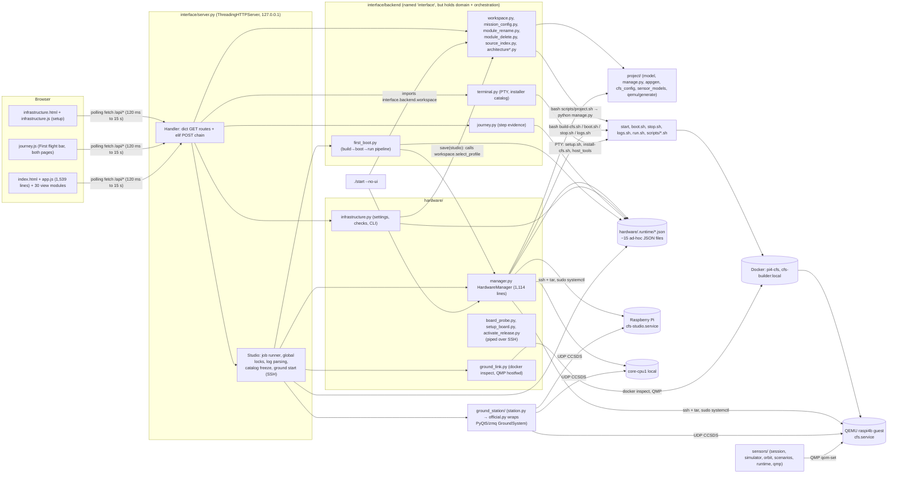

# Flight Studio: code review report

Repo: `Raiagues/cfs_emulator`, branch `first-flight-flow`, commit `071396c` (single squashed commit). Read-only review. Tests were run in a copy at `audit/code_work`. Companion document: `audit/endpoints.md`, which maps every UI control to its handler, route, endpoint, server handler and process, and lists the reverse server-route map.

Size of the codebase (excluding `cFS/`, images and vendor files):
- Python backend: about 10k lines across `interface/`, `hardware/`, `ground_station/`, `project/`, `sensors/`.
- Front end: 31 ES modules, 7.1k lines. `app.js` alone is 1,539 lines.
- CSS: 11 files, 2,485 lines, 243 KB.

---

## 1. Architecture overview

### 1.1 Components as they are today



### 1.2 How data moves
- **Browser → server.** The browser only polls; there is no push channel. Timers:
  - `app.js:1496`: `/api/jobs` and `/api/ground` every 1.5 s.
  - `app.js:1497`: `/api/workspace` and `/api/hardware` every 15 s.
  - `app.js:1231`: progress render every 1 s; `app.js:1539`: signal render every 180 ms.
  - `first-boot.js:270`: `/api/first-boot` every 600 ms.
  - `journey.js:144`: `/api/journey` every 3.5 s.
  - `shell.js:71`: `/api/terminal/read` every 120 ms per terminal.
  - `infrastructure.js:288`: `/api/jobs` every 400 ms during installs.
- **Long operations.** These run as threads in `Studio.job` (`server.py:61-106`), which keeps per-job log buffers of up to 3,000 lines. The full buffers are re-serialized on every `/api/jobs` poll (`server.py:348-359`).
- **State.** Durable state is spread across about 15 JSON files in `hardware/.runtime/`. Many modules read and write them through the private methods `HardwareManager._load`/`_save`: 26 `_load` and 7 `_save` call sites outside `manager.py`.
- **Process control.** Docker, QEMU, SSH, cmake and git are driven by `subprocess`, often as Python → bash → Python chains.

---

## 2. Test results

Both suites were run in the copy `audit/code_work`, using the README commands.

| Suite | Command | Result |
|---|---|---|
| Python | `python3 -m unittest discover -s interface/tests -v` (Python 3.13.18) | **79 run, 76 passed, 0 failed, 3 skipped**, in 4.4 s |
| JavaScript | `node --experimental-default-type=module --test interface/tests/*.mjs` (Node 22) | **33 passed, 0 failed, 0 skipped** |

The three skips:
1. `test_sensor_hal.SensorHalTest.test_guest_bus_configuration_follows_the_selected_project`: skipped because `dtc`, `fdtput` and `fdtget` are not installed (`test_sensor_hal.py:44`).
2. `test_workspace_http.WorkspaceHTTPTest.test_app_library_device_sensor_and_source_lifecycle`
3. `test_workspace_http.WorkspaceHTTPTest.test_bus_and_optional_hal_lifecycle`

The last two skip because the NASA `cFS/` checkout is absent (`test_workspace_http.py:45`). **On a fresh clone, the two end-to-end HTTP tests of the mission workflow do not run.** Your coordinator saw one skip, presumably on a machine with `cFS/` present.

Not run:
- `interface/tests/live_ground.py` and `live_round_trips.py`. They need a running cFS, and unittest does not discover them because they are not named `test_*`.
- Any browser or end-to-end test. None exists.
- No CI runs either suite: `.github/workflows/image.yml` only publishes the emulator image, by manual dispatch.

What the tests cover, and what they miss:
- The `.mjs` tests assert regexes on generated HTML attribute strings. Examples: `workspace-ui.mjs:114-170` (`/data-view="bench" data-device="mag"/`), and `journey-navigation.mjs:33-44`, which **enshrines the contradictory rail→step mapping** (bench→sensor, code→command).
- Python tests reach into private functions: `test_journey.py:68-84` calls `infrastructure._identity`, `infrastructure._receipt` and `hardware._save`.
- None of the navigation defects in `endpoints.md` §8 is caught. There is no test for "opening a route must not POST or start a job".

---

## 3. Prioritised findings

Severity scale:
- **Critical**: breaks the "clone and run, no hacks" promise or causes unexpected side effects.
- **High**: architecture defects that create bugs.
- **Medium**: maintainability, robustness or security weaknesses.
- **Low**: hygiene.

### F1 [Critical] Opening a route has side effects: navigation starts builds, writes settings and reopens dialogs
- `first-boot.js:258`: as soon as the Boot view mounts and the target is verified, idle and not stopped, the client POSTs `/api/job {action:'first-boot'}`. Server side, `first_boot.execute` (`first_boot.py:234-268`) runs build → catalog → `boot.sh` → deploy → `systemctl start`. This is triggered by the journey "Boot" pill, by "Continue to boot" (`infrastructure.js:487`), by deep links, and by Back/Forward (`app.js:974`).
- `infrastructure.js:506`: any setup URL with `?target=` auto-runs `verify()`. `runChecks()` POSTs `/api/infrastructure` whenever the selected target differs from the saved one (`:243`). `infrastructure.save` then calls `hardware.select_target()` (`hardware/infrastructure.py:137`) and, if board/os differ, `workspace.select_profile()`, which **regenerates mission sources** (`:119-124`). The journey "Board" pill is `/?target=physical` (`journey.js:34`), so **clicking it switches the project's saved target to physical.**
- `app.js:966-974`: `popstate` → `followLocation()` → `openFlightStep()`. Pressing Back onto `#command` reopens the "New command" dialog or the app wizard (`app.js:940-952`).
- `server.py:320-337` with `first_boot.py:214-216`: **`GET /api/first-boot` starts a `logs` job** (SSH `journalctl -f`) through `follow_boot_journal`, every 600 ms poll.
- **Why it matters.** This is the root of "buttons redirect to wrong places" and "first-run sequence is buggy". A user exploring the guide launches multi-minute builds, changes their target, or rewrites `project/config.json` without clicking any action.
- **Fix.** Routes are pure views:
  - Every mutation comes from an explicit button with a visible label ("Start first boot", "Save target").
  - GET handlers are idempotent; log followers are started by explicit `POST /api/targets/{t}/logs` or opened by the server when a run starts.
  - Back/Forward only re-renders. Activities such as dialogs or the wizard are opened by buttons, never by `openFlightStep`.
  - Add a test that loads every route and asserts that no POST was issued and no job exists.

### F2 [Critical] Navigation has four unsynchronised sources of truth, and "Code" is a CSS trick
- The sources: `location.hash`, `state.view` (`app.js:23`), the body classes `code-only`/`no-editor`/`no-tree`/`simulation-mode` (toggled at `app.js:130,992-995,1208,1215,1237-1238,1247,1266-1267,1270,1392`), and the journey step derived from the hash with a hard-coded alias table (`journey.js:16`, `railSteps = {architecture:'app', bench:'sensor', code:'command', ground:'event', simulation:'sensor'}`).
- `selectView('code')` sets `state.view='architecture'` and adds `body.code-only` (`app.js:991-992`). CSS hides the panel (`workspace.css:265`), so the full architecture and 3D CAD diagram is still rendered on every Code render.
- "Expand editor" (`app.js:1215`), "Show source" (`app.js:1235-1245`) and `data-arch-source` (`app.js:1246-1254`) change body classes without changing the hash. The rail highlight (`syncNavigation`, `app.js:1499-1503`), the hash and the journey pill then disagree.
- Contradictions this creates (detail in `endpoints.md` §8):
  - The Hardware rail highlights the *Sensor* step, but the Sensor pill opens Synthetic data.
  - The Code rail highlights *Command* but clears the command activity (`app.js:1258`).
  - An unknown hash falls back to *App* (`workspace-route.js:11`).
- **Fix.** One `router.js` with a single route table: `{id, path, view, step, guard}`. `state.view`, the body classes, the rail highlight and the journey step are all *derived* from the current route by a single `render(route)`. "Code" becomes a real view. Layout toggles (editor expanded, sidebar hidden) become part of the view state, not global classes, or are excluded from routing explicitly.

### F3 [High] Journey completion evidence is fragile, not durable, and not per target
- **Target, App and Command are credited from file mtimes.** Target uses the mtime of `checks-<t>.json` (`journey.py:103`), App the mtime of `mission/apps/<n>/CMakeLists.txt` (`:19`), Command the mtime of the fcncodes header (`:30`). A `git checkout`, a copy or a `touch` re-completes them. After "Start over", existing apps never count again.
- **Event is credited only from the live ground session** (`journey.py:38-41`). Disconnecting, reconnecting or restarting the server un-completes it. `docs/validation.md:24` confirms this.
- **Sensor and Test evidence is global** (`signal-observations.json`, `journey.py:49-62`), so a QEMU run completes those steps for Native and Board. Conversely, on Native the steps can never be completed by the user.
- **"Start over" is a per-browser `localStorage` cutoff** (`journey.js:114-118`). The server knows it only through `journey_reset_at` in `ground/start` (`app.js:868`).
- Heuristics recover "older receipts" (`journey.py:98-102`, `first_boot.py:197-212`).
- **Fix.** The core appends `{step, target, at, evidence_ref}` records to an event log (`.runtime/journey.jsonl` or SQLite) at the moment each observation happens: OPERATIONAL seen, NOOP event received, app created by the generator, command added, QMP write confirmed, scenario passed, board OPERATIONAL. A reset is a server-side event. `derive()` becomes a pure fold over events. Each step declares whether it is per target.

### F4 [High] One global lock serialises unrelated operations, so the UI fails with "Operation in progress"
- `Studio.exclusive()` (`server.py:53-59`) acquires `Studio.operation`, the same lock that every non-background job holds for its whole duration (`server.py:77,231-269`). Builds and first boots hold it for minutes.
- These calls go through it: file save (`server.py:626`), every mission mutation (`:636-655`), simulation save (`:662`), hardware target, model and device (`:664-669`), `ground/start`, `ground/stop`, `ground/send` and `ground/tests` (`:686-692`), and the GETs `ground/catalog` and `ground/source` (`:559,562`, `wait=3`).
- Effects: Ctrl+S, closing a tab, opening the Ground Station or sending a command all fail during a build. During a `values` or `sensor-test` job, `ground/send` fails immediately.
- **Fix.** Separate concerns:
  - A workspace write lock. `Workspace.lock` already exists (`workspace.py:53`).
  - A per-target runtime lock, plus the existing cross-process `execution.lock` (`manager.py:891-895`).
  - A catalog cache lock.
  - Builds already guard against concurrent edits via the fingerprint re-check (`manager.py:1029-1030`), so file writes need not wait for builds.

### F5 [High] Heavy blocking work runs in HTTP threads and is polled aggressively
- `GET /api/hardware` → `HardwareManager.status()` (`manager.py:597-663`) runs, synchronously:
  - `docker inspect` with a 30 s timeout (`:455`)
  - an SSH probe of the guest with an 8 s timeout (`:389`), plus SSH to the physical board (`:305-315`)
  - `pgrep`
  - `docker image inspect` (`:650`)
  - `builds_status()` → `fingerprint()`, which `stat()`s every file under `cFS/`, `mission/` and `project/` on every call (`:160-204`)
- `GET /api/workspace` also calls `builds_status()` (`server.py:549`) and `Workspace.snapshot()`, which runs git subprocesses (`library_index.py:13`) and a per-app source analysis.
- `GET /api/jobs` serialises up to 30 jobs × 3,000 lines every 1.5 s (`server.py:348-359`, `app.js:1496`). `POST /api/simulation` does the same just to check whether a simulation runs (`server.py:660`).
- `POST /api/infrastructure/check` runs a probe for up to 30 s in the request thread (`infrastructure.py:155-156`).
- `POST /api/ground/start` combines SSH, `docker inspect`, QMP, a 10 s receiver wait and a 5 × 2 s retry loop (`server.py:404-442`, `station.py:139-157`).
- **Fix.**
  - A background `Monitor` in the core refreshes target status with a TTL and publishes changes.
  - The web layer exposes `GET /api/events` (Server-Sent Events) and cursor-based logs (`GET /api/jobs/{id}/log?cursor=`).
  - The fingerprint is cached per directory mtime, or computed only at build time and on file-save events.
  - Remove the 180 ms and 1 s render timers in favour of event-driven renders.

### F6 [High] The GUI and infrastructure layers are entangled, and the dependency direction is inverted
See §4 for the full boundary. The most damaging points:
- `hardware/infrastructure.py:94` `save(studio, body)` takes the HTTP `Studio` object and calls `studio.workspace.select_profile` (`:124`). The infrastructure layer depends on the web layer.
- The CLI `start:118,143` imports `interface.backend.workspace.Workspace`. The command line depends on the "interface" package.
- `server.py:36-494` (`Studio`) contains:
  - the job runner
  - log-line parsing into boot stages (`:199-210`)
  - catalog freezing (`:361-389`)
  - ground session start, including an inline `ssh systemctl show InvocationID` (`:432-437`)
- The first-flight pipeline lives in `interface/backend/first_boot.py:234-268`.
- Deployment policy is implemented in the browser: the launch state machine in `command-launch.js:2-33`, the installer repair order in `setup-plan.js:15-35`, and "needs setup" in `app.js:355` and `hardware-links.js:42`.
- **Fix.** A core package plus a CLI that does everything, with a thin HTTP/UI adapter (§4).

### F7 [High] The runtime state store is ad-hoc JSON accessed through private members; one cache invalidation is broken
- About 15 files with no schema or version: `connection.json`, `deployed.json`, `target.json`, `active.json`, `probe.json`, `operational-*.json`, `checks-*.json`, `signal-observations.json`, `native.json`, `native-build-settings.json`, `emulator.json`, `build-*.json`, `catalog-*.json`, plus `execution.lock` and `clone-cfs.lock`.
- They are read and written from `interface/server.py`, `interface/backend/journey.py`, `first_boot.py`, `hardware/infrastructure.py` and `ground_link.py` through `hardware._load`/`_save` and other privates (`grep -rnoE "hardware\._[a-z_]+"`: 26 `_load`, 7 `_save`, plus `_qemu_running`, `_capture`, `_stream`, `_require_build`, `_flight_state`, `_mark_stopped` and `_local_flight_state` used cross-module).
- **Bug:** `hardware/infrastructure.py:134` sets `hardware._physical_observation = None`. That attribute exists nowhere else. The real cache is `_flight_observations` (`manager.py:53,291-303`), so changing the board connection does not invalidate the cached physical observation for up to 3 s.
- **Fix.** A `StateStore` with typed dataclasses (`Deployment`, `Connection`, `CheckReceipt`, ...), a schema version with one migration function, and public methods such as `deployments.mark_stopped(target)` and `targets.select(t)`. Replace the broken line with `hardware._invalidate_observation('physical')`, or better, a public `invalidate()`.

### F8 [High] The default target disagrees between modules; a fresh clone defaults to QEMU in the workspace and CLI
- `manager.py:67-72`: with no `target.json`, the default is `"qemu"` whenever `project/config.json` has a board. The committed config has `"board": "raspi4b", "os": "raspios"`.
- `hardware/infrastructure.py:86`: the setup page defaults to `"native"`.
- `scripts/build-cfs.sh:16` re-implements the manager's rule in inline Python.
- **Consequences.**
  - `./start --no-ui build` on a fresh clone does a flight build, which requires Docker.
  - Opening `/studio` before setup picks Emulator (`workspaceTarget`, `workspace-route.js:15-18`).
  - The README tells users to start with Native.
- **Fix.** Make `Settings.default_target()` the single source. Ship `config.json` with `board: null` (native), or require an explicit first selection.

### F9 [High] The ground station imports a PyQt5 desktop application to send UDP packets
- `ground_station/official.py:18-33` imports `PyQt5.QtCore.QThread`, `zmq`, `MiniCmdUtil`, `RoutingService` and `GenericTelemetry` from the NASA desktop tool, toggles `sys.dont_write_bytecode`, and **closes a class-level socket of the third-party module at import time** (`MiniCmdUtil.sock.close()`, `:33`).
- `station.py:87-92` injects `cFS/tools/cFS-GroundSystem` into `sys.path`.
- Command definitions are written as **pickles** and `pickle.load`ed back (`official.py:151-183`).
- PyQt5 and pyzmq are a mandatory setup check for every target, including Native (`hardware/infrastructure.py:227-229`).
- **Why it matters.** PyQt5 wheels are a frequent install failure (headless machines, new Python versions, Wayland or no X). It is the heaviest dependency of a web app, and it exists only to pack a CCSDS header and decode a few packets. `official.payload()` (`:38-87`) already does the payload packing.
- **Fix.**
  - A pure-Python `ccsds.py`: v1 primary header, command secondary header, checksum, and a telemetry decoder driven by the compiled catalog offsets, which are already available.
  - Plain `socket` UDP.
  - Keep GroundSystem only as an optional parity test.
  - Replace pickles with JSON.

### F10 [High] The QEMU ground link works only on a Linux Docker bridge, and patches QEMU networking live
- `hardware/ground_link.py:66-101` reads the container IP and gateway with `docker inspect pi4-cfs`, requires exactly one host-reachable bridge network, and then runs `hostfwd_add` through the QMP monitor from the HTTP request thread.
- This fails on Docker Desktop (macOS, Windows, WSL), rootless Docker and Podman, and on hosts with several bridges. It also needs the host to write `board/qmp.sock`.
- **Fix.**
  - Declare UDP forwards at start-up: `docker run -p 127.0.0.1:<cmd>:<cmd>/udp -p 127.0.0.1:<tlm>:<tlm>/udp` in `boot.sh:45-53`, and `hostfwd=udp::<cmd>-:<cmd>` in `scripts/emulator.sh:38`.
  - Telemetry return goes to the slirp gateway, `10.0.2.2`, forwarded to the host.
  - The ground link for QEMU becomes `127.0.0.1` like Native. Ports come from `Settings`.

### F11 [High] Hard-coded identifiers prevent two checkouts or two emulators from coexisting
- Container name `pi4-cfs`, 12 occurrences: `boot.sh:30,34,45,59,63`, `logs.sh:4`, `manager.py:455`, `emulator_ssh.py:31,35,131`, `infrastructure.py:392`, `ground_link.py:67`.
- Guest SSH port `2222`: `scripts/emulator.sh:38`, `emulator_ssh.py:55,65`, `infrastructure.py:32,392`.
- Service names `cfs.service` / `cfs-studio.service`: `server.py:433`, `manager.py:375,931,951,953,1084`.
- The board directory `cfs-arm64` (`manager.py:246-254,263,289`), and `BUILD_JOBS=4` for flight builds (`build-cfs.sh:35`).
- The QEMU install path is read by regex out of `cfs.service` (`manager.py:820-821`, with `/opt/cFS/build-rpi_linux` in `cfs.service:7-8`).
- Image `ghcr.io/raiagues/cfs_emulator:latest` (`config/image`).
- **Fix.** A single `Settings` dataclass, loaded from `config/settings.toml` and overridable per project in `.runtime/settings.json`. Derive a per-project container name: `flightstudio-<sha1(root)[:8]>`. Pass values to the shell scripts as arguments or environment variables, never re-derive them inside the scripts.

### F12 [Medium] Sleeps and retries paper over races
| Location | Workaround | What it hides |
|---|---|---|
| `manager.py:345` | `time.sleep(1)` after starting native `core-cpu1` | whether it crashed |
| `manager.py:838` | `systemctl start cfs.service && sleep 2 && systemctl is-active` | readiness of the service |
| `hardware/activate_release.py:46` | `time.sleep(2)` | readiness of the service |
| `station.py:150-157` | re-sends `TO_LAB_OUTPUT_ENABLE_CC` up to 5 × 2 s (`_enable_downlink`, loop at `:152`) | CI_LAB may not be up yet |
| `app.js:318` | shows "Emulator ready" for 6 s after `ready_at` | there is no "ready" event |
| `server.py:71-73` | de-duplicates journal readers ended less than 30 s ago | duplicate log readers |
| `first_boot.py:197-212` | re-validates "older receipts" on every poll | earlier buggy parsing |

**Fix.** Use explicit readiness signals:
- Native: stream stdout and wait for `CFE_ES_Main entering OPERATIONAL state`, with a timeout.
- systemd: `Type=exec`, plus waiting on the journal for that same line scoped to `_SYSTEMD_INVOCATION_ID` (the code already knows how to do this, `manager.py:930-949`).
- Downlink: wait for the first telemetry packet event, with one documented timeout.

### F13 [Medium] Logic is duplicated across layers
| Logic | Copies |
|---|---|
| Emulator boot-stage detection | `server.py:199-210` (4 stages, feeds `app.js:325` with 6 labels) and `first_boot.py:26-37` `guest_milestone` (6 stages, feeds `first-boot.js:13` with 7 labels) |
| "Needs setup" | `app.js:355`, `hardware-links.js:42`, `command-launch.js:22` |
| Default target | `manager.py:67-72`, `infrastructure.py:86`, `build-cfs.sh:16` |
| systemd InvocationID query | `server.py:432-437`, `manager.py:931-935`, `manager.py:376-386` |
| Service-name mapping | `server.py:433`, `manager.py:375`, `manager.py:931` |
| HTTP client | `app.js:43-55`, `infrastructure.js:24-45`, `journey.js:94` |
| HTML escape | `app.js:22`, `infrastructure.js:11`, `first-boot.js:5` |
| Target-label maps | `terminal.js:63,92`, `app.js:329,375`, `first-boot.js:7` |
| Target selection | `POST /api/infrastructure` and `POST /api/hardware/target`, with different validation and receipts |
| Board/OS selection | setup page via `/api/infrastructure` and toolbar via `/api/mission/profile`; both end in `Workspace.select_profile` |
| CLI vs HTTP option validation | `start:174-183` and `server.py:121-176` |

**Fix.** One implementation per concern in the core. One `api.js`, one `format.js` (escape, hex, labels) in the front end.

### F14 [Medium] `app.js` is a god module, and the UI drives itself through synthetic clicks
- 1,539 lines, 78 distinct `state.*` properties (67 assigned in `app.js`), 21 lines over 300 characters (the longest is 1,307), and 4 interval timers.
- One 218-line `if/else if` dispatcher (`app.js:1232-1450`) handles every `<button>` in the document, including buttons from other modules. Ordering bugs are latent: `data-target` (`:1435`) is tested before `data-job` (`:1436`), and `data-view` (`:1258`) before `data-device` (`:1416`).
- Other modules add their own document-level listeners: `orbit-preview.js:219-284` adds 9, plus `selectors.js:31`, `terminal.js:30` and `app.js:975`.
- The UI clicks its own buttons:
  - `$('#board-select').click()` (`app.js:1255`)
  - `document.querySelector('[data-add-bus]')?.click()` (`:1301`), which does nothing when that button is not rendered
  - workbench jobs click the toolbar button (`:1441`)
  - Enter becomes a synthetic `MouseEvent('click')` (`:1217-1221`)
- `mountMissionMap` re-binds listeners and creates a new `ResizeObserver` on every render (`mission-diagram.js:241,247,271-331`).
- **Fix.**
  - Split into `router.js`, `store.js` (typed slices: workspace, hardware, jobs, ground, simulation, editor), `api.js`, `actions/*.js` (named commands such as `startJob`, `selectTarget`), and `views/<name>.js`. Each view owns `mount(root)` and `unmount()` and delegates events only within its root.
  - Call actions directly instead of clicking DOM elements.
  - Add ESLint rules `max-lines` and `max-len`. Optionally use a small rendering library (Preact or lit-html) to remove manual DOM diffing such as `updateNode` (`first-boot.js:121-140`) and the board canvas surgery (`app.js:558-568`).

### F15 [Medium] CSS is layered patch upon patch: duplicates, alias variables and dead classes
- 92 selectors are defined in more than one file, and 422 selectors repeat within a single file (script `audit/code_scripts/css_dupes.py`). Examples:
  - `.simulation-mode.editing-signals .studio .panes>.editor` is defined 9 times: `simulation.css:4,32,59,121,123,127` and `workspace.css:508,546,592`.
  - `.signals-bench` appears at `simulation.css:5,61,206` and `workspace.css:430,509`.
  - `.brand` is defined 7 times: `workspace.css:18,76,81,89,134,141` and `infrastructure.css:21`.
- The token layer is redefined:
  - `design.css` has `:root` twice (`:15,:101`) and the light theme twice (`:49,:140`).
  - `workspace.css` has 5 `:root` blocks (`:2,83,193,399,536`), including a legacy alias layer: `--green:var(--fs-muted)` (a variable called *green* that is grey), `--red`, `--text`, `--raised` at `:193`, and `--ink`, `--bg` at `:400-401`.
- There are 44 `!important`, about 110 dead classes (§5.3), and `Cache-Control: no-store` on all assets (`server.py:592`).
- Positive: no hard-coded hex colours outside `design.css` (grep finds 0).
- **Fix.** Use `tokens.css` (one `:root` plus `[data-theme=light]`), `base.css`, and one file per component or view with a prefix. Enable stylelint `no-duplicate-selectors`, `declaration-no-important`, and `custom-property-pattern: ^fs-`. Delete the dead classes and alias variables.

### F16 [Medium] Security: any local user can obtain a shell; the editor can rewrite the server
- `GET /api/session` hands the CSRF token to any client that sends a valid `Host` header (`server.py:548,604-605`).
- With that token, `POST /api/terminal/create {}` spawns an interactive `$SHELL -i` (`terminal.py:52-57`). `POST /api/file` can write into `interface/` and `hardware/` (`workspace.py:41` `EDIT_ROOTS`), so the server's own code can be edited.
- Binding to `127.0.0.1` stops remote attackers and browser CSRF, since Host and Origin are checked (`server.py:609-613`). It does not stop **other local accounts or processes** on a shared machine.
- `pickle.load` of files under the project tree (`official.py:176-183`).
- **Fix.**
  - Print a per-launch secret URL (`http://127.0.0.1:8765/?t=<token>`, Jupyter-style), exchange it for an `HttpOnly; SameSite=Strict` cookie, and never serve the token over GET.
  - Limit editable roots to `mission/`, `project/` and `sensors/`.
  - Replace pickles with JSON.

### F17 [Medium] Remote commands are built as shell strings
- `manager.py:534,794-795,833-838,697,702` and `server.py:434` concatenate shell commands for SSH.
- `manager.py:376-387` sends an inline Python program as a quoted argument.
- Inputs are regex-validated (`manager.py:227-255`) and quoted with `shlex.quote`, so **no exploitable injection was found**. The pattern is still fragile.
- There is no `shell=True` anywhere. The checks in `infrastructure.py:365,368,371` re-split strings that came from `shlex.join`.
- **Fix.** One remote agent script, `infra/remote/agent.py`, sent over stdin as `board_probe.py` already is, taking JSON arguments: `status`, `deploy <release>`, `start`, `stop`, `journal --invocation`.

### F18 [Medium] Python → bash → Python chains and inline Python inside bash
- `Workspace._mutate_components` → `bash scripts/project.sh` → `python3 project/manage.py` (`workspace.py:595-596`), with a 60 s timeout.
- `values`: `manager.py:911` → `scripts/project.sh values` → `sensors/runtime.py`.
- Setup checks run `python -m hardware.infrastructure check-board`, which then runs ssh (`infrastructure.py:240`).
- `build-cfs.sh:16,28,37` embeds Python one-liners that read runtime JSON.
- **Fix.** Call core functions in-process. Shell scripts become thin wrappers around `python -m flightstudio ...`, or disappear.

### F19 [Medium] Mutable interpreter-global state
- `sys.path.insert` at `server.py:17`, `workspace.py:55` and `station.py:89-91`.
- `sys.dont_write_bytecode` is toggled at `workspace.py:54` and `official.py:18-29`.
- A third-party class socket is closed at import (`official.py:33`).
- **Fix.** A `pyproject.toml`, installation into a venv with `pip install -e .`, and absolute imports.

### F20 [Medium] Compatibility shims and legacy migrations sit in hot paths
- `hardware/run.py` (shim) and `project/qemu/catalog.py` (re-export).
- `infrastructure.check()`, labelled "Compatibility response" (`:331-337`).
- `first_boot.py:197-212` ("Older receipts accepted subsystem messages…") and `journey.py:98-102` ("older receipts without a selection marker") run on every poll.
- `first-boot.js:31` ("Earlier receipts captured process entry…").
- **Fix.** Version the state files and run one migration at start-up, then delete the shims.

### F21 [Medium] The "sensorless" build copies the whole source tree
- `manager.py:717-755` copies `cFS/`, `mission/`, `project/`, `scripts/`, `sensors/`, `config/` and `interface/backend` into `hardware/.runtime/sensorless`. It then runs `appgen.py delete-app` and `manage.py sync` on the copy, and builds there.
- That costs gigabytes and minutes, and adds a second build tree that the fingerprint and catalog logic must track (`manager.py:762`, `first_boot.py:255`).
- **Fix.** A generated CMake profile (a separate `MISSION_DEFS` directory or a `-DSTUDIO_SENSORLESS=ON` app list) in the same tree, with a separate build directory.

### F22 [Medium] Two deployment procedures and two service units for the same Linux target
- QEMU: install dir swap plus `cfs.service`, baked into the image by `Dockerfile:36,43-44` (`manager.py:809-840`).
- Raspberry Pi: `releases/` plus `activate_release.py` plus `cfs-studio.service`, installed by `setup_board.py` (`manager.py:775-807`).
- So there are two log commands (`manager.py:947,951,953`), two stop paths and two readiness checks.
- **Fix.** Provision the QEMU guest with the same `setup_board.py` and use the release and activation flow for both. The emulator is then a faithful stand-in for the board.

### F23 [Medium] Tests: implementation-detail assertions, default skips, no CI, no end-to-end
See §2. **Fix.**
- Add a GitHub Actions workflow that caches a pinned `cFS/` checkout and runs both suites, so the HTTP lifecycle tests actually run.
- Add a Playwright end-to-end test of the nine journey steps that asserts the URL, the highlighted step, the absence of side-effect requests on navigation, and that Back/Forward does not open dialogs.
- Test public behaviour (route → JSON) instead of private functions and HTML regexes.

### F24 [Medium] The emulator image and build are not reproducible
- `Dockerfile:23` downloads Raspberry Pi OS from a dated URL **without a checksum**, while the QEMU tarball is checksummed (`:71-72`).
- The image is referenced as `:latest` (`config/image`).
- `docker build --network=host --target cfs-builder` runs on every flight build (`build-cfs.sh:46`).
- The publish workflow runs only on the default branch, but the README asks users to use `first-flight-flow`. The published `latest` may not match the branch's register models, which are checked by label in `boot.sh:26-29` and `manager.py:650-652`.
- **Fix.** Pin with a sha256, tag images with the repo version and model fingerprint, and build the builder image once in `setup`, not on every build.

### F25 [Low] Error mapping is coarse and errors leak internals
- `ValueError`, `KeyError`, `OSError` and `RuntimeError` all become HTTP 400 with `str(error)` (`server.py:598-599,702-703`). A missing body key returns only `'path'`.
- Anything else becomes 500 with `str(error)` (`:600-602,704-706`).
- There are `except BaseException` blocks at `server.py:100`, `module_delete.py:71`, `sensors/qmp.py:26` and `project/manage.py:108`. They re-raise, but should be `except Exception` or `try/finally`.
- **Fix.** Typed domain errors (`NotFound`, `Conflict`, `Busy`, `Invalid`) mapped to 404/409/423/422, and request-body schemas.

### F26 [Low] Hand-rolled routing
- A dict for GET routes plus a 30-branch `elif` for POST (`server.py:546-698`), with no per-route schema. `/studio` redirect logic and static serving are inline.
- **Fix.** A route table with decorators: `@route('POST', '/api/jobs', schema=JobRequest)`. The standard library is enough. If dependencies are acceptable, Starlette gives SSE and static files out of the box.

### F27 [Low] Leftovers from the author's environment, and doc drift
- `Workspace.HIDDEN` contains `.agents` and `.codex` (`workspace.py:40`), artifacts of the authoring AI toolchain.
- `interface/README.md` describes an "Open workspace" button that opens 3D architecture; the current flow is "Continue to boot" → `#boot`.
- `emulator-guide.html` describes old labels.
- `docs/validation.md` claims "79 de 79 passaram", but 3 tests skip without `cFS/` and dtc.

### F28 [Low] Terminal input detection is heuristic
- `terminal.py:97-104` decides "Input required" from the TTY ECHO flag or a `(yes/no)` regex, which drives `infrastructure.js:197-198`.
- **Fix.** Run installers non-interactively (`sudo -A` with a UI askpass, or `pkexec`), or mark prompts explicitly from the scripts.

### F29 [Low] Wiring state is split between the server and the browser
- Pins are saved in `project/config.json` through `/api/hardware/device`, but bend offsets live in `localStorage['studio-wires:<host>:<board>']` and are merged with the config at read time (`app.js:462-469,478`).
- **Fix.** Keep presentation-only geometry in the project as well, or clearly separate it as a UI preference.

---

## 4. GUI vs infrastructure separation

### 4.1 Classification

| Concern | Belongs to | Lives today in | Mixing |
|---|---|---|---|
| Emulator image (Dockerfile, QEMU patch, model codegen) | Infrastructure | `Dockerfile`, `scripts/build.sh`, `scripts/setup.sh`, `project/qemu/generate.py` | Started from the browser PTY (`terminal.py:26-27`). Readiness checked in `hardware/infrastructure.py:241-247`. |
| Emulator lifecycle (run, stop, logs, SSH enrolment) | Infrastructure | `boot.sh`, `stop.sh`, `logs.sh`, `scripts/emulator.sh`, `hardware/emulator_ssh.py`, `manager.py:454-530,1036-1062` | Driven through `bash` from `manager.py:497,816,926,1058`. Container name hard-coded. |
| Deploy to QEMU or a Pi over SSH | Infrastructure | `manager.py:775-840`, `hardware/{board_probe,setup_board,activate_release}.py` | `server.py:432-437` duplicates SSH logic. |
| Build cFS | Infrastructure (core) | `scripts/build-cfs.sh`, `project/manage.py sync/stamp`, `manager.py:1012-1034`, `manager.py:160-204` | Catalog freezing done by `server.py:361-389`. |
| Mission model, generator, rename, delete, source index, architecture analysis | **Core domain** (not GUI) | `project/*` **and** `interface/backend/{workspace,mission_config,module_rename,module_delete,mission_tables,source_index,architecture,architecture_details,library_index}.py` | About 3.5k lines of domain code live under `interface/`. The CLI imports it from there (`start:118,143`). |
| First-flight orchestration | Core | `interface/backend/first_boot.py:234-268` | Under `interface/`. Called by `server.py:273-274`. |
| Journey evidence | Core (event log); presentation in the GUI | `interface/backend/journey.py`, `journey.js` | Partly decided in the browser (`journey.js:24,27`). Evidence comes from mtimes and live sessions. |
| Sensor models and QMP feed | Infrastructure (simulation runtime) | `sensors/*`, `project/sensor_models.py` | Driven via `scripts/project.sh values`. Fine otherwise. |
| Ground UDP link | Core service | `ground_station/*`, `hardware/ground_link.py` | Started from `server.py:404-442`. Depends on PyQt5. |
| Setup checks and installers | Core CLI (`doctor`, `setup`) | `hardware/infrastructure.py`, `hardware/host_tools.py`, `interface/backend/terminal.py:21-28`, `setup-plan.js` | Repair policy in the browser (`setup-plan.js:25`). `save()` takes `Studio` (`infrastructure.py:94`). |
| Web terminal (PTY) | GUI adapter | `interface/backend/terminal.py` | Doubles as the installer runner. |
| HTTP, session, static files, routing | GUI | `interface/server.py` | `Studio` also contains orchestration (`server.py:36-494`). |
| Rendering, client routing, view state | GUI | `interface/static/*` | The browser also contains deployment policy (`command-launch.js`, `app.js:355`, `hardware-links.js:40-48`). |

### 4.2 Proposed boundary
1. **`flightstudio` (core package, no HTTP).** A service API in plain Python:
   - `Project` (model, generator, mission edits)
   - `Builder`
   - `Target` protocol, with `NativeTarget`, `QemuTarget` and `BoardTarget` each implementing `status()`, `build()`, `deploy()`, `start()`, `stop()` and `logs(follow, invocation)`
   - `Emulator` (image, container)
   - `GroundLink` (pure-Python CCSDS over UDP)
   - `SensorFeed`
   - `Setup` (checks, repairs)
   - `Journey` (event log)
   - `Jobs` (runner with typed events and cancellation)
   - `StateStore` (versioned)
   - `Settings` (ports, names, image, paths)
2. **`flightstudio` CLI** (`python -m flightstudio`, wrapped by `./start`). Every UI operation has a CLI command, and a parity test enumerates the HTTP routes and asserts that each maps to a core call that the CLI also exposes.
3. **`flightstudio_web` (thin adapter).** Each route parses and validates, calls one core method, and serialises the result. There is no `subprocess`, SSH, Docker or file-format knowledge in this layer. It provides `GET /api/events` (SSE) carrying job, status and journey events, plus static assets.
4. **Front end.** Router, store and views. It renders state and calls actions, and holds **no** infrastructure policy. The server returns `next_action` (for example `{label:'Start emulator', action:'boot'}`) instead of the browser recomputing it in three places.

### 4.3 Target directory layout

```
flightstudio/                     # core: importable, no HTTP
  __init__.py
  __main__.py                     # CLI entry (argparse); ./start execs this
  settings.py                     # Settings dataclass: ports, container name, image, ssh port, dirs, build jobs
  state.py                        # StateStore: typed, versioned records (replaces hardware/.runtime/*.json soup)
  errors.py                       # NotFound, Conflict, Busy, Invalid
  jobs.py                         # Job runner, cancellation, event bus
  events.py                       # typed events (JobLine, JobState, TargetStatus, JourneyStep)
  project/                        # was project/* + interface/backend/{workspace,mission_*,module_*,source_index,architecture*,library_index}.py
    model.py  manage.py  appgen/  drivers/  cfs_config.py  mission.py  rename.py  delete.py  source_index.py  architecture.py
  build/
    builder.py                    # native cmake | containerised cross build (no bash)
    fingerprint.py                # cached per-directory
  targets/
    base.py                       # Target protocol
    native.py  qemu.py  board.py
    ssh.py                        # one argv builder; remote agent invocation
  emulator/
    container.py                  # docker run/stop/logs, per-project container name
    qmp.py
    image.py                      # image tag/fingerprint checks
  ground/
    ccsds.py                      # pure-Python pack/unpack (no PyQt5)
    catalog.py  station.py  round_trip.py  link.py
  sensors/                        # session, simulator, orbit, scenarios, models
  setup/
    checks.py                     # preflight probes (was hardware/infrastructure.py)
    installers.py                 # native tools, docker, clone cFS, board key/service
  journey/
    evidence.py                   # append-only event log + pure derive()
flightstudio_web/                 # thin HTTP layer
  app.py                          # route table, auth cookie, SSE
  routes/{workspace,files,jobs,targets,ground,simulation,setup,journey,terminal}.py
  terminal.py                     # PTY adapter only
  static/
    index.html  setup.html
    js/{main.js, router.js, store.js, api.js, format.js, actions/*.js, views/{setup,boot,architecture,hardware,code,ground,synthetic}.js, components/*.js}
    css/{tokens.css, base.css, components/*.css, views/*.css}
    vendor/ fonts/
infra/
  docker/{emulator.Dockerfile, builder.Dockerfile, emulator.sh, patches/qemu-lsm303dlhc-signed.patch}
  guest/{config/*, cfs.service}      # or provision via remote/setup_board.py
  remote/{agent.py, setup_board.py, activate_release.py}   # files piped over SSH
scripts/                          # thin wrappers: exec python -m flightstudio <cmd>
tests/{unit, integration, web, e2e}
pyproject.toml                    # deps; optional extra [groundsystem] for parity tests
```

### 4.4 Migration order (each step keeps tests green)
1. Add `Settings` and `StateStore`, and replace every cross-module `hardware._load`/`_save` (F7, F11). Fix `infrastructure.py:134`.
2. Move domain modules out of `interface/backend` into `flightstudio/project`. Make `start` import from there (F6).
3. Extract the job runner and orchestration from `server.py` into `flightstudio/jobs.py` and `targets/*`. `first_boot.execute` becomes `FirstFlight.run()` in the core.
4. Remove side effects from navigation: Boot gets an explicit start button, the setup page never saves on load, and GETs stay pure (F1). Add the end-to-end guard test.
5. Add the router with a single route table, make "Code" a real view, and drive the rail and journey from it (F2).
6. Replace the journey evidence with an event log (F3).
7. Split the global lock (F4). Add SSE and remove polling (F5).
8. Implement the pure-Python CCSDS link and fixed UDP forwards for QEMU (F9, F10).
9. Unify the QEMU and board deployment (F22). Remove the sensorless tree copy (F21).
10. Restructure the CSS and delete the dead code in §5 (F15).

---

## 5. Dead files, functions, branches and CSS (with evidence)

### 5.1 Files
| File | Evidence | Note |
|---|---|---|
| `interface/static/emulator-guide.html` | `grep -rn "emulator-guide" --exclude-dir=.git .` → only `interface/server.py:578-579` | Not linked from any page. Stale labels. Remove it and its route. |
| `project/qemu/catalog.py` | `grep -rn "qemu.catalog\|qemu/catalog\|qemu import catalog" --exclude-dir=.git .` → nothing | "Compatibility import" re-export of `project.sensor_models.register`. |
| `hardware/run.py` | `grep -rn "hardware\.run\b\|hardware/run\.py" --exclude-dir=.git .` → only `docs/pr-review.md:9` | Shim to `./start --no-ui run`. |
| `run.sh` | referenced only in messages (`boot.sh:32,77`) and `docs/pr-review.md` | Duplicates `./start --no-ui run`. Keep one entry point. |

### 5.2 Functions, branches and routes (reachable by nobody, or by tests only)
| Item | Evidence |
|---|---|
| `server.py:275-278`, job action `clone-cfs` | The UI uses `terminal/create {setup_action:'clone-cfs'}` (`infrastructure.js:408`, `setup-plan.js:16`). `grep "'clone-cfs'" interface/static/*.js` shows only installer labels and repair mapping. |
| Job action `setup` (`manager.py:896-899`) | The UI converts `setup` into navigation (`app.js:509,748`). Over HTTP, `scripts/setup.sh` would fail at sudo (`manager.py:109` sets `SUDO_ASKPASS=/bin/false`). |
| Job action `connect` | The toolbar `connect` opens a dialog (`app.js:1436`). No `api('job',{action:'connect'})` exists. |
| `Handler.stream_checks` (`server.py:512-537`) and `infrastructure.check` (`hardware/infrastructure.py:331-337`) | Only `interface/tests/test_setup_checks.py:39-63` uses them. |
| `GET /api/infrastructure?verify_source=1` (`server.py:555`) | No UI caller (`grep verify_source interface/static` → nothing). |
| `POST /api/mission/app {action:'delete'}` (`server.py:638-639`) | UI never sends `delete` (`grep "'delete'" interface/static/*.js` → only a feedback map and `app.js:1157`). Only the default-skipped `test_workspace_http.py:215,235` uses it. |
| `Workspace.mutate` actions `add-app`, `remove-app` (`workspace.py:533-535,545-546`) and `remove-command` (`:607`) | No `data-remove="app\|command"` emitter. `create('app')` returns at `app.js:689`. No tests. |
| `app.js:714-717` (`if(kind==='app' && …code-only)`) | Unreachable: `create()` returns for `kind==='app'` at `app.js:689`. |
| `app.js:988` (`view==='communication'`), `app.js:571` (`communication` title), `app.js:549,608` (`.communication-browser>nav,.communication-message`) | `grep -n 'data-view="communication"\|communication-browser\|communication-message' interface/static/*` → only these app.js lines. |
| `app.js:1446` `copySetup`, `app.js:1447` `hardwareRefresh` | `grep -rn "data-copy-setup\|data-hardware-refresh" interface/static` → nothing. |
| `hardware/infrastructure.py:134` `hardware._physical_observation = None` | `grep -rn _physical_observation` → only this line. Dead assignment and a bug (F7). |
| Attributes `data-arch-expand` (`app-diagram.js:79`), `data-assembly-stage` (`hardware-links.js:50`), `data-mission-block` (`mission-diagram.js:81`) | Never read by JS or CSS (script `audit/code_scripts/data_attrs.py`). |

Note: a whole-repo scan for Python `def` and `class` names referenced only at their definition found **none** (`audit/code_scripts/dead_py.py`). Python dead code is at the branch and route level listed above, not whole functions.

### 5.3 Dead CSS classes
Method: `audit/code_scripts/dead_css.py` extracts the class names used in selectors of every `interface/static/*.css` file and searches all `.js` and `.html` files for each name as a whole token. Dynamically built prefixes (`tone-*`, `token-*`, `side-*`, `wire-*`, `map-group-*`, built at `mission-stack.js:94,112,140`, `mission-diagram.js:103,197`, `ui.js:77-91`, `app.js:1374`) and the vendor class `xterm-viewport` were removed by hand. Spot-checks:
- `grep -rlw stack-diagram interface/static` → `workspace.css` only (`:458`)
- `grep -rlw gs-shell` → `ground-workbench.css` only (`:38`)
- `grep -rlw communication-view` → `ground-workbench.css:3` only
- `grep -rlw signals-board` → `simulation.css:10` only
- `grep -rlw board-drag-hint` → `board.css:15` only
- `grep -rlw architecture-split` → `architecture.css:51` only
- `grep -rlw profile-selector` → `workspace.css:576` only

Dead classes by file:
- **workspace.css (51):** `no-explorer system-node physical-board runtime-node rail-divider arch-expand add-sensor inline-check gs-bar architecture-tabs infrastructure-link gs-console source-index-label stack-frame stack-diagram volume face-left face-right face-label layer-label layer-caption leader stack-guide leader-end signal-summary orbit-settings guide-field guide-command guide-bytes gs-link-bar gs-filter gs-desks gs-browser gs-definition-meta signal-file gs-no-parameters sent-log route-diagram route-station route-path comm-stack comm-service signal-views stack-node stack-plane stack-layer gs-parameter-heading gs-parameter-form profile-selector`. These are remnants of an older SVG "stack diagram" and an older ground workbench. Example: `workspace.css:609` `.stack-pick:is(:hover,:focus-visible) .layer-label` targets a class nothing emits.
- **ground-workbench.css (23):** `communication-view communication-link is-connected communication-app communication-app-grid comm-status communication-error comm-stack comm-service comm-services gs-shell gs-icon-button gs-link-bar gs-main gs-list-item gs-item-label gs-list-group gs-console gs-filter gs-desks gs-browser uplink-end trip-blocked`. These are remnants of the removed Communication view (see §5.2).
- **architecture.css (6):** `architecture-action architecture-eyebrow is-split architecture-split detail-only map-title`
- **simulation.css (6):** `signals-board signal-stop signal-hardware signal-device-list signal-summary qemu-device`
- **editor-guide.css (3):** `guide-bytes guide-command guide-route`
- **board.css (1):** `board-drag-hint`

Total: about 90 dead class names, in roughly 160 rules counting duplicates across files.

### 5.4 Duplicated CSS (not dead, but conflicting)
See F15. Full list: run `python3 -I audit/code_scripts/css_dupes.py <repo>`.

---

## 6. What is good, and worth keeping
- Concurrency control on edits is thought through: `expected_hash` revisions, plan hashes, and `_assert_inputs` re-reads (`workspace.py:305-364,481-491`), plus atomic writes (`workspace.py:193-204`).
- Request hardening: Host and Origin checks, a token header, a size limit, and a JSON content-type requirement (`server.py:604-623`). A CSP is set on HTML.
- Subprocesses are always argv lists (no `shell=True`). Process-group kill on cancel and timeout (`manager.py:100-144`).
- Theming uses tokens consistently: zero hex literals outside `design.css`.
- The cross-process execution lock (`manager.py:891-895`) and "cannot confirm stopped" guards (`manager.py:399-433`) are the right instincts. They belong in the core `Target` layer.
