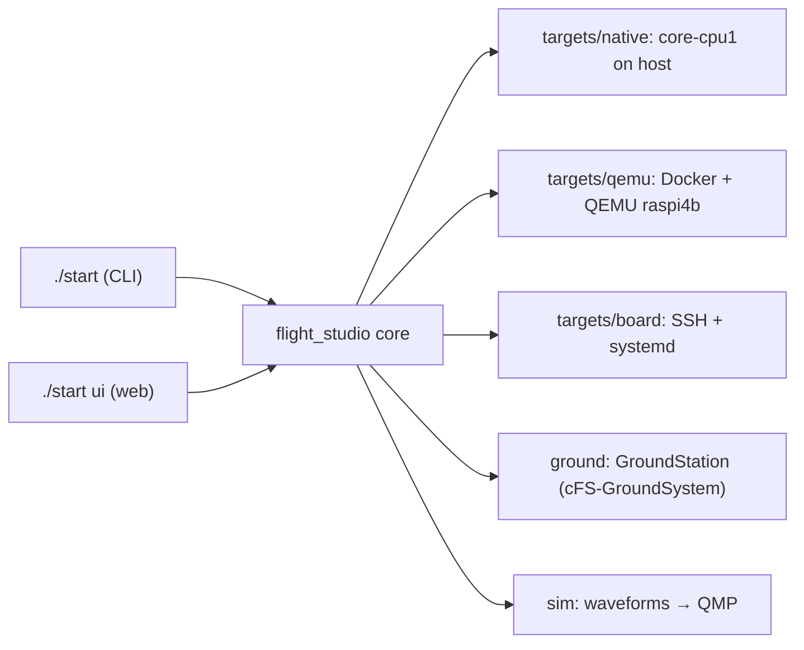

# Flight Studio infrastructure audit (terminal-only)

- Repository: https://github.com/Raiagues/cfs_emulator, branch `first-flight-flow` at `071396c`
- Working copy: `<repo>` (nothing outside it was modified, apart from host packages and a short-lived dockerd, both listed in section 7)
- Host: Ubuntu 24.04.5, x86_64, 2 CPUs, 7 GB RAM. You run as root, but **without `CAP_SYS_RESOURCE`**, and there is no `/dev/kvm`. `python3` on PATH is `/usr/local/bin/python3` (3.13), while the distro's default is 3.12.
- Egress goes through a policy proxy that allows GitHub (git), the Ubuntu archive and PyPI. It **blocks** `registry-1.docker.io`, `ghcr.io`, `deb.debian.org`, `download.qemu.org` and `downloads.raspberrypi.com`, each with HTTP 403 from the proxy. I did not try to get around these blocks.
- Raw logs: `audit/infra_logs/`. Helper scripts I wrote: `audit/infra_tools/` (`lo_up.py`, `ground_cli.py`, `ground_connect.py`).
- Date: 2026-11-19. Wall-clock: 21:09 to 21:37 (A about 13 min, B about 4 min, C about 11 min until blocked, D static review).

## 0. Executive summary

| Path | Result | Main blockers / findings |
| --- | --- | --- |
| **A. Native, no UI** | **Works end to end**, with 2 real bugs found | (1) `./start --no-ui run` reports success even when cFS crashes during startup. Here it crashed with `OS_QueueCreate ... errno 22`, because root without `CAP_SYS_RESOURCE` turns off OSAL's queue truncation. (2) `setup-native.sh --check` reports PyQt5/zmq "available" when they cannot be imported under the active interpreter. (3) A busy UDP 1234 still reports "running": CI_LAB bind fails, so the uplink is dead. (4) There is no ground-station CLI: the README's `live_ground.py` needs the web backend. Once cFS ran in an isolated net+ipc namespace with `msg_max=256`, it reached `CFE_ES_Main entering OPERATIONAL state`. TO_LAB enable, `SAMPLE_APP_NOOP_CC`, the NOOP event and the `CommandCounter` 0 → 1 all round-tripped, and the NOOP of 17 apps passed through `live_round_trips.py`. |
| **B. CLI-only infra** | **Works**. The output is not friendly. | app new / build / run / delete, library new / build / remove / delete, `project add-bus/add-device/add-sensor/check`, `simulate-preview`, `simulate --dry-run` and file-edited waveforms all work. Bugs: `simulate-preview --model mpu6050` prints nothing and exits 0 (the template has no `__main__`). 400 to 570 lines of JSON for simple actions. Help text shows `manage.py`/`simulator.py` and an unsupported `--root`. Error messages point to UI buttons or low-level scripts. A BrokenPipe traceback appears when output is piped. |
| **C. Emulator** | **dockerd runs. Image build and boot are impossible here** because of egress policy. | `setup.sh` (EUID guard removed for the test) completes its tooling and SSH-key steps, then stops at `docker pull ghcr.io/...` (403) and at `FROM debian:trixie-slim` (403). I tested instead: the Docker-context subset of `generate.py` (OK), the flight cross-compile on the host (OK, 75 s), and 79 unit tests (OK). The static review found Linux-only assumptions: a QMP Unix socket in a bind mount, a ground link through a routable bridge IP, a fixed container name and port, `latest` tags that do not match the branch's model fingerprint, an amd64-only CI image, no `--platform`, no disk/time/TCG guidance, and SSH config tied to an absolute path. |
| **D. Physical board** | Static review, plus a CLI smoke test against an unreachable host | High risk: binaries built on trixie need `GLIBC_2.38`, which I confirmed on a cross build (`__isoc23_strtol@GLIBC_2.38`). They will not start on Raspberry Pi OS Bookworm (glibc 2.36), and nothing checks for this. The service runs a user-writable binary as root. The cross build needs Docker plus internet. I²C enablement, the host firewall (UDP 2234) and NAT/jump hosts are not handled or documented. |

Top fixes are listed in section 5.

---

## 1. Task A: native path without the web UI

### 1.1 Commands, timings, outputs

| # | Command (from repo root) | Time | Result |
| --- | --- | --- | --- |
| A1 | `./scripts/install-cfs.sh` | 8.8 s | OK. Shallow recursive clone of `nasa/cFS` **HEAD (unpinned)** → `NASA cFS ready at a4d305dc06fb. Mission files are in mission/.` The log is full of `\r` progress spam (fine in a TTY, noisy in logs). |
| A2 | `./scripts/setup-native.sh --check` | <1 s | `PyQt5: missing`, `zmq: missing`, `Missing: PyQt5, zmq`, exit 1 |
| A3 | `./scripts/setup-native.sh` | 5 min 39 s | `apt-get update` (slow mirror here, 34 MB at about 100 kB/s), then installs `python3-pyqt5 python3-zmq`, then re-checks: **`PyQt5: available`, `zmq: available`, `Native build tools and Ground Station packages ready.`** This is a **false positive** (see A-bug-2). |
| A4 | `./start --no-ui profile --native` | <1 s | `{"target": "native"}`. `./start --no-ui profile` then prints `target: native` **and** `board: raspi4b, os: raspios`, which is confusing. |
| A5 | `./start --no-ui build` | 42.3 s | OK. `Build ready: mission/build-native/exe/cpu1` plus build-state JSON. Runs `manage.py sync` twice, and also builds `core-cpu2`. |
| A6 | `unshare`/`nsenter` (net only) … `./start --no-ui run --no-follow` | 1 s | **Exit 0**, prints the deploy JSON (`pid 24425`). **cFS had in fact crashed**: `native.log` shows `OS_QueueCreate_Impl(): OS_QueueCreate Error. errno = 22` … `CFE_EVS_TaskMain: Application Init Failed` … `CFE_PSP: Exiting cFE with PROCESSOR Reset status.` `active.json` still says `"phase": "running"`. |
| A7 | `./start --no-ui status` (after crash) | 0.5 s | 103 lines of JSON. `native.running: false`, but no "crashed/exited" indicator and no last error. It also shows `"docker": {"available": false, "error": "Docker did not respond..."}` for a native-only user. |
| A8 | New holder `unshare --net --ipc --fork` + `echo 256 > /proc/sys/fs/mqueue/msg_max` (private IPC namespace), then `nsenter -t $HOLDER --net --ipc ./start --no-ui run --no-follow` | 1 s | OK. `native.log` line 130: **`CFE_ES_Main entering OPERATIONAL state`** |
| A9 | Headless ground check: `nsenter … python3 infra_tools/ground_cli.py infra_work` (drives `ground_station.GroundStation` directly) | 15 s | **PASS** (output below) |
| A10 | README test: backend in the namespace (`./start --ui --port 8765`, on the namespace's own loopback), then `python3 interface/tests/live_ground.py --target native --port 8765` | 12 s | **PASS**: `{"command": "SAMPLE_APP_NOOP_CC", "bytes": 8, "telemetry_packets": 4, "event": "SAMPLE: NOOP command v7.0.2-rc1-oss"}` |
| A11 | `ground/start` via API, then `python3 interface/tests/live_round_trips.py --target native --port 8765` | 10 s | **17/17 apps passed** (cf, ci_lab, cs, ds, fm, hk, hs, lc, md, sample_app, sc, to_lab, cfe_es/evs/sb/tbl/time). `Without NOOP: ['sch_lab']` |
| A12 | `./start --no-ui run --no-follow` again while running | <1 s | Correctly refused: `Error: cFS is already running on this workspace on the local host...` (exit 1) |
| A13 | `./start --no-ui logs` | n/a | Follows `native.log` with `tail -F` (OK) |
| A14 | `./start --no-ui stop`, run twice | 0.26 s | `Native cFS stopped.` `{"stopped": true}`. Idempotent. Status then shows `can_start: true`. |

`ground_cli.py` output (trimmed; the "Data to send" hex dumps printed by NASA's `MiniCmdUtil` are removed):

```
[  8.3s] catalog: 281 commands, 39 packets, transport=1234/2234
[  8.4s] sent TO_LAB_OUTPUT_ENABLE_CC (24 bytes): 1880c0000011069b3132372e302e302e3100000000000000
[  8.8s] downlink open, packets received=1
[  9.8s] SAMPLE_APP HK CommandCounter baseline=0
[  9.8s] sent SAMPLE_APP_NOOP_CC (8 bytes): 1882c000000100a4
[ 10.2s] EVENT: SAMPLE_APP id=3 'SAMPLE: NOOP command v7.0.2-rc1-oss'
[ 15.2s] SAMPLE_APP HK CommandCounter 0 -> 1
{"result": "PASS", "telemetry_packets": 34, "malformed": 0, "distinct_mids": 18, "apps_seen": [cf, cfe_es, cfe_evs, cfe_sb, cfe_tbl, cfe_time, ci_lab, cs, ds, fm, hk, hs, lc, md, sample_app, sc, to_lab]}
```

Extra verification: the same binary run as an unprivileged uid (`setpriv --reuid=65534`, default `msg_max=10`) **reaches OPERATIONAL**. The README's "run as your normal user" path works on a stock Linux machine. The crash is specific to root without `CAP_SYS_RESOURCE`, which covers Docker containers, devcontainers and CI jobs running as root.

### 1.2 What broke in A, with root cause and fix

**A-bug-1 (High): `run` reports success for a cFS that dies during startup; the mqueue limit is not diagnosed.**
- Root cause, part 1: `hardware/manager.py::_run_native` sleeps 1 s, checks `process.poll()`, then records the deployment and `active.json phase=running`. cFS took longer than 1 s to fail.
- Root cause, part 2: OSAL's BSP (`osal/src/bsp/generic-linux/src/bsp_start.c`) reads `/proc/sys/fs/mqueue/msg_max` only when `geteuid() != 0`. As root it assumes there is no limit. Without `CAP_SYS_RESOURCE` (which Docker drops by default), `mq_open` depth 50 > `msg_max` 10 gives `EINVAL`.
- Fix, in `hardware/manager.py::_run_native`: replace the 1 s check with a wait for the OPERATIONAL marker, with timeout, early-exit detection and diagnosis:

  ```python
  OPERATIONAL = "CFE_ES_Main entering OPERATIONAL state"
  def _native_diagnosis(text):
      if "OS_QueueCreate Error" in text:
          limit = Path("/proc/sys/fs/mqueue/msg_max").read_text().strip()
          return (f"POSIX queue depth limit fs.mqueue.msg_max={limit}. As root without CAP_SYS_RESOURCE "
                  "(containers/CI) OSAL does not truncate queues. Run as a normal user, or: sudo sysctl -w fs.mqueue.msg_max=256")
      if "CI: bind socket failed" in text:
          return "UDP command port (CI_LAB, 1234 by default) is already in use, probably by another cFS instance."
  # after Popen(...):
  deadline = time.monotonic() + 30
  log = self.runtime / "native.log"
  while True:
      text = log.read_text(errors="replace")
      if process.poll() is not None:
          raise HardwareError("Native cFS exited during startup. " + (_native_diagnosis(text) or "See " + str(log)))
      if OPERATIONAL in text:
          problem = _native_diagnosis(text)
          if problem:                      # e.g. uplink socket failed: stop it, do not report success
              self._stop_native(emit); raise HardwareError(problem)
          break
      if time.monotonic() > deadline:
          raise HardwareError("cFS did not reach OPERATIONAL within 30 s; see " + str(log))
      time.sleep(0.2)
  emit(f"cFS OPERATIONAL (pid {process.pid}). Uplink UDP 1234, downlink UDP 2234. Log: hardware/.runtime/native.log")
  ```

  Also add a preflight in `_run_native`: bind-test `0.0.0.0:<catalog transport.command_port or 1234>/udp` and refuse with the owning PID. Optionally check `os.geteuid()==0` and the `CapEff` bit 24 from `/proc/self/status`, and warn before starting.
- Secondary: `native.log` is opened with `"wb"`, so a crash log is lost on the next run. Write `logs/native-<timestamp>.log` and keep a `logs/latest-native.log` symlink, as `boot.sh` already does for QEMU.

**A-bug-2 (Medium): `setup-native.sh` declares Ground Station packages ready when they cannot be imported.**
- Root cause: `hardware/host_tools.py` uses `importlib.util.find_spec("PyQt5")`. That finds the package directory in `/usr/lib/python3/dist-packages` but never loads `PyQt5.sip`/`QtCore`. The apt packages are built for the distro Python (3.12), while `python3` on PATH is 3.13. `python3 -c "from PyQt5.QtCore import QThread"` gives `ModuleNotFoundError: No module named 'PyQt5.sip'`, and the zmq backend `.so` files are `cpython-312`. The Studio's own check in `hardware/infrastructure.py` imports correctly and would have failed, so the two checks disagree. Plain `pip install -r ground_station/requirements.txt` also says "already satisfied" (it sees the apt dist-info); only `--ignore-installed` fixed it. The same thing happens to pyenv, conda, Homebrew-on-Linux or deadsnakes users.
- Fix, in `hardware/host_tools.py`:
  - Probe with a real import in a subprocess: `{"PyQt5": "from PyQt5.QtCore import QThread", "zmq": "import zmq"}` run with `sys.executable -c`.
  - Install apt/dnf/pacman Python packages only when `Path(sys.executable).resolve() == Path("/usr/bin/python3").resolve()`.
  - Otherwise stop with: "python3 at X is not your distribution's interpreter. Create a venv: `python3 -m venv .venv && . .venv/bin/activate && ./scripts/setup-native.sh`". The venv branch already pip-installs.
  - Add `pgrep` (procps) and `stdbuf` (coreutils) to the tool list. Without `pgrep`, `_local_flight_state` turns the `OSError` into "nothing running", so `stop` and the duplicate-start guard silently stop working.

**A-bug-3 (Medium): a busy command port still reports "running".** Reproduced inside the namespace by binding UDP 1234 first. cFS logs `OS_SocketBindAddress_Impl(): bind: Address already in use` / `CI: bind socket failed = -1`, still reaches OPERATIONAL, `run` exits 0 and `status` reports `running: True`. On a real host this happens with two checkouts, or a stale `core-cpu1` from another directory. `assert_can_start` only looks at processes under this checkout, by design. Fix: the preflight bind test plus the log diagnosis above. Longer term, allow per-workspace UDP ports (CI_LAB/TO_LAB platform config) so several instances can coexist.

**A-gap-4 (Medium): no ground-station CLI.** `interface/tests/live_ground.py` and `live_round_trips.py` need the HTTP backend (`/api/session` token on port 8765), so they cannot run without the server. The `GroundStation` class works headlessly; my 80-line `infra_tools/ground_cli.py` proves it. Fix: add `./start --no-ui ground {connect,send,watch,smoke,test}` wrapping `GroundStation` plus `hardware.ground_link.resolve_ground_link`. Move the catalog freezing in `interface/server.py::freeze_catalog/ground_catalog` into `ground_station/` so the CLI and server share it. Silence `MiniCmdUtil`'s "Data to send" prints, or redirect them to the log.

**A-doc-5 (Low):** the main `README.md` terminal route stops after `install-cfs.sh` and `setup-native.sh`. `profile/build/run/stop` appear only in `hardware/README.md`. The README also never mentions `fs.mqueue.msg_max`, running as root in containers, or what success looks like (OPERATIONAL line, ports).

---

## 2. Task B: CLI-only infrastructure

### 2.1 Commands and results

| Command | Time | Result |
| --- | --- | --- |
| `./start --no-ui app new demo_app --preview` | <1 s | OK, 141-line JSON plan (files to create/update) |
| `./start --no-ui app new demo_app` | 0.74 s | OK. Creates `mission/apps/demo_app/` (about 25 files), `project/apps/demo_app.json`, and a startup entry. **Prints a 573-line mission snapshot.** |
| `./start --no-ui build` (with demo_app) | 16.6 s (incremental) | OK. `demo_app.so`, `demo_app_tbl.tbl`, startup `CFE_APP, demo_app, DEMO_APP_Main, DEMO_APP, 55, 32768, 0x0, 0;` |
| run in namespace | 1 s | `DEMO_APP 1: Demo App Initialized.Demo App v7.0.2-rc1-oss (Draco) DEV BUILD`, then OPERATIONAL |
| `./start --no-ui app delete demo_app` | <1 s | OK. Sources removed, but **untracked `mission/modules.cmake` remains**. Prints a 400+ line snapshot. |
| `./start --no-ui app list` | <1 s | 471 lines of JSON, no table |
| `./start --no-ui library list / new payload_lib / remove / delete` | <1 s each | OK. A build with the library took 13.8 s (`payload_lib.so`). `remove` sets `included: false`, `delete` removes `mission/libs/`. `mission/libraries.cmake` remains. `library new` prints the *app* snapshot, not the library. |
| `./start --no-ui project --help` | | Lists 19 subcommands, but only 2 have help text. Usage line says `manage.py` and advertises `--root`, **which `./start` rejects**. |
| `./start --no-ui simulate --help` | | Usage line says `simulator.py`, `--root` again |
| `./start --no-ui simulate-preview --help` | | Shows irrelevant `--host/--user/--ssh-port/--identity-file/--directory/--target` |
| `./start --no-ui simulate-preview --model tmp105` | 0.25 s | OK: `Preview · tmp105.py · no data sent`, then 8 samples `temperature=8.491 °C …` |
| `… --model lsm303dlhc_mag` | | OK (3 axes) |
| `… --model mpu6050` | | **Prints only the `$ python3 -m sensors.mpu6050 --steps 8` line, exit 0** (bug B-1) |
| `… --model orbit` / `bogus` | | `Error: Select a Python sensor model to preview.` (UI wording, no list of valid models) |
| `profile --board raspi4b --os raspios`, `project add-bus i2c-bus.1`, `project add-device tmp105 --id probe --model tmp105 --bus i2c-bus.1 --address 0x48` | <1 s | OK (the README sequence). Positional `tmp105` is a display name, which is undocumented. |
| `project add-sensor acquisition temperature --device probe` before `app new acquisition` | | `{"error": "App is not registered for project editing: acquisition"}` on **stdout**, exit 2. Other commands print `Error:` on stderr. |
| `app new acquisition` + `project add-sensor …` + `project check` | <1 s | OK. Generates the HAL reader, `hal_sensor`, `linux_i2c_lib`, `tmp105_lib`. `{"check": true}` |
| `python3 -m sensors.session --dry-run --steps 4` / `./start --no-ui simulate --dry-run probe --steps 3 --interval 0.1` | <1 s | OK, values from `sensors/tmp105.py` |
| `./start --no-ui simulate-preview --device probe` | 24 s (24 steps × 1 s) | OK, but `@sensor {json}` UI-protocol lines are mixed into the human output |
| Edited `sensors/tmp105.py` (README example `warm_up`, `initial 23.5`) | | Preview shows `23.500, 23.700, 23.900, 24.100 °C`, so file edits are picked up on the next run. `initial 999` gives `Error: probe.temperature: initial value is outside the sensor range` (exit 1). |
| `project check-build --target native` (stale) | | `{"error": "cFS build configuration is missing or stale; run ./scripts/build-cfs.sh"}`. Should say `./start --no-ui build`. |
| `setup --target native`, `boot --target native` | | `Error: Native cFS runs on this computer. Use Build, Run cFS, Stop or Output.` (UI button names; should point to `./scripts/setup-native.sh`) |
| `values` (no emulator) | | `Error: The booted board has no valid hardware record. Run ./stop.sh, then ./boot.sh …` then `Error: Command exited with code 1.` (exit 1). The advice is wrong when the emulator is not running at all. |
| `./start --help \| head` | | `BrokenPipeError` traceback. Other commands print `Error: [Errno 32] Broken pipe`. |
| `python3 -m unittest discover -s interface/tests` (in a namespace) | 42.6 s | **79 tests, OK (skipped=1)** |

### 2.2 What works without any UI
Source install, native tool check and install, profile selection, native build/run/stop/status/logs, app/library lifecycle, sensor wiring (`project add-bus/add-device/add-sensor/check/sync`), waveform previews and dry runs, and (by API) the infrastructure check plans. `hardware.infrastructure.check(HardwareManager('.'), 'native'|'qemu'|'physical')` runs fine headlessly and prints PASS/FAIL per probe, but it has **no CLI entry point**.

### 2.3 What is missing for terminal-only use
1. Ground station CLI (connect / send / watch / smoke / test plans). `live_*.py` need the web server.
2. `doctor`/`check` command exposing `hardware.infrastructure.check` (with `repair` hints; the "Emulator image" probe has no repair command).
3. Emulator configuration CLI (SSH port and image live in `hardware/.runtime/emulator.json`, written only by the UI), plus `emulator reset` (delete `board/` disk), `emulator kill`, `emulator ssh`.
4. Human-readable output by default and `--json` on demand. The status, app and library output is 100 to 570 lines of JSON.
5. Help strings for `build/run/stop/boot/...` in `./start --no-ui -h` (empty today). `project` and `simulate` help should show `./start --no-ui project ...`, not `manage.py`.
6. Clear ownership of generated files: `mission/modules.cmake`, `mission/libraries.cmake`, `ground_station/test-plans.json` appear as untracked files with no guidance on whether to commit them.

### 2.4 Fixes for B
- **B-1:** `sensors/mpu6050.py` has no `if __name__ == "__main__": from sensors.session import sensor_main; sensor_main(__file__)`, and neither does the template `project/drivers/templates/waveform.py.in`, so every newly registered model has the same silent preview. Fix both. Better still, make `hardware/manager.py::_simulate` independent of each file's main block: `[sys.executable, "-u", "-c", f"from sensors.session import sensor_main; sensor_main({str(self.root/'sensors'/(model+'.py'))!r})", "--steps", "8"]`. Treat "no output" as an error.
- **B-2:** in `start`, add `signal.signal(signal.SIGPIPE, signal.SIG_DFL)` at the top of `main()`.
- **B-3:** messages. In `hardware/manager.py::execute`, change the native rejection to `"Native runs on this computer: use ./start --no-ui build|run|stop|logs. Install prerequisites with ./scripts/setup-native.sh."`. In `project/manage.py` check-build: `"run ./start --no-ui build --target <t>"`. In `sensors/runtime.py::REBOOT`: `"./start --no-ui shutdown --target qemu && ./start --no-ui boot --target qemu"`, and when no container exists say "Boot the emulator first".
- **B-4:** output. Add `--json` to `./start --no-ui`. Default to short summaries, for example `Created app demo_app (25 files) · startup: +demo_app (priority 55) · next: ./start build`. Errors always go to stderr as `Error: …` with documented exit codes (section 4).
- **B-5:** in `start`, pass `prog='./start --no-ui project'` to `manage.py`/`simulator.py` argparse (env var or argument), hide `--root`, and give every subparser a `help=`.
- **B-6:** in `hardware/manager.py::status`, skip Docker probing when the target is native and there is no qemu deployment (today it reports a Docker error to native users, and can block 30 s when the daemon hangs).

---

## 3. Task C: emulator path

### 3.1 What I ran

| Step | Result |
| --- | --- |
| `dockerd > /tmp/dockerd.log 2>&1 &` | **Daemon up in 1 s**: Docker 29.10.0, storage driver `overlayfs` (containerd snapshotter), cgroup v1, buildx v0.39.0. No `--iptables=false` or `vfs` needed. |
| Egress probes | `ghcr.io`, `registry-1.docker.io`, `deb.debian.org`, `download.qemu.org`, `downloads.raspberrypi.com` → **HTTP 403 from the session's egress proxy**. Every external input of the emulator image is unreachable here. |
| `./scripts/setup.sh` as root | `Run ./scripts/setup.sh as your normal user; it requests sudo when needed.` (exit 1). Same via `./start --no-ui setup --target qemu`. Creating a NOPASSWD sudo test user was refused by this session's permission policy, so: |
| `bash -c "$(sed 's/^if ((EUID == 0)); then/if false; then/' scripts/setup.sh)" scripts/setup.sh` (root, guard removed) | 5 s. Passed the native check, installed `openssh-client` via apt, `Docker client 29.10.0, engine 29.10.0`, buildx bootstrap, generated `~/.ssh/cfs-emulator/{id_ed25519,config}`. Then `docker pull ghcr.io/raiagues/cfs_emulator:latest` → `Forbidden (agent proxy…)` → `Image download failed. Building locally; this can take several minutes...` → `FROM debian:trixie-slim` → 403 → `ERROR: failed to build`. |
| `./boot.sh` / `./start --no-ui boot --target qemu` | `Run ./scripts/setup.sh first to prepare Docker and the emulator image.` (exit 1). Fine, but `status` says `qemu.can_boot: true` while `image_ready: false`. |
| `./start --no-ui build --target qemu` / `--target physical` | Fails at `docker build --target cfs-builder` (Docker Hub 403) |
| **Substitute check 1:** reproduced the `.dockerignore` context subset and ran `python3 project/qemu/generate.py <dir>` exactly as the `qemu-builder` stage does | OK. Generates `studio_mpu6050.c` and appends `system_ss.add(when: 'CONFIG_I2C', if_true: files('studio_mpu6050.c'))`. Fingerprint `4ecbafff…` matches the branch. |
| **Substitute check 2:** flight cross-compile on the host without Docker. Ubuntu `gcc-aarch64-linux-gnu` (6 s apt), then the exact cmake invocation of `build-cfs.sh` with `-DSIMULATION=aarch64-linux-gnu`, including the `acquisition` app with the TMP105 HAL reader. | **OK in 1 min 15 s** (2 jobs). `core-cpu1: ELF 64-bit LSB pie executable, ARM aarch64`. `acquisition.so, hal_sensor.so, linux_i2c_lib.so, tmp105_lib.so` installed. |
| **Substitute check 3:** register-model fingerprint of the published image vs this branch | `main` (f1cdb0e): `97259d0f…`. `first-flight-flow`: `4ecbafff…`. **Different.** |
| 79 unit tests incl. `test_emulator_ssh.py` (mocked Docker) | OK |

Not possible here: building QEMU 11.1.2 with the patch (I would expect about 15 to 25 min on 2 CPUs), downloading Raspberry Pi OS, the guestfish provisioning, the TCG boot (I would expect several minutes), deploy, and the QEMU ground link. All of these are estimates, not measurements.

### 3.2 Static review: what breaks on a normal developer machine

Severity: H = blocks the path, M = wrong or very slow behaviour, L = polish.

| # | Sev | Where | Problem | Who is hit | Fix |
| --- | --- | --- | --- | --- | --- |
| C1 | H | `config/image`, `scripts/setup.sh`, `.github/workflows/image.yml` | One mutable tag `ghcr.io/raiagues/cfs_emulator:latest`, published only from the default branch by manual `workflow_dispatch`. Its `org.flight-studio.register-models` label is the main-branch fingerprint (`97259d0f…`), but this branch needs `4ecbafff…`. `setup.sh` **pulls several GB, sees the label mismatch, then rebuilds everything locally**, and the local build overwrites `:latest`. Switching branches flips this back and forth. | Everyone on a non-main branch | Use content-addressed tags: `ghcr.io/raiagues/cfs_emulator:models-<fp[:12]>` (keep `latest` only as an alias). In `setup.sh`, compute the fingerprint first and `docker pull` that exact tag; fall back to building only when the tag is absent. Have CI publish on push to any branch that changes `Dockerfile`, `project/qemu/**`, `project/drivers/models/**`, `scripts/emulator.sh` or the patch. |
| C2 | H | `.github/workflows/image.yml` (`platforms: linux/amd64`), `boot.sh`, `scripts/build.sh`, `scripts/build-cfs.sh` | Only amd64 is published, and nothing passes `--platform`. On arm64 (Apple Silicon, Ampere, Asahi, a Pi 5 used as dev host) the pull fails ("no matching manifest") and a full local build starts with no warning about its duration. If an amd64 image were forced, QEMU-TCG would run under binary translation (extremely slow). | arm64 hosts | Publish `linux/amd64,linux/arm64`. Pass `--platform "linux/$(docker version -f '{{.Server.Arch}}')"` explicitly. Print an estimated build time before a local build. For `cfs-builder` on arm64, `gcc-aarch64-linux-gnu` and `/usr/aarch64-linux-gnu` (the toolchain's `CMAKE_FIND_ROOT_PATH`) may not exist (I could not verify this). Install the native `gcc`, which provides `aarch64-linux-gnu-gcc`, and drop `CMAKE_FIND_ROOT_PATH` when host arch == target arch. |
| C3 | H | `scripts/emulator.sh` (`-qmp unix:/work/board/qmp.sock`), `sensors/runtime.py`, `hardware/ground_link.py` | The host connects to a **Unix socket created by the container inside a bind mount**. That works on Linux Docker Engine. With Docker Desktop (macOS, Windows/WSL2 integration), sockets on bind mounts do not cross the VM boundary (known limitation, unverified here). `run --target qemu` always calls `sensors/runtime.py prepare`, which opens QMP **even with no sensors configured**, so Run cFS fails there too. | macOS, Docker Desktop on Windows/WSL2 | Expose QMP over TCP published on loopback (`-qmp tcp:0.0.0.0:4444,server=on,wait=off` plus `-p 127.0.0.1:<qmp_port>:4444`), or run the QMP client inside the container (`docker exec pi4-cfs python3 …`). Skip QMP in `prepare` when `config["devices"]` is empty. |
| C4 | H | `hardware/ground_link.py::_qemu_link` | The ground link requires the container's bridge IP to be routable from the host, and the bridge gateway to be a local address (it binds 172.17.0.1:2234). That is false on Docker Desktop (macOS/Windows/WSL2-integration) and with rootless Docker/Podman. It also collides with any host process bound to `0.0.0.0:2234`, such as a native ground station or another checkout. | Docker Desktop users, rootless engines, parallel use | Use published ports instead of the bridge IP. Start QEMU with `hostfwd=udp::1234-:1234` and run `docker run -p 127.0.0.1:<cmd>:1234/udp`. For the downlink, set TO_LAB `dest_IP=10.0.2.2` (slirp gateway, which is the container), then relay in the container to `host.docker.internal:<tlm>` (for example `socat UDP-LISTEN:2234,fork UDP:host.docker.internal:2234`, plus `--add-host=host.docker.internal:host-gateway` on Linux). Make the ports per-workspace. |
| C5 | M | `boot.sh`, `hardware/*` | Container name `pi4-cfs` and SSH port 2222 are global constants. Two checkouts cannot run emulators side by side. `boot.sh` runs `docker rm pi4-cfs` on *any* stopped container with that name, even one from another checkout (no workspace check before removal). Port 2222 is commonly taken (Gitea, other VMs). It is configurable only through the UI. | Multi-checkout users | Name the container `flight-studio-<sha1(realpath(root))[:8]>` and label it with the workspace path. Check the label before `rm`. Add a CLI command `emulator config --ssh-port`. Auto-pick a free port when the default is busy. |
| C6 | M | `scripts/setup.sh`, `~/.ssh/cfs-emulator/config` | Per-user config that embeds the **absolute path** of the last workspace's `board/known_hosts`. Manual `ssh -F ~/.ssh/cfs-emulator/config pi4-cfs` breaks after moving the repo or setting up a second clone. (The Studio itself overrides it with `-o`, so only manual use is affected.) The private key is unencrypted (acceptable for a loopback-only lab, but say so). | Multi-clone, moved repos | Generate `board/ssh_config` inside the workspace and keep only the key in `~/.ssh/cfs-emulator/`. Add `./start --no-ui emulator ssh` so users never need the file. |
| C7 | M | `scripts/emulator.sh`, `Dockerfile` | Disk and time are not documented. Estimates: final image about 3.5 to 4 GB. A local build needs about 10 GB of cache (3 GB raw image layer, qcow2 layer, QEMU build tree). Each workspace copies a **full** qcow2 (2 GB or more, growing) into `board/`. The guest disk is resized to only 4 GiB, and the root fs may not grow because the custom `-append` bypasses Raspberry Pi OS first-boot actions (please verify). | Laptops, small disks | README: ask for **15 GB free** and state measured build/boot times. Check free space in `setup.sh` (`df -Pk`). Consider `qemu-img create -b` overlays with a versioned backing file. Raise the disk to 8 GiB and grow the partition in the `prepare` stage (`virt-resize`/`growpart`). |
| C8 | M | `boot.sh`, README | The `raspi4b` machine is **TCG-only** (no KVM/HVF acceleration for this machine type on any host). Boot is slow everywhere, and nothing says so. The only signal is `[Boot: 120s] Waiting for guest SSH` lines. Timeouts are 600 s, or 1800 s on first boot. | Everyone | Print "QEMU raspi4b uses software emulation; first boot typically N min, later boots M min" before waiting. Document both times after measuring them. |
| C9 | M | `scripts/setup.sh` | Distro Docker packages: Debian 12 `docker.io` is 20.10 and there is no `docker-buildx` package, so the script fails with an apt error or "Docker Engine 23+ … required" and gives no pointer. WSL2 without systemd: `sudo systemctl enable --now docker` fails, and `set -e` aborts. Rootless Docker/Podman: `--user $(id -u)` maps to a subuid, so writes to `board/` fail. | Debian 12, WSL2, Fedora + podman-docker | Detect these cases and print the exact remedy (link to docs.docker.com/engine/install, `sudo service docker start`, "rootless engines are unsupported"). Allow `--yes`/non-interactive mode. Stop refusing root outright: warn and continue for devcontainers/CI (`boot.sh` already accepts root). |
| C10 | M | `scripts/setup.sh` | After adding the user to the `docker` group it says "Sign out and sign in again", but continues the long image build with `sudo docker`. That works, but the user cannot use `./start` until they re-login, and the message comes at the very end. | First-time Linux users | Print the re-login notice **before** the long build, and suggest `newgrp docker` for the current shell. |
| C11 | L | `Dockerfile` | `FROM debian:trixie-slim` is not digest-pinned, and trixie-backports QEMU is installed and then shadowed by the self-built binary (dead weight; the dpkg database no longer matches `/usr/bin/qemu-system-aarch64`). The Raspberry Pi OS image download has **no checksum**, while the QEMU tarball has one. `ninja -j4` is hard-coded. | Reproducibility | Pin `debian:trixie-slim@sha256:…`. Add `sha256sum -c` for the `.img.xz`. Use `ninja -j"$(nproc)"`. Install only what libguestfs needs in `base` (`qemu-system-x86` on amd64 comes in as a dependency anyway). |
| C12 | L | `cfs.service` | Guest unit: no `KillSignal=SIGINT` (the physical unit has it), so `systemctl stop` sends SIGTERM, which bypasses the PSP's orderly shutdown. Legacy path `/opt/cFS/build-rpi_linux`. It sits at the repo root, where board users may think it is for them. | | Add `KillSignal=SIGINT`, `TimeoutStopSec=15`. Move it to `emulator/guest/cfs.service`, together with `config/` (guest-only: root autologin, root SSH) and `scripts/emulator.sh`. |
| C13 | L | Naming | `board/` holds the **emulator** disk, not anything for the physical board, and `boot.sh` is emulator-only. Both are confusing next to the "Board" target. | | Rename to `.emulator/` (or `var/emulator/`) and `emulator/boot.sh`, or route everything through the CLI (`./start emulator up`). |
| C14 | L | `hardware/manager.py::_run_qemu` | Same weakness as native: `systemctl start && sleep 2 && is-active` counts as success, with no OPERATIONAL check. | | Follow the journal of the new InvocationID until the OPERATIONAL line or a timeout (the code to follow the journal already exists in `_logs(kind='current-flight')`). |

Things that look right and should be kept: the SSH host-key pinning through `docker exec ssh-keyscan` into a workspace `known_hosts` with `HostKeyAlias`; loopback-only `-p 127.0.0.1:2222`; `--user uid:gid` with `/etc/passwd` mounts, so files in `board/` are owned by the user on Linux; a small `.dockerignore` context; layering so a model change only re-runs the generator and an incremental ninja; atomic install swap in the guest; `execution.lock`.

---

## 4. Task D: physical board (static review)

Reviewed: `hardware/manager.py` (`probe`, `prepare_board`, `_run_physical`, `_stop_physical`, `_shutdown`), `hardware/setup_board.py`, `hardware/activate_release.py`, `hardware/board_probe.py`, `hardware/ground_link.py`, `scripts/build-cfs.sh`, `cfs.service`, `boot.sh`, `config/`. CLI smoke test: `./start --no-ui connect --target physical --host 192.0.2.10 --user pi` returned in 3.1 s with `Error: SSH failed. Check that the board is on the same network and the key is authorized. ssh: connect to host 192.0.2.10 port 22: No route to host` (exit 1, clear). `build --target physical` failed at the Docker Hub pull (policy).

| # | Sev | Risk | Evidence / root cause | Fix |
| --- | --- | --- | --- | --- |
| D1 | **H** | **glibc mismatch**: the binary will not start on Raspberry Pi OS **Bookworm** | `cfs-builder` is `debian:trixie-slim` (glibc 2.41). My equivalent cross build (glibc 2.39) needs `__isoc23_strtol@GLIBC_2.38`. Bookworm ships 2.36, so the service fails with "version `GLIBC_2.38' not found", and `activate_release.py` rolls back with only a systemd error. `board_probe.py` reports `PRETTY_NAME` but checks neither the version nor glibc. The README just says "Raspberry Pi OS 64-bit". | Build in the **oldest supported** userland: a `cfs-builder` `FROM debian:bookworm-slim` runs on Bookworm and Trixie, or pick the builder from the probed `VERSION_CODENAME`. Add `getconf GNU_LIBC_VERSION` to `board_probe.py`, and refuse before upload when it is lower than the build's maximum `GLIBC_x.y` (from `objdump -T`). |
| D2 | H | Service runs a **user-writable** binary as **root** | `setup_board.py` writes `cfs-studio.service` with no `User=`; `ExecStart=/home/<user>/cfs-arm64/studio/current/cpu1/core-cpu1`, and `cf/*.so` lives in the user's home. Any code running as that user can gain root on the next `sudo -n systemctl start` (documented as "as with sudo ./core-cpu1", but the sudoers rule makes it passwordless). | Run as the user, with only the needed privileges: `User=<user>`, `AmbientCapabilities=CAP_SYS_NICE CAP_IPC_LOCK CAP_SYS_RESOURCE`, `LimitRTPRIO=99`, `LimitMSGQUEUE=infinity`. Note: OSAL only reads `msg_max` when euid != 0, so CAP_SYS_RESOURCE is needed. Or keep root but install releases into a root-owned `/opt/flight-studio/releases` through a fixed, validated helper allowed in sudoers. |
| D3 | M | The cross build needs Docker **plus internet** (Docker Hub, deb.debian.org) for every new machine | `build-cfs.sh` always runs `docker build --target cfs-builder`. My test showed a Docker-free cross build works in 75 s with distro cross compilers. | Add `--toolchain host` (use `aarch64-linux-gnu-gcc` from apt when present) next to the Docker builder. With D1, warn when the host toolchain's glibc is newer than the board's. |
| D4 | M | No telemetry from the board, silently | The host firewall (ufw/firewalld default-deny on Fedora/Ubuntu desktops) drops inbound UDP 2234. NAT, `ProxyJump`, VPNs, or IPv6-only mDNS break the `$SSH_CONNECTION`-derived return address (`ground_link._ssh_addresses`, forced `-4`). | Document it. In `ground connect`, run a reachability probe (send TO_LAB enable, wait 5 s, then print "no packets: check that UDP 2234 is allowed inbound from <board IP>, e.g. `sudo ufw allow from <ip> to any port 2234 proto udp`"). Allow `--return-host`. |
| D5 | M | I²C not enabled | `_run_physical` does `modprobe i2c-dev`, but `/dev/i2c-1` exists only with `dtparam=i2c_arm=on`. The sensor reads `Status -2` (ENOENT) and the user must dig through telemetry. | `setup_board.py`: check `/dev/i2c-1` when buses are configured, and print or offer `sudo raspi-config nonint do_i2c 0 && sudo reboot`. |
| D6 | M | SSH onboarding from the CLI | BatchMode only (no passwords). The UI shows the `ssh-keygen`/`ssh-copy-id` commands (`hardware.infrastructure.snapshot()["commands"]`). On the CLI, `connect` just fails with "key is authorized"; the hidden `python3 -m hardware.infrastructure authorize-key` exists but is undocumented. | `./start --no-ui board authorize --host … --user …`, running `ssh-keygen` if needed and `ssh-copy-id` interactively, then `prepare` (runs the printed `sudo python3 …/setup_board.py`). |
| D7 | L | Narrow hardware gate | `probe` requires the model string "Raspberry Pi 4 Model B", `aarch64` and `/etc/rpi-issue`. Pi 400 / CM4 (same SoC), Pi 5, and Ubuntu-on-Pi are rejected. That is intentional, but the message only dumps the JSON. | A friendlier message: "Supported: Raspberry Pi 4B with Raspberry Pi OS 64-bit (Bookworm/Trixie). Found: <model>, <os>". |
| D8 | L | LAN exposure | CI_LAB listens on all interfaces with no authentication, so anyone on the LAN can command the board. The service is passwordless-startable, and `poweroff` is passwordless. | Put it in the README ("lab use on a trusted network only"). Optionally bind CI_LAB to the ground station's IP. |
| D9 | L | `--sensorless` copies the whole `cFS/`, `mission/`, `project/` into `hardware/.runtime/sensorless` on every build | Slow and doubles disk use | Use `git worktree`/hard links, or generate an overlay `CFS_APP_PATH` instead of a copy. |
| D10 | L | `cfs.service`, `boot.sh` and `config/` at the repo root are emulator-only | Board users may think they need them | Move them under `emulator/` (see C12/C13). |

Good design to keep: the release directory per upload, the atomic `studio/current` symlink swap with rollback, cleanup limited to marked releases, the sudoers rule limited to exact commands and checked with `visudo -cf`, `StrictHostKeyChecking=accept-new` (refuses changed keys), and stopping other targets before switching.

---

## 5. Top fixes (prioritised)

1. **`hardware/manager.py::_run_native`** (and `_run_qemu`): wait for `CFE_ES_Main entering OPERATIONAL state` with timeout. Fail on early exit, on `OS_QueueCreate Error` and on `CI: bind socket failed`, with actionable hints (`msg_max`/`CAP_SYS_RESOURCE`, port owner). Add a UDP port preflight. Keep per-run logs.
2. **`hardware/host_tools.py`**: real import probes under `sys.executable`. No distro packages for a non-distro interpreter (tell the user to use a venv). Check `pgrep`/`stdbuf`.
3. **`config/image` + `scripts/setup.sh` + `.github/workflows/image.yml`**: fingerprint-addressed tags (`:models-<fp12>`), a multi-arch publish, publishing from any branch that changes the emulator inputs, an exact-tag pull and an explicit `--platform`.
4. **Emulator transport** (`scripts/emulator.sh`, `boot.sh`, `hardware/ground_link.py`, `sensors/runtime.py`): QMP over loopback TCP (or `docker exec`), UDP published ports with a slirp/`host.docker.internal` relay instead of bridge-IP routing, a per-workspace container name and ports, and no QMP when no sensors are configured. Until then, state in the README that the emulator path requires **Linux with Docker Engine** (WSL2 only with Docker Engine inside the distro).
5. **Board userland compatibility** (`Dockerfile` cfs-builder → `debian:bookworm-slim`, `hardware/board_probe.py` + `manager.probe`): glibc check before upload. Run the service as the user with capabilities (`hardware/setup_board.py`).
6. **Ground station CLI** (`start` + `ground_station/cli.py`): `ground connect|send|watch|smoke`. Move catalog freezing out of `interface/server.py`.
7. **`project/nasa_source.py`**: pin the NASA cFS revision in a lock file (today it is `--depth 1` of `nasa/cFS` HEAD, which reports itself as `v7.0.2-rc1-oss … DEV BUILD`). Add `./start source update` to move the pin deliberately.
8. **CLI hygiene** (`start`, `project/manage.py`, `sensors/simulator.py`, `sensors/runtime.py`, `sensors/mpu6050.py`, `project/drivers/templates/waveform.py.in`): human output with `--json`, SIGPIPE, `prog=` names, help strings, CLI-oriented error messages, and the waveform `__main__`/runner fix.
9. **Docs**: an English README following the outline in section 6.2, including measured disk/time figures, TCG speed, msg_max, firewall and glibc notes.
10. **CI smoke test** (GitHub Actions `ubuntu-24.04`, non-root): `install-cfs → setup-native --check → build → run (wait OPERATIONAL) → ground smoke → stop`. It would have caught A-bug-1, A-bug-2 and B-1.

---

## 6. Recommended terminal-first architecture

### 6.1 One CLI, clear subcommands

Keep `./start` as the single entry point, but make `--no-ui` implicit when a subcommand is given (`./start ui` opens the web UI). Every web action calls the same Python functions. Proposed tree:

```
./start doctor   [--target native|qemu|board] [--fix] [--json]     # hardware.infrastructure.check + repair hints
./start setup    native | emulator [--build-only] | board --host H [--user U]   # idempotent, --check, --yes
./start source   install | status | update [--rev SHA]              # pinned NASA checkout
./start target   [native | qemu | board --host H ...]               # select and persist; show when no arg
./start build    [--target T] [--toolchain docker|host] [--sensorless]
./start run      [--target T] [--follow] [--timeout 30]             # waits for OPERATIONAL, prints ports
./start stop | status | logs [--boot] [--since-start]
./start emulator image pull|build|status | up | down | kill | reset | ssh | console | config --ssh-port N
./start board    authorize | prepare | probe | shutdown
./start ground   connect | send CMD [field=value ...] | watch [--events|--packets] | smoke | test run NAME
./start app      new|list|edit|enable|disable|remove|delete NAME [--preview]
./start library  new|list|remove|delete NAME
./start sensor   add-bus | add-device | link | check | preview [--model M|--device D] | run [--device D]
./start ui       [--port 8765]
```

Conventions:
- **Output**: human-readable by default, `--json` for machines. Streaming commands prefix lines with the phase (`[build]`, `[deploy]`, `[cfs]`).
- **Exit codes**: 0 ok · 1 operation failed · 2 usage · 3 prerequisite missing (with the fix command printed) · 4 busy/conflict (lock or another instance) · 130 interrupted.
- **Logs**: `logs/<UTC timestamp>-<action>-<target>.log` plus `logs/latest-<action>.log`. The last 20 lines are echoed on failure.
- **Idempotency**: every setup step is "check, then act, then re-check", has `--check` (dry run), never prompts for sudo without saying why, and supports `--yes`.
- **State**: everything mutable for a workspace lives under `.flight-studio/` (or the existing `hardware/.runtime/`), including the emulator disk (rename from `board/`), SSH config, ports and logs. Nothing workspace-specific goes in `~` except the SSH private key.
- **Layout**:

```
flight_studio/              python package (importable, testable)
  cli/                      argparse entry; one module per command group
  targets/native.py qemu.py board.py   (split hardware/manager.py, 1100 lines today)
  build.py deploy.py ground/ sim/ infra/checks.py
emulator/                   Dockerfile, emulator.sh, guest/ (cfs.service, config/*), patches/
board/                      setup_board.py, activate_release.py, board_probe.py   (physical only)
interface/                  web UI only; calls flight_studio.*
```



### 6.2 README outline for newcomers (English)

1. **What Flight Studio is** (lab for learning cFS; not for flight). The three targets in one table.
2. **Prerequisites per OS**

   | OS | Native | Emulator | Board |
   | --- | --- | --- | --- |
   | Ubuntu 22.04/24.04, Debian 12/13, Fedora 40+, Arch | ✓ (git, cmake, make, gcc, Python ≥3.10, PyQt5, pyzmq) | ✓ Docker Engine ≥23 + Buildx (Debian 12: install from docs.docker.com), 15 GB free, 4 GB RAM | ✓ + SSH key, same LAN, UDP 2234 allowed inbound |
   | WSL2 (Ubuntu) | ✓ | ✓ only with Docker Engine **inside** the distro (`systemd=true`); Docker Desktop is not supported (QMP/UDP) | ✓ (mirrored networking or port proxy) |
   | macOS | ✗ (use a Linux VM) | ✗ (Docker Desktop limits) | via a Linux VM |
   | Containers / CI as root | ✓ after `sysctl fs.mqueue.msg_max=256`, or run as non-root | n/a | n/a |

3. **Quick start: native (copy-paste, about 7 minutes)**

   ```sh
   git clone -b first-flight-flow https://github.com/Raiagues/cfs_emulator && cd cfs_emulator
   ./scripts/install-cfs.sh          # → "NASA cFS ready at <rev>"
   ./scripts/setup-native.sh         # → "Native build tools and Ground Station packages ready."
   ./start --no-ui profile --native
   ./start --no-ui build             # about 45 s on 2 CPUs → "Build ready: mission/build-native/exe/cpu1"
   ./start --no-ui run --no-follow   # (proposed) → "cFS OPERATIONAL … UDP 1234/2234"
   ./start --no-ui ground smoke      # (proposed) → NOOP event + CommandCounter 0→1
   ./start --no-ui stop
   ```

   ```mermaid
   sequenceDiagram
       participant You as Terminal
       participant cFS as core-cpu1 (host)
       You->>cFS: ./start run (process, log in hardware/.runtime/native.log)
       You-)cFS: UDP 1234 TO_LAB_OUTPUT_ENABLE_CC (dest 127.0.0.1)
       cFS-)You: UDP 2234 housekeeping + EVS
       You-)cFS: SAMPLE_APP_NOOP_CC
       cFS-)You: EVS "SAMPLE: NOOP command" · HK CommandCounter +1
   ```

4. **Emulator (QEMU Raspberry Pi 4B)**: one-time `./scripts/setup.sh` (show the measured pull time vs local build time), `profile --board raspi4b --os raspios`, `build --target qemu`, `boot --target qemu` (first boot N min: software emulation), `run`, `ground smoke`, `stop`, `shutdown`. Disk usage and where it lives.

   ```mermaid
   flowchart LR
       Host["Host: ./start, ground station"] -- "SSH 127.0.0.1:2222" --> C["Docker container"]
       C --> Q["QEMU raspi4b (TCG)"] --> G["Raspberry Pi OS guest: cfs.service"]
       Host -- "UDP 1234 (published)" --> C
       G -- "UDP 2234 via slirp + relay" --> Host
       Host -- "QMP (sensor values)" --> Q
   ```

5. **Physical Raspberry Pi 4B**: flash Raspberry Pi OS 64-bit (state the supported releases and glibc), enable SSH and I²C, `board authorize`, `board prepare` (one sudo command on the Pi), `build --target physical`, `run --target physical`, the firewall rule, `shutdown`.

   ```mermaid
   flowchart LR
       Host["Host: cross build (Docker or host toolchain)"] -- "SSH tar → releases/<id>" --> Pi["Pi: studio/current → cfs-studio.service"]
       Host -- "UDP 1234" --> Pi
       Pi -- "UDP 2234 (allow in host firewall)" --> Host
   ```

6. **Create your first app** (`app new`, `build`, `run`, send its NOOP), plus **sensors and synthetic data** (`project add-bus/add-device/add-sensor`, `simulate-preview`, editing `sensors/<model>.py`).
7. **Expected outputs** for each step: the exact success lines above, and how to read `status`.
8. **Troubleshooting**

   | Symptom | Cause | Fix |
   | --- | --- | --- |
   | `OS_QueueCreate Error. errno = 22` then `PROCESSOR Reset` | root without CAP_SYS_RESOURCE (container/CI) | run as a normal user or `sudo sysctl -w fs.mqueue.msg_max=256` |
   | `CI: bind socket failed` | UDP 1234 is busy (another cFS) | `./start stop` in the other checkout, or `pkill core-cpu1` |
   | `No module named 'PyQt5.sip'` | apt PyQt5 is for a different Python | use a venv and `./scripts/setup-native.sh` |
   | `permission denied … docker.sock` | not in the docker group yet | log out and in, or `newgrp docker` |
   | "Install the updated emulator image…" | image model fingerprint differs from the branch | `./scripts/setup.sh` (rebuilds) |
   | "Linux SSH did not become ready" | slow TCG | wait, or check `./logs.sh`; on low-RAM hosts give Docker 4 GB |
   | `GLIBC_2.38 not found` on the Pi | board OS older than the builder | use Raspberry Pi OS Trixie, or the bookworm builder |
   | No telemetry from the board | host firewall / NAT | allow UDP 2234 from the Pi |
   | Sensor `Status -2` | I²C disabled | `sudo raspi-config nonint do_i2c 0` |

9. **Where things live** (`cFS/`, `mission/`, `project/`, `.flight-studio/` state, `logs/`) and **what to commit**.
10. **Tests** (unit, the native CLI smoke test, live tests) and links to the deeper docs.

---

## 7. Side effects and cleanup

- Started and stopped: network/IPC namespace holder processes (`unshare … sleep infinity`), my native `core-cpu1` instances, a backend server inside the namespace (port 8765 of that namespace only), a UDP squatter inside the namespace, and `dockerd` (plus its containerd). **All are stopped.** No containers or images were ever created; `/var/lib/docker` is 712 KB. The only `core-cpu1` still running belongs to `<repo>` (the other agent), and I did not touch it. UDP 1234/2234 and TCP 8765 in the host namespace were never bound by me.
- Removed: `/root/.ssh/cfs-emulator/` (created by the setup.sh test) and the temporary directories in `/tmp`.
- Left installed (harmless, needed to reproduce): apt `python3-pyqt5 python3-zmq openssh-client gcc-aarch64-linux-gnu g++-aarch64-linux-gnu libc6-dev-arm64-cross`; pip (`--break-system-packages --ignore-installed`) `PyQt5 5.15.11`, `pyzmq 27.3.0` for `/usr/local/bin/python3`.
- Working copy `<repo>` contains test state: `acquisition` app plus the `probe` TMP105 device on `i2c-bus.1` (in `project/config.json`, `mission/apps/`, `mission/libs/`, `project/apps/`), native build, and `hardware/.runtime/*`. Selected target: native. Untracked residue (`mission/modules.cmake`, `mission/libraries.cmake`, `ground_station/test-plans.json`) is described in section 2.3. Nothing was committed or pushed.
- Not possible in this environment: pulling or building the emulator image, booting QEMU, and a real board. The emulator and board conclusions come from static review plus the substitute checks listed above.
