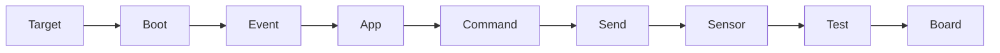

# Design do Flight Studio

Na primeira visita, a pessoa escolhe onde executar o cFS. O Studio verifica o destino, compila a missão e mostra a inicialização. A navegação lateral continua disponível para quem quer inspecionar a arquitetura, abrir um arquivo ou trabalhar diretamente na estação de solo.

## Tipografia e superfícies

As duas aparências usam as mesmas dimensões. Inter serve à interface. JetBrains Mono identifica arquivos, símbolos C, números, unidades e código. As fontes são distribuídas com o Studio. Use os pesos 400 para conteúdo, 500 para controles e 600 para ênfase. [Tokens](../interface/static/design.css) · [Licença das fontes](../interface/static/fonts/LICENSE.txt)

| Tamanho | Token | Uso |
| --- | --- | --- |
| 10 px | `--fs-small` | Rótulo curto de seção, em mono, maiúsculas e espaçamento de 0,12 em |
| 11 px | `--fs-caption` | Unidade, legenda, origem ou informação secundária |
| 12 px | `--fs-label` | Texto da interface |
| 13 px | `--fs-body` | Botão e conteúdo com ênfase |
| 15 px | `--fs-heading` | Título de cartão ou painel |
| 20 px | `--fs-title` | Título de página |

| Elemento | Regra |
| --- | --- |
| Janela | `--fs-bg` no fundo, `--fs-surface` em navegação e barras. O tema claro usa fundo bege. |
| Cartão ou diálogo | `--fs-panel`, borda de 1 px em `--fs-line` e raio `--fs-radius-card` de 6 px. Reserve a faixa lateral de cor para o gutter do diff. |
| Controle | Raio `--fs-radius-control` de 4 px. Uma ação primária por grupo, com `--fs-accent` e `--fs-on-accent`. |
| Pílula ou ponto | Raio `--fs-radius-pill` de 99 px. Um ícone, número ou rótulo acompanha a cor. |
| Foco e estados | `--fs-accent` para foco e seleção, `--fs-success` para confirmação, `--fs-danger` para erro. |
| Texto | `--fs-text` para o conteúdo e `--fs-muted` para contexto. Use os tokens também nos componentes montados por JavaScript. |

As telas de referência são 1440 × 900 e 1366 × 768. O cabeçalho, o guia e as ações principais cabem na janela. Listas extensas, código, inspeções e saída do terminal rolam em seus próprios painéis. Os desenhos se adaptam ao espaço disponível. A escolha de tema acompanha o usuário entre o setup e o workspace. [Tema](../interface/static/theme.js) · [Capturas e comparação](validation.md)

## Guia First flight

A barra de 44 px fica sob o cabeçalho. Cada pílula abre uma área. O número à esquerda conta as etapas com evidência. O primeiro item pendente pulsa, e **Next** aparece quando é preciso mudar de área. O ícone de reinício zera a contagem na própria tela. A pessoa pode continuar com seu arquivo aberto e com as alterações locais no editor. [Guia](../interface/static/journey.js) · [Critérios de conclusão](backend.md#evidência-do-guia)

- Escreva rótulos em inglês, preferencialmente com até quatro palavras. Mostre a relação entre peças com o desenho, o estado pelo ícone e a unidade ao lado do valor. Nomes de arquivos, eventos recebidos e saída de processos preservam o texto de origem.
- Ao iniciar uma operação, mostre o indicador em execução. Ao receber a confirmação, desenhe o check SVG com `pathLength="1"` e `stroke-dashoffset`, aplique escala 0,4 → 1,14 → 1 e um único pulso do anel. Uma linha recém-inserida pode surgir com fade.
- Dê nome acessível aos ícones interativos. Preserve foco ao atualizar um painel e permita operação por teclado. Com `prefers-reduced-motion`, mostre o resultado final de cada transição diretamente.

## Comportamento por tela

| Área | Ação e resposta |
| --- | --- |
| **Choose target** | As três ilustrações representam Native, Emulator e Board. Ao abrir a página, os grupos aparecem em estado neutro. Ativar um cartão por clique, Enter ou Espaço inicia os três grupos em sequência, inclusive no destino já selecionado. **Install requirements** verifica e corrige o destino. Quando há pendências, **Click + to fix** aponta para os grupos em âmbar. Em **Board**, o host e o usuário salvos abrem o campo correspondente em **Configure**. **Save settings** grava os valores e reinicia as verificações. **Cancel** descarta a edição. O anel acompanha a instalação e dá lugar a um check depois da verificação. **Details** abre os comandos e seus resultados ou o terminal da instalação em andamento. Ambos se sobrepõem ao setup. Os três grupos aprovados liberam **Continue to boot**. |
| **First boot** | Os cartões acompanham as etapas necessárias para o alvo. A pilha acende conforme o log do voo. Clique em uma camada para inspecionar seu desenho. A seção **Start cFS** traz cinco cartões de Executive Services. Clicar em um marco observado recupera o registro exato e as camadas daquele momento, inclusive quando vários eventos chegam no mesmo milissegundo. O botão **Resume** volta à execução. A pilha ocupa a altura disponível, e a barra do console mantém **Open console** ou **Close console** visível. Escape fecha o console. O replay usa os instantes registrados pelo build e pelo cFS. É possível pausar, retomar e rever as camadas. **Ground Station** abre a estação quando o cFS está em OPERATIONAL. |
| **Ground Station** | Na primeira conexão, **Select ENABLE_OUTPUT** prepara o comando com o endereço de retorno. O envio continua sendo uma ação do usuário. O primeiro contato usa `sample_app` ou uma app de missão. O coach distingue pacote recebido, evento do NOOP e incremento do contador. **All apps** abre o restante do catálogo. Clicar em um envio anterior recupera as observações daquele envio, inclusive depois de trocar de comando. |
| **Mission architecture** | 3D e 2D mostram a mesma missão. Gire, aproxime e selecione uma peça para ver as conexões e ações. Em **Your apps**, **Create your first app** abre **What it is → Its files → Create**. O nome ocupa o espaço tracejado no barramento. O usuário vê os arquivos, o registro de startup e o build antes de confirmar. A engrenagem reúne os parâmetros avançados. |
| **Code** | Navegar pela árvore abre arquivos e linhas de origem. A atividade **New command** de uma app de missão abre o percurso **Code → Struct → Prototype → Dispatch → Events → Handler → Test**. Uma etapa de código recebe o check depois da visita e da identificação da referência. O handler exige implementação. No passo **Test**, o Studio prepara a revisão que contém o comando e abre seu formulário na estação. Um check final exige as observações de voo do teste. |
| **Hardware** | O CAD mostra o computador em Native e a placa selecionada nos demais alvos. **2D → Pinout** mostra pinos físicos. O fluxo parte do barramento, passa pelo dispositivo e chega à associação do leitor HAL com a app. |
| **Synthetic data** | Uma órbita alimenta os sensores selecionados. **Signals** mostra globo, trajetória e curvas. Em **Python**, **Dry run** usa o modelo local e **Send to QEMU** escreve nos dispositivos. **QEMU** separa valor calculado, escrita e leitura observada. **Test** compara o valor enviado e a leitura do HAL em cada cenário local. |
| **Board** | A última pílula abre a configuração da placa física. O deploy e a inicialização são acompanhados pela mesma tela de boot. |

Em **Code**, a árvore exibe **A** e **M** junto aos arquivos novos e modificados. **Tags** reúne anotações e regiões editáveis. Digitar `@` em um comentário abre as sugestões. **Packet** detalha o pacote a partir das fontes e do catálogo compilado. **Dispatch** leva às referências de inscrição, seleção do comando e handler. [Editor e navegação](../interface/static/source-guide.js)

Em **Ground Station**, use a visão do sistema para percorrer apps e serviços ou selecione um comando para observar sua ida e volta. O teste associa passos a pacotes, campos e eventos do catálogo. Os passos aguardam os resultados da execução. [Estação](../interface/static/round-trip-view.js) · [Editor de testes](../interface/static/trip-editor.js)
