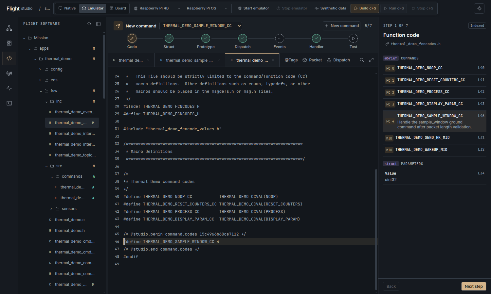

# Design do Flight Studio

O seletor de destino, a bancada de hardware, a arquitetura, o editor e a estação de solo compartilham a tipografia e a paleta do HTML de referência. A configuração abre antes do CAD 3D da missão. A camada de hardware abre a bancada. O fluxo principal tem duas decisões, escolher onde executar o cFS e abrir o workspace.

## Cores e tipografia

Os valores ficam em [design.css](../interface/static/design.css). Use os tokens CSS abaixo para que uma alteração alcance as duas aparências. O tema claro usa superfícies de papel bege. O tema escuro usa cinzas frios e a mesma hierarquia de contraste.

| Elemento | Token | Uso |
| --- | --- | --- |
| Tela | `--fs-bg` | Área de trabalho e navegação |
| Superfície | `--fs-surface`, `--fs-panel`, `--fs-raised` | Ilustrações, grupos de controles e hover |
| Borda | `--fs-line` | Delimitar um painel ou separar grupos |
| Texto | `--fs-text`, `--fs-muted` | Conteúdo principal e contexto secundário |
| Ação principal | `--fs-accent`, `--fs-on-accent` | Botão principal, foco e destino selecionado |
| Estado | `--fs-success`, `--fs-danger` | Resultado de uma operação acompanhado de ícone ou texto |
| Interface | `--fs-sans` | Inter nos comandos e rótulos |
| Código e valores | `--fs-mono` | JetBrains Mono nos nomes de símbolos e valores técnicos |

Os arquivos de fonte são locais e têm [licença OFL](../interface/static/fonts/LICENSE.txt). A escala de texto usa 11 px para legendas, 12 px para rótulos, 13 px para conteúdo e 15 px para títulos de grupos. O título de entrada usa 22 px. Os pesos 500 e 600 dão hierarquia sem introduzir outra família.

## Comportamento

- A seleção de destino persiste ao abrir o workspace ou executar uma operação que usa a configuração. O número de jobs aceita entrada direta e os botões de incremento respeitam os limites de 1 a 64.
- O setup abre com os ícones das ferramentas em estado neutro. Os indicadores de grupo abrem seus detalhes. **Run all checks** inicia a sequência, com um comando em execução por vez. O anel destaca a etapa ativa e o selo indica o resultado. Clique no ícone para consultar o comando, a saída, a duração e o código de retorno quando disponível.
- O clone oficial aparece na configuração quando a fonte precisa ser instalada. “Source” dá acesso à revisão instalada. Os detalhes de SSH e da imagem ficam junto ao destino no botão de configurações.
- A configuração usa a altura disponível da janela. Quando o terminal abre na barra inferior, os cartões de destino se compactam. Os botões principais permanecem acessíveis. Em telas pequenas, os detalhes e o histórico do terminal têm rolagem própria.
- As ações primárias têm preenchimento de destaque. As secundárias têm borda discreta e os botões de ícone expõem um nome acessível. Um grupo deve ter uma única ação primária.
- As animações respondem a foco, seleção e passagem do ponteiro. A preferência do sistema por movimento reduzido desativa as transições. Em telas estreitas, os desenhos mantêm a ordem e os campos passam à linha seguinte.
- O botão com o atributo `data-theme-toggle` usa [theme.js](../interface/static/theme.js). A escolha persiste entre o setup e o workspace, inclusive entre abas no mesmo endereço.

## Áreas do workspace

| Área | O que aparece | Origem |
| --- | --- | --- |
| Hardware | CAD do computador ou da placa. Em **2D → Pinout**, a Raspberry Pi mostra os números físicos do conector. | Perfil ativo, lista de dispositivos e atribuições de pinos. |
| Arquitetura | As duas projeções mostram a mesma missão. No CAD, arraste para girar, use a roda para aproximar ou afaste com o botão −. Shift e arrastar desloca a câmera. O controle de enquadramento restaura a vista. Clique em uma peça para acender suas ligações, abrir o código ou passar à seção em 2D. | Apps, bibliotecas, serviços cFE, leitores associados e pinos físicos da missão. |
| Código | Árvore de arquivos com as marcas **A** e **M**, abas de arquivos e navegação para linhas de origem. | Arquivos da missão e cópia do cFS, índice de símbolos e estado Git. |
| Ground Station | Comandos por aplicação, parâmetros e tamanho do pacote, envio, telemetria e eventos. O histórico mostra os bytes enviados pelo transmissor. | Catálogo do build do alvo, datagramas recebidos e registro de envio. |
| Ground Station → System overview | Apps da missão e serviços cFE agrupam os registros por direção. Um comando abre sua visão de round trip. | Configuração de startup, envios UDP e pacotes recebidos. |
| Synthetic data | Prévia orbital, canais dos dispositivos, parâmetros de sinal, arquivos Python e resultados de testes locais. | Sessão de sensores e amostras dos jobs de teste ou de simulação. |

A posição de cada nome em `header_pins` no catálogo da placa corresponde ao número físico do pino, começando em 1. **Pinout** usa esse catálogo para identificar a alimentação, GPIO e as conexões de cada sensor. [Diagrama do conector da Raspberry Pi](https://www.raspberrypi.com/documentation/computers/raspberry-pi.html#gpio)

Em **Synthetic data → Orbit**, selecione um perfil ou configure o perigeu, o apogeu e os quatro ângulos. **TLE** importa os elementos médios e a época UTC de duas linhas com checksum válido. A prévia usa o propagador selecionado, **Two-body** ou **J2**. O segundo inclui as taxas seculares de precessão. A sombra usa um cilindro terrestre e a direção do Sol na época simulada. Clique na trajetória para parar naquele ponto ou use as setas do teclado. Arraste o globo para girar e use a roda do mouse para ampliar. [Formato TLE do CelesTrak](https://celestrak.org/NORAD/documentation/tle-fmt.php) · [Posição solar aproximada do USNO](https://aa.usno.navy.mil/faq/sun_approx)

**Save settings** grava a órbita no dicionário `SESSION` de `sensors/signals.py`. Para ligar uma grandeza à órbita, selecione o sensor, escolha **Orbit · sunlight** e salve o valor de sombra e o incremento sob luz solar. Para uma transição gradual, configure a constante de tempo em **Response time (s)**. A prévia, o teste Python e o envio por QMP consultam a mesma propagação em [orbit.py](../sensors/orbit.py). Durante o envio, o relógio segue o tempo das amostras. No gráfico, **local test** identifica uma amostra do teste Python e **sent to QEMU** identifica uma escrita que o monitor QMP confirmou.

## Editor

Ao abrir um arquivo C de uma app, o seletor acima do código lista os comandos encontrados no despacho. Escolha um deles ou clique na linha da definição. A árvore de arquivos acompanha o salto, com **A** para arquivos adicionados e **M** para modificados. A linha selecionada fica destacada.

Os sete círculos percorrem **Code**, **Struct**, **Prototype**, **Dispatch**, **Events**, **Handler** e **Test**. Cada etapa de código leva à declaração, ao campo ou à chamada correspondente. O painel lateral mostra os números de linha e os códigos de função. IDs e chamadas do EVS aparecem quando o índice encontra uma emissão direta no handler. Um círculo tracejado indica uma etapa ainda sem referência. O círculo **Test** usa o resultado do último teste registrado para aquele comando no mesmo alvo e build.

- **Tags** lista os comentários do arquivo e os pontos de edição `@studio.edit`. Digitar `@` em um comentário C abre as opções. Tab ou Enter completa a anotação e Escape fecha a lista.
- **Packet** mostra MID, código de função e campos do payload. Com o catálogo compilado, também mostra os offsets e tamanhos em bytes. Com um envio registrado na sessão daquele build, os blocos exibem os bytes efetivamente enviados.
- **Dispatch** permite seguir da inscrição do Software Bus no código da app até o handler. Clique em qualquer referência para abrir seu arquivo e linha.

Em uma missão vazia, **New mission app** cria a primeira app. Depois, **New command** permite escolher uma app de missão inclusive enquanto você consulta o código oficial da NASA. O Studio abre os arquivos gerados. Complete o handler, compile o alvo e use **Test → Open Ground Station** para abrir esse comando na estação de solo.

