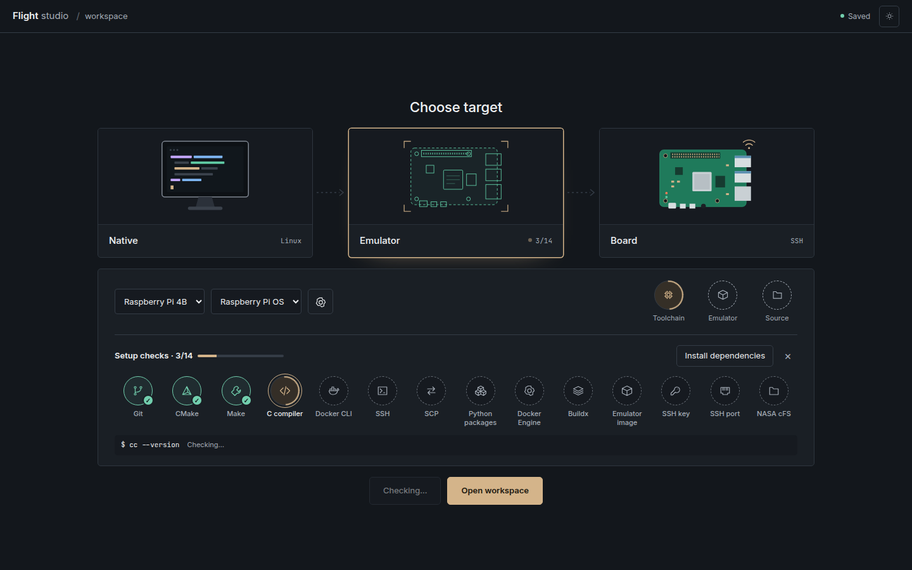
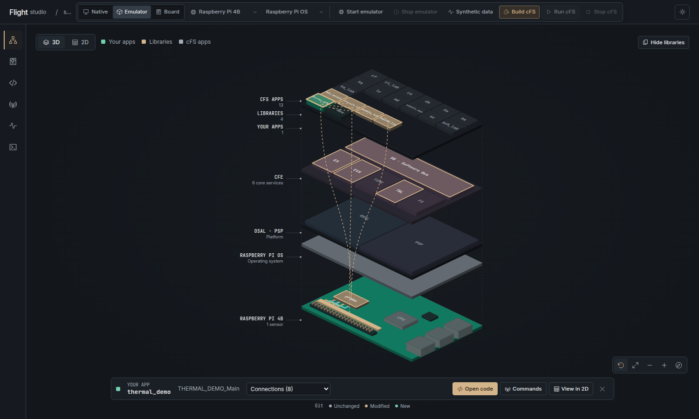
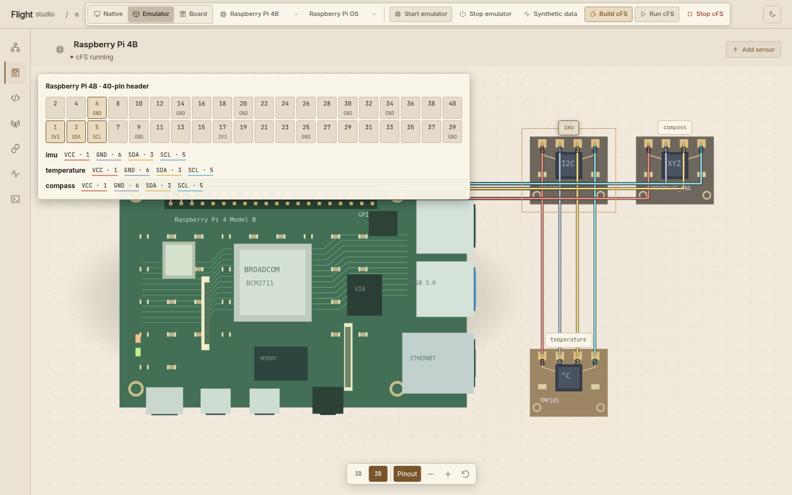
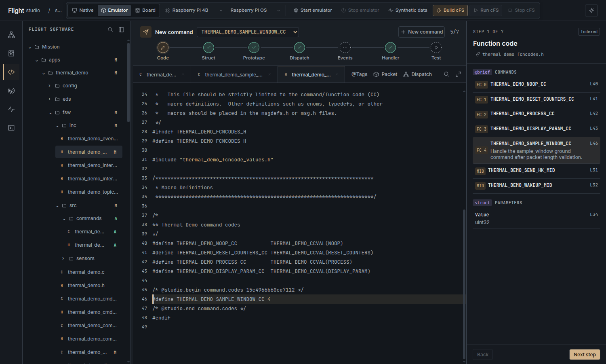
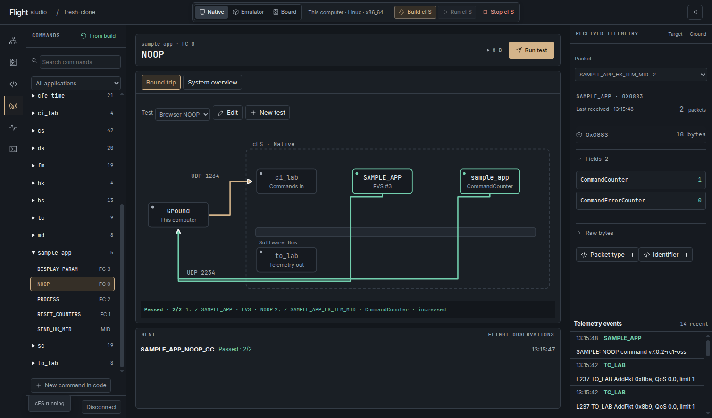
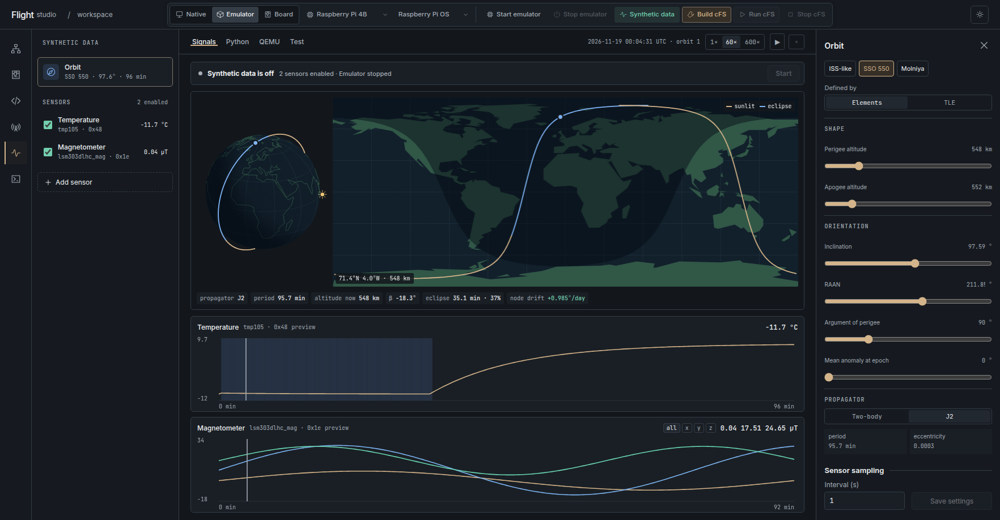

# Validação do Flight Studio

Verificações executadas em Ubuntu 24.04 x86-64, com Python 3.12, Chromium, Docker, QEMU e uma Raspberry Pi 4 Model B Rev 1.5 física. As missões de teste foram criadas em pastas temporárias. O projeto distribuído começa com a seleção de apps da NASA, sem a app `science` e sem os sensores das capturas abaixo.

A suíte Python concluiu 41 testes, e a suíte JavaScript concluiu 10. Os testes de voo abaixo usaram processos cFS reais.

## Cenários exercitados

| Cenário | Resultado observado |
| --- | --- |
| Configuração da bancada | No Chromium, uma missão vazia passou por **Add bus → Connect sensor → Link HAL → Open reader**. O editor abriu o leitor C gerado para o TMP105. A mesma ação contextual ficou visível nas projeções 2D e 3D. |
| Barramento no Linux emulado | Em dois boots isolados do Raspberry Pi OS com kernel aarch64 6.18.50, a missão vazia produziu um controlador desabilitado e nenhum `/dev/i2c-1`. Após selecionar o barramento e conectar um TMP105, o kernel criou o dispositivo. O registro I²C do chip em `0x48`, lido via SSH, retornou 24,5 °C após a escrita QMP de 24.500 m°C. |
| Órbita e sinal no guest | Em um terceiro boot, `orbit.sunlight` usou 15,5 °C de base e 4 °C de amplitude para o TMP105. Com o satélite iluminado, a prévia calculou 19,5 °C. A sessão escreveu 19.500 m°C pelo QMP e o registro de temperatura, lido dentro do guest em `/dev/i2c-1`, retornou 19,5 °C. |
| Instalação do zero | O instalador baixou o cFS e seus submódulos diretamente de `nasa/cFS`. Checkout independente `a4d305dc06fb`. Nenhum arquivo de `cFS/` é rastreado pelo Git da plataforma. |
| Missão nativa | Na revisão `93e589b86430`, adicionei `orbit_demo`, compilei e confirmei que a app inicializou. cFE entrou em `OPERATIONAL` como usuário normal. |
| Missão no checkout recém-baixado | Na revisão `a4d305dc06fb`, `thermal_demo` carregou junto com `hal_sensor`, `linux_i2c_lib` e `tmp105_lib`. O teste detectou um limite de nomes de pipes que impedia a app de iniciar. O overlay agora dimensiona o limite pelos nomes declarados. Após a correção, o log confirmou `THERMAL_DEMO Initialized` e o estado `OPERATIONAL`. A própria `THERMAL_DEMO` respondeu a `THERMAL_DEMO_NOOP_CC` por telemetria. |
| Ground Station nativa | Um `SAMPLE_APP_NOOP_CC` de 8 bytes recebeu o evento `SAMPLE: NOOP command v7.0.2-rc1-oss`. A sessão registrou 31 pacotes de telemetria. |
| Missão ARM64 | A app `science` foi compilada com leitores para TMP105, LSM303DLHC magnetômetro e MPU6050. A missão inicializou em Raspberry Pi OS no QEMU. |
| Aquisição real no modelo emulado | Três passos do gerador escreveram sinais por QMP. A leitura dos registradores pelo Linux do guest retornou os dados dos três chips. A app enviou os três pacotes à estação com `Valid = 1`, `Status = 0`, `ReadCounter = 176` e `ErrorCounter = 0`. O pacote do TMP105 continha `Value = 24000` na unidade do modelo, ou 24 °C. |
| Comando pelo navegador | O botão Send transmitiu `1882c000000100a4` ao QEMU. O evento NOOP da SAMPLE_APP voltou cerca de 432 ms depois nessa execução. O teste pela API também recebeu o evento, com 43 pacotes na sessão. |
| Placa física por SSH e UDP | Em uma Raspberry Pi 4 Model B Rev 1.5 com Linux aarch64, a missão padrão ARM64 compilada contra `a4d305dc06fb` chegou a `OPERATIONAL`. A Ground Station enviou `SAMPLE_APP_NOOP_CC`, recebeu 26 pacotes e o evento da SAMPLE_APP. O journal do serviço registrou o mesmo evento. |
| Edição e navegação | Criação, renomeação e remoção usando a API, ligação de leitores, edição C mantida após sincronização e rejeição de uma revisão antiga. No Chromium, o editor localizou o payload, o despacho, o handler e as anotações da app de teste. Para SAMPLE_APP_NOOP_CC, os seis saltos de código abriram as linhas do clone local, incluindo o protótipo e o evento EVS 3. As ferramentas Tags, Packet e Dispatch abriram no navegador e aceitaram fechamento com Escape. Em uma missão vazia, New mission app criou thermal_lab. Em seguida, com a fonte oficial de sample_app aberta, New command criou THERMAL_LAB_READ_PROBE_CC em thermal_lab. O editor coube em janelas de 1366 × 768, 390 × 844 e 844 × 390. |
| Round trip com cFS nativo | Em missão isolada, as 12 apps de distribuição com NOOP, a app de missão `thermal_demo` e os cinco serviços cFE com NOOP emitiram os eventos EVS esperados. O teste de `sample_app` também exigiu aumento do `CommandCounter` em um pacote de housekeeping distinto. O `sch_lab` estava carregado e seu catálogo não expôs um NOOP. |
| Interface | A configuração abriu primeiro. O workspace abriu na pilha 3D. As navegações 3D/2D, a folha de pinagem com 40 pinos, os dois temas, o terminal e o layout de 390 px foram exercitados. Os arquivos de fonte são servidos localmente. |
| Verificação manual do setup | No Chromium, abrir a página, trocar de alvo, consultar os grupos e recarregar gerou zero pedidos de verificação. Um clique em **Run all checks** executou os 14 comandos do perfil Emulator em sequência, com no máximo um pedido em andamento. Em um ambiente de teste com CMake ausente, a etapa falhou e as demais foram executadas. A página coube em janelas de 1366×768, 1024×600, 390×844 e 844×390. |
| Instalação e terminal | Uma instalação temporária exercitou os estados pendente, em execução, sucesso e falha, os códigos de saída 7 e 0 e a retomada do mesmo terminal após recarregar a página. |

Os três sensores foram medidos no QEMU. Na placa física, o ensaio usou a missão inicial sem sensores adicionais. O serviço voltou ao estado inativo e o link para a instalação anterior foi restaurado ao final do teste.

## Telas da aplicação

A configuração reúne o destino de execução, o clone oficial e os checks. O terminal de preparação abre na parte inferior.



A pilha usa os módulos e dispositivos da missão. Selecionar a placa abre o CAD de hardware. O modo 2D oferece a pinagem física do conector.





No editor, o navegador de arquivos acompanha a linha de origem. As anotações pertencem aos comentários C.



A estação exibe o comando selecionado, os bytes transmitidos e os pacotes recebidos do alvo. As contagens variam a cada execução.



A bancada de sinais mostra a trajetória em luz e eclipse, as séries por sensor e os parâmetros da sessão. A prévia e o gerador Python compartilham os elementos orbitais e o modelo de propagação escolhido. Os valores de teste local e os confirmados pelo QMP têm identificações próprias.



## Repetir

A suíte Python usa a biblioteca padrão e um compilador C no host. O teste HTTP utiliza o checkout instalado para montar uma missão em diretório temporário. Os testes de interface em JavaScript usam o executor de testes do Node. O Node só é necessário para essa suíte.

```sh
./scripts/install-cfs.sh
python3 -m unittest discover -s interface/tests -v
node --experimental-default-type=module --test interface/tests/*.mjs
```

Com a estação e o cFS em execução no alvo escolhido, use o teste de ponta a ponta para confirmar a resposta da app oficial pelo canal de telemetria.

```sh
python3 interface/tests/live_ground.py --target native
python3 interface/tests/live_ground.py --target qemu
```

Execute cada linha com o alvo correspondente ativo. O teste usa a sessão existente ou encerra apenas a conexão de Ground Station que ele próprio abriu. [Preparação e execução dos alvos](../README.md) · [Revisão do PR de rshz3028](pr-review.md).

Para repetir a verificação das apps em uma missão de teste, conecte a Ground Station, aguarde uma amostra de housekeeping e execute o comando abaixo. A saída contém o MID, a sequência CCSDS e os valores recebidos para cada NOOP. O script remove a definição de teste temporária após cada envio.

```sh
python3 interface/tests/live_round_trips.py --target native --port 8765
```
