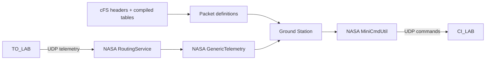

# Ground Station

Commands and telemetry use the official NASA cFS-GroundSystem modules bundled
in `cFS/tools/cFS-GroundSystem`. Ground Station reads flight definitions without
editing cFS sources.

```sh
python3 -m pip install -r ground_station/requirements.txt
./start
```

Build and run cFS, open **Ground Station**, then **Connect**. Select an application
to send commands or inspect telemetry. Clicking a command or packet opens its C
source definition in the editor.



## Definitions

The catalog uses the selected build's compiler to resolve message IDs, command
codes, payload sizes and field offsets. CPU1 startup and the installed mission
tables select active modules and subscriptions. Definitions remain tied to the
running build; Build and Run apply source changes.

- Native artifacts: `cFS/build-native/exe/cpu1/`.
- Board/emulator artifacts: `cFS/build-flight/exe/cpu1/`.
- GroundSystem command/parameter/telemetry files: `.runtime/definitions/`.

`catalog.py`, `discovery.py`, `tables.py` and `subscriptions.py` produce metadata.
`official.py` connects NASA's sender, receiver and decoder to the browser.

## Transport

Native execution uses loopback. For QEMU, the platform resolves the container
route and forwards UDP commands to the guest. Physical-board connections use the
configured SSH host to discover the flight address. Ports come from the compiled
mission configuration.

**Architecture → Communication** shows commands sent and telemetry received per
app. Select a counter to inspect packets, decoded fields and bytes from the
current Ground Station connection.

Upstream: [NASA cFS](https://github.com/nasa/cFS),
[NASA cFS-GroundSystem](https://github.com/nasa/cFS-GroundSystem).
