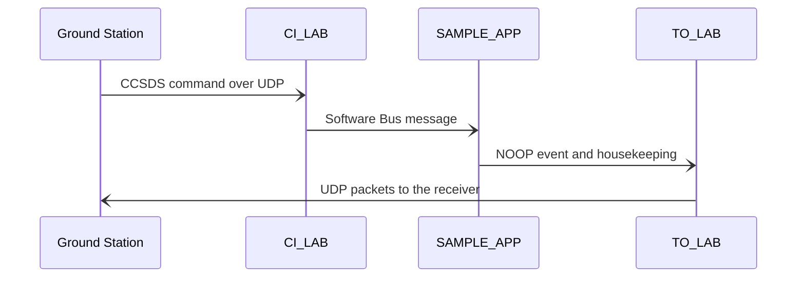

# Ground Station

Ground Station sends CCSDS packets to CI_LAB over UDP and decodes TO_LAB packets using the compiled catalog's field offsets, types and byte order.

## Sending a command and confirming its response

1. Select a target, build the mission and run cFS. For Emulator, start QEMU before running cFS.
2. Open **Ground station** and select **Connect**. The receiver opens and the first-contact flow selects `TO_LAB_OUTPUT_ENABLE_CC`. Check `dest_IP` and select **Send**. The first decoded packet confirms that telemetry is reaching the receiver.
3. Select `sample_app` and `SAMPLE_APP_NOOP_CC`. Check the MID, function code and packet length before sending. **Sent** records the transmitted bytes.
4. Find `SAMPLE: NOOP command` in the received events. The next `SAMPLE_APP` housekeeping packet reports its increased `CommandCounter`. Together, these observations demonstrate that the app processed NOOP.

UDP transmission, received telemetry and app processing are separate observations. **Sent** records a local send. A received packet confirms the return path. An event with the expected source and content is evidence of processing. Per-app counters report locally sent commands and received telemetry for the current connection.

The compiled TO_LAB subscription table determines which packets reach the ground. Send **ENABLE_OUTPUT** after reconnecting to select the receiver address. **Start over** resets the target's server-side history, shared by all browser tabs.

## Round-trip checks

In **Ground Station → Round trip**, choose a command and select **New test**. Set a timeout and add the expected observations in order. The send form uses the compiled command fields.

For `SAMPLE_APP_NOOP_CC`:

1. Add **Flight event**, set **EVS app name** to `SAMPLE_APP` and **Message contains** to `NOOP`. An exact numeric event ID can also be required.
2. Add **Telemetry packet**, select `SAMPLE_APP_HK_TLM_MID`, then **Field increases** and `CommandCounter`. Wait for an initial housekeeping sample to establish the baseline.
3. Save and select **Run test**. Open the run under **Sent** to inspect its event, MID, CCSDS sequence and decoded value. **Edit** changes, reorders or removes checks.

Only packets decoded after the send in that session are eligible. Each check consumes a distinct observation. EVS and housekeeping usually lack a unique command correlation identifier; when other senders are active, use a correlation field published by the application itself.

The round-trip diagram uses discovered publishers and subscriptions for the selected MID. Animation illustrates the supported route after a confirmed observation; its timing is not an internal Software Bus trace. **System overview** provides per-app command and telemetry records.

Plans are stored in `ground_station/test-plans.json`. Before sending, Studio validates packet identifiers and fields against the selected build's catalog. Editing a plan does not require rebuilding cFS.

## Compiled packet catalog

The build compiler resolves MIDs, function codes, structure sizes, alignment and field offsets. Unsupported C types are displayed as bytes. The installed startup list determines which apps are eligible command recipients. ARM64 analysis uses the local `cfs-builder:local` container with networking disabled.

Command-to-MID associations come from C dispatch comparisons, early returns or handler tables. Insufficiently supported routes remain unresolved with an explanation. [Catalog overrides](overrides.json) can explicitly supply a type, MID, function code, length and fields; validation checks packet consistency.

| Local data | Purpose |
| --- | --- |
| `hardware/.runtime/catalog-<profile>-<fingerprint>.json` | Native or flight build catalog |
| `ground_station/.runtime/definitions/<fingerprint>/` | Definitions consumed by NASA modules |
| `ground_station/.runtime/subscriptions.json` | Subscriptions confirmed for the connection, build and service run |
| `ground_station/.runtime/passed-tests.json` | Latest passing run per target and command, with build fingerprint and received observations |

After editing a header, rebuild and run the updated mission. **Connect** selects the corresponding catalog fingerprint. First catalog preparation requires compiler queries.

## Network paths

Ports are read from the compiled CI_LAB and TO_LAB configuration. The default checkout profile uses UDP 1234 for commands and UDP 2234 for telemetry.

| Target | Command path | Return path |
| --- | --- | --- |
| Native | Local loopback | Local loopback |
| Emulator | Docker's published loopback UDP port forwards to the guest CI_LAB port | TO_LAB sends to the QEMU network's host address; a receiver inside the container forwards packets to Ground Station |
| Board | Board address observed over SSH | Local address observed by the board on that SSH connection |

QEMU command forwarding is configured at startup. Ground Station discovers the published Docker port and opens its telemetry receiver in the container. Restart the emulator after changing the compiled mission's port. QMP carries sensor stimuli separately. For Board, Studio reads `SSH_CONNECTION` and checks the host UDP route using the observed addresses; NAT or SSH jumps that change the return address may prevent verification.

Implementation: [catalog](catalog.py) · [C discovery](discovery.py) · [NASA integration](official.py) · [session](station.py).
