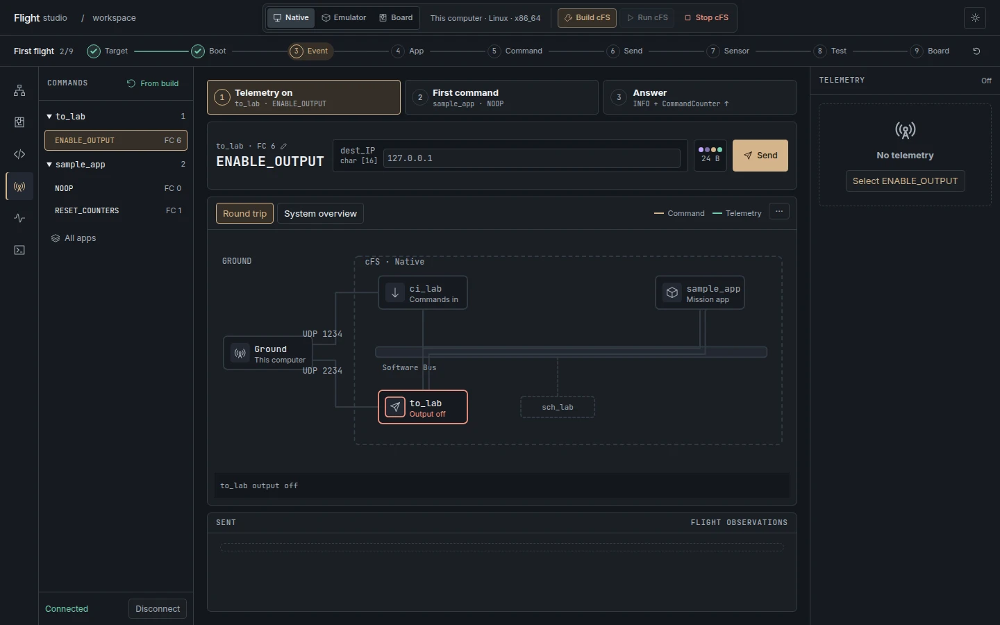
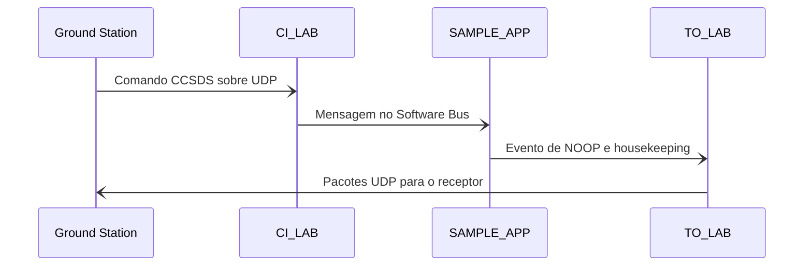

# Ground Station

A estação envia comandos ao cFS em execução e decodifica a telemetria recebida. Os módulos oficiais em `cFS/tools/cFS-GroundSystem/` vêm com o checkout da NASA feito no setup. O Studio usa o MiniCmdUtil para enviar comandos, o RoutingService para receber datagramas UDP e o GenericTelemetry para decodificar os pacotes. Para preparar o checkout e o ambiente Python, consulte o [guia inicial](../README.md).

## Enviar um comando e confirmar a resposta

1. No workspace, selecione o destino, compile a missão e execute **Run cFS**. Para **Emulator**, inicie o emulador antes de executar o cFS.
2. Abra **Ground station** e clique em **Connect**. No primeiro contato, a estação abre o receptor UDP e seleciona `TO_LAB_OUTPUT_ENABLE_CC`. Confira o endereço de retorno em `dest_IP` e clique em **Send**. O indicador **Telemetry on** acende com o primeiro pacote decodificado.
3. Selecione `sample_app` e o comando `SAMPLE_APP_NOOP_CC`. Confira MID, código e tamanho do pacote e envie o comando. A seção **Sent** mostra os bytes transmitidos.
4. Em **Telemetry events**, procure o evento `SAMPLE: NOOP command`. O housekeeping seguinte de `SAMPLE_APP` informa o novo `CommandCounter`. Esses dois registros permitem verificar que a app processou o NOOP.

A transmissão UDP, a chegada de telemetria e o processamento pela app são observações distintas. **Sent** registra a transmissão local. O primeiro pacote recebido confirma o caminho de retorno. Um evento com a origem e a assinatura esperadas constitui evidência de processamento. Em **System overview**, os contadores por app mostram o tráfego da conexão atual, incluindo os comandos automáticos enviados a TO_LAB.

Depois do primeiro evento de NOOP confirmado, o Studio habilita a saída automaticamente nas reconexões ao mesmo destino durante a execução do Studio. As confirmações do painel pertencem à conexão ativa. Com o downlink aberto, a estação inscreve os pacotes ausentes da tabela compilada via `TO_LAB_ADD_PKT_CC` e espera até oito segundos por cada confirmação. As falhas ficam em **Catalog details**.

**Start over** marca um novo início neste navegador. Se a última resposta de NOOP do destino for anterior ao reinício, a próxima conexão aguarda o envio manual de **ENABLE_OUTPUT**. A sessão de voo pode continuar durante o reinício do guia.

## Montar um teste de ida e volta

Em **Ground Station → Round trip**, selecione um comando da árvore e clique em **New test**. Escolha o tempo limite e acrescente as observações na ordem esperada. O formulário de envio usa os campos do comando compilado.

Por exemplo, para testar `SAMPLE_APP_NOOP_CC`:

1. Em **Flight event**, configure **EVS app name** como `SAMPLE_APP` e **Message contains** como `NOOP`. Também é possível exigir um ID numérico exato.
2. Adicione **Telemetry packet**, escolha `SAMPLE_APP_HK_TLM_MID`, **Field increases** e `CommandCounter`. Aguarde uma amostra desse housekeeping para estabelecer o valor inicial.
3. Salve e clique em **Run test**. No histórico **Sent**, abra a execução para ler o evento, o MID, a sequência CCSDS e o valor recebido. **Edit** permite alterar, reordenar ou excluir as etapas.

O teste compara somente pacotes decodificados depois do envio naquela sessão. Cada etapa consome uma observação distinta. A linha de envio registra o datagrama local. As linhas de retorno aparecem quando o receptor identifica os critérios escolhidos. Eventos EVS e housekeeping normalmente não carregam um identificador que os relacione de maneira exclusiva ao comando. Em uma missão com outros emissores, inclua no teste um campo de correlação que a própria aplicação publique.

**System overview** mostra apps e serviços da missão. Alterne entre **Commands** e **Telemetry** e selecione um componente para examinar seus registros. O contador de comandos mede envios locais. O de telemetria mede recebimentos na estação.

Os testes são armazenados em `ground_station/test-plans.json`. O Studio confere os identificadores e campos contra o catálogo do alvo antes de transmitir. Mudar um teste dispensa recompilação da missão.

## Como o catálogo acompanha a compilação

O compilador do build resolve MIDs, códigos, tamanhos de estrutura e deslocamentos de campos, inclusive o alinhamento. A estação exibe como bytes os campos cujo tipo C o decodificador ainda não suporta. O startup instalado determina as apps elegíveis para receber comandos. A análise do build ARM64 usa o contêiner local `cfs-builder:local` com a rede desativada.

A associação de um código de comando ao seu MID vem do despacho em C, por comparação, retorno antecipado ou tabela de handlers. Uma rota sem evidência suficiente fica pendente, acompanhada do motivo. O arquivo de overrides permite declarar explicitamente o tipo, MID, código, tamanho e campos de uma definição. O validador confere a consistência do pacote. [Overrides do catálogo](overrides.json)

| Dados locais | Função |
| --- | --- |
| `hardware/.runtime/catalog-<perfil>-<fingerprint>.json` | Catálogo do build nativo ou de voo |
| `ground_station/.runtime/definitions/<fingerprint>/` | Definições consumidas pelos módulos da NASA |
| `ground_station/.runtime/subscriptions.json` | Inscrições confirmadas por conexão, compilação e execução do serviço |
| `ground_station/.runtime/passed-tests.json` | Última execução aprovada por destino e comando, com o fingerprint da compilação e as observações recebidas |

Editar um header altera o código da missão. Depois de compilar e executar a nova versão, **Connect** seleciona seu catálogo pelo fingerprint. A primeira abertura de um catálogo demanda consultas ao compilador.

## Caminho de rede

As portas são lidas da configuração compilada de CI_LAB e TO_LAB. No perfil padrão do checkout usado neste projeto, os comandos usam UDP 1234 e a telemetria usa UDP 2234.

| Destino | Caminho do comando | Caminho de retorno |
| --- | --- | --- |
| Native | Loopback do computador | Loopback do computador |
| Emulator | Endereço do contêiner e redirecionamento UDP para o guest | Gateway da bridge do Docker |
| Board | Endereço da placa observado pelo SSH | Endereço local observado pela placa na conexão SSH |

Em **Emulator**, a conexão cria um `hostfwd_add` por QMP para a porta compilada. A implementação espera uma bridge Docker alcançável a partir do host e o redirecionamento dura até o fim do processo QEMU. Em **Board**, o Studio lê `SSH_CONNECTION` e verifica a rota UDP do host usando os endereços observados. Um NAT ou salto SSH que altere o endereço de retorno pode impedir essa verificação.

A descoberta, o uso dos módulos oficiais e o estado da sessão ficam nos módulos abaixo. [Catálogo](catalog.py) · [Descoberta em C](discovery.py) · [Integração NASA](official.py) · [Sessão](station.py)
