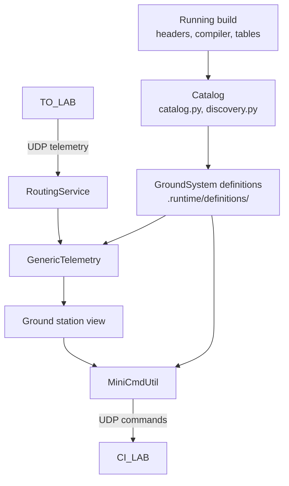
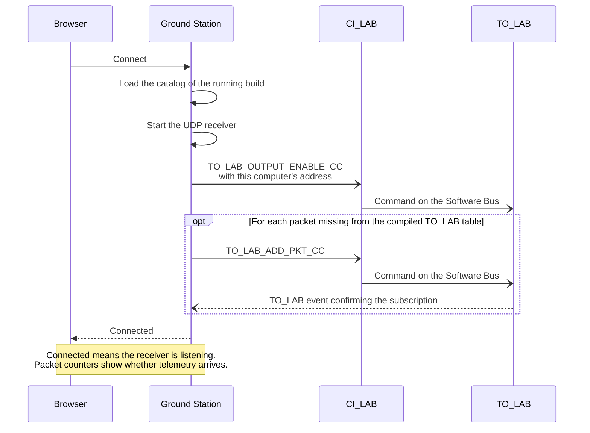
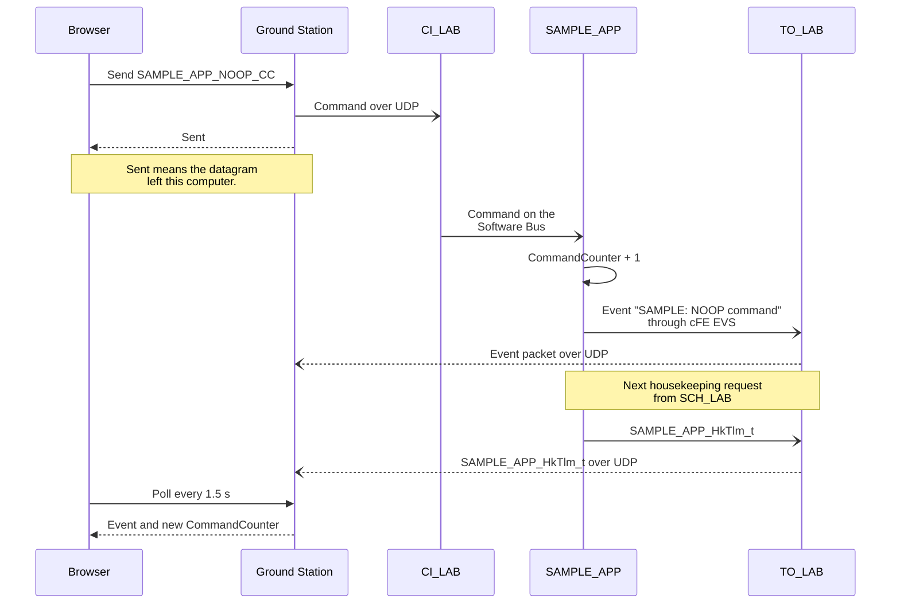

# Ground Station

The Ground Station sends commands to the running cFS and decodes the telemetry that
comes back. It uses the official NASA cFS-GroundSystem modules bundled in
`cFS/tools/cFS-GroundSystem`. MiniCmdUtil builds and sends each command,
RoutingService receives the telemetry over UDP and GenericTelemetry decodes it.
Flight Studio gives these modules definitions read from the build that is running.

## Connecting

Connect needs cFS running on the selected target, started by Flight Studio. Flight
Studio then loads that build's catalog, starts the UDP receiver
and sends `TO_LAB_OUTPUT_ENABLE_CC` with the address where telemetry should go. The
compiled TO_LAB table may lack some packets of the catalog, such as those of apps added
to the mission. For each of them, Flight Studio sends `TO_LAB_ADD_PKT_CC` and waits up
to 8 seconds for the TO_LAB event that confirms the subscription. Failures appear in
the view as Partial reception.

## Sending a command

A command passes through several programs before anything confirms it. The `Sent`
status only means that the datagram left this computer, because UDP has no delivery
acknowledgement and CI_LAB sends no reply. The app's own reports show that it
processed the command. For `SAMPLE_APP_NOOP_CC`, these are the `SAMPLE: NOOP command`
event and the `CommandCounter` field of the next housekeeping packet.

Architecture → Communication counts, per app, the telemetry packets received and the
commands sent during the current connection. The commands that Connect sends to
TO_LAB are counted too. Messages that stay on the Software Bus never reach the Ground
Station and are not counted.

## Definitions

The catalog asks the build's own compiler for message IDs, command codes, payload
sizes and field offsets, including padding. Fields whose C declaration is not supported
are shown as raw bytes. Only apps in the installed startup script can receive
commands. Flight builds are inspected in a temporary `cfs-builder:local` container
without network access, so this computer needs no cross compiler.

A command code is associated with a message ID only by the code that dispatches it.
That can be a `CFE_SB_MsgId_Equal` branch, a negated test that returns for every other
ID, or an entry in a handler table. A code without such evidence stays in the catalog
as unresolved, with the reason, and it cannot be sent. Message IDs are never derived
from app or command names.

[`overrides.json`](overrides.json) adds packets and commands, or replaces them by ID,
with an explicit MID, size, command code and field layout. Flight Studio rejects an
entry whose MID does not match its packet type, or whose size, code or fields are
inconsistent.

| Files | Contents |
| --- | --- |
| `hardware/.runtime/catalog-<native\|flight>-<fingerprint>.json` | Catalog of one build |
| `ground_station/.runtime/definitions/<fingerprint>/` | Definition files read by the GroundSystem modules |
| `ground_station/.runtime/subscriptions.json` | TO_LAB subscriptions confirmed per connection, build and service run |

`catalog.py`, `discovery.py`, `c_source.py`, `tables.py` and `subscriptions.py` build the
catalog. `official.py` connects the GroundSystem sender, receiver and decoder, and
`station.py` keeps the connection state shown in the browser.

## Transport

The UDP ports come from the compiled CI_LAB and TO_LAB configuration. In the current
upstream configuration, commands use port 1234 and telemetry uses port 2234.

| Target | Commands go to | Telemetry goes to |
| --- | --- | --- |
| Native | 127.0.0.1 | 127.0.0.1 |
| QEMU | The container's address, forwarded by QEMU to the guest | The Docker bridge gateway, which is this computer |
| Board | The board's address in the SSH connection | This computer's address in the SSH connection |

For a board, both addresses come from `SSH_CONNECTION` on the board, and Flight Studio
checks that this computer has a UDP route to the board from that address. The check
fails when the board sees another address for this computer, as happens behind NAT or
through an SSH jump host.

## Design notes

### Definitions belong to a build

The running binary decodes and dispatches messages with the layouts it was compiled
with, so definitions taken from sources edited after the build could decode its
packets wrongly. Each catalog is therefore saved under the fingerprint of the build it
came from, and Connect uses the catalog of the build that is deployed on the target.
Source changes reach the Ground Station after Build and Run, and the first catalog of
a new build takes longer to load while the compiler is queried.

### Commands reach QEMU through a forward added on Connect

QEMU's user network accepts incoming traffic only on forwarded ports, and the command
port is known only from the build. On Connect, Flight Studio adds a UDP forward with
the QMP `hostfwd_add` command, from the container's address to the guest's command
port. Telemetry needs no forward, because the guest sends it out through QEMU's
address translation to the Docker bridge gateway. This requires the container to have
exactly one Docker bridge network reachable from this computer, as with the default
bridge of Docker Engine on Linux. The forward lasts until QEMU stops.
