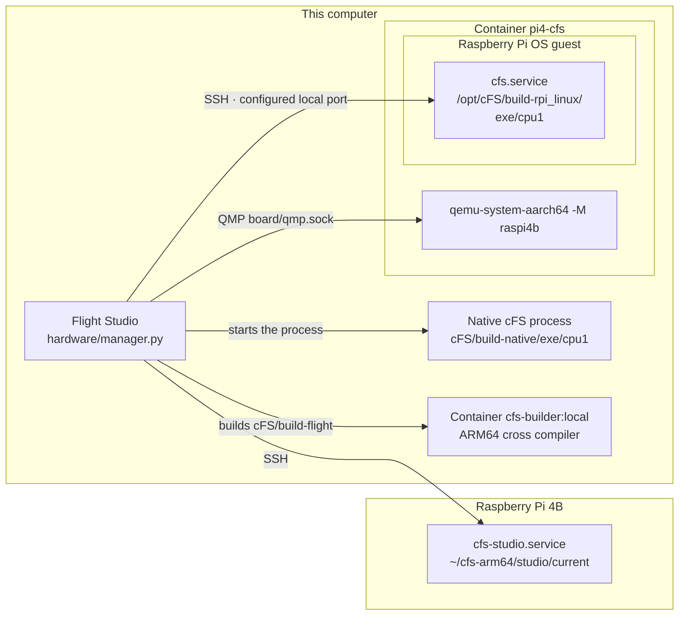

# Execution targets

Flight Studio runs cFS on this computer, in a QEMU-emulated Raspberry Pi 4B or on a
physical Raspberry Pi 4B. The browser and `./start --no-ui` both go through
`HardwareManager` in [`manager.py`](manager.py). Before cFS starts on one target,
Flight Studio checks that it is stopped on every target this checkout may have
started, so one checkout runs at most one cFS instance.

The diagram shows where cFS runs for each target and how Flight Studio reaches it.



## Infrastructure

Infrastructure at `/` configures the execution target before opening `/studio`.
Native uses host tools. Emulator exposes its image and local SSH port. Physical
board exposes the SSH host, user, port, key path and installation folder relative
to the remote user's home. **Check** verifies local requirements; **Test SSH**
checks the board; **Prepare cFS service** sets up its existing on-demand service.
Commands that need a password run in the page's interactive terminal.

Connection settings are local to `hardware/.runtime/`, which Git ignores. Board/OS
selection continues to use `project/config.json` and the generated cFS toolchain.
Private SSH keys remain in the local SSH configuration.

## Native

Native builds with this computer's compiler and runs `core-cpu1` as a local process.
The installed mission is in `cFS/build-native/exe/cpu1/`; output also goes to
`hardware/.runtime/native.log`. Selecting Native preserves the saved board and
sensors for the other targets. Driver code uses the devices available on the host.

```sh
./start --no-ui profile --native
./start --no-ui build
./start --no-ui run
./start --no-ui logs
./start --no-ui stop
```

`run` and `logs` follow the output, and Ctrl+C stops following without stopping cFS.
`run --no-follow` returns as soon as cFS has started.

## QEMU

```sh
./start --no-ui profile --board raspi4b --os raspios
./start --no-ui setup
./start --no-ui build
./start --no-ui boot
./start --no-ui run
./start --no-ui stop
./start --no-ui shutdown
```

Selecting a board profile sets the default to `--target qemu`. The toolbar and
CLI share the selected execution target; `--target` overrides it for one command. Setup runs
[`scripts/setup.sh`](../scripts/setup.sh), which prepares Docker, the emulator's SSH key
in `~/.ssh/cfs-emulator/` and the emulator image named in `config/image`.

Boot starts the `pi4-cfs` container, which runs QEMU's `raspi4b` machine with the
Raspberry Pi OS disk from `board/raspios.qcow2`. QEMU's user network forwards the
container's port 2222 to the guest's SSH port, and Docker publishes the selected host port only on
127.0.0.1. The emulated sensors come from `project/config.json` when QEMU starts, so a
change of devices, buses or addresses needs Stop QEMU and a new boot. When QEMU is
already running but Flight Studio lost track of it, Retry QEMU connection checks SSH
again without starting a new boot. `logs --kind boot` shows
the Linux console, which is also saved in `logs/latest.log`, and `logs --kind flight`
shows the cFS output.

Builds for the emulator and the board run the ARM64 cross compiler inside the
`cfs-builder:local` image and install the mission in `cFS/build-flight/exe/cpu1/`. Run
then loads `i2c-dev` in the guest when the project has sensors, copies the build to a
staging directory over SSH, swaps it with the installed one and starts `cfs.service`.
Flight Studio confirms that the service is active two seconds later, which shows that
the process is running. The cFS output shows whether cFE reached its operational state.

`./run.sh` runs the selected profile from a shell, with the same checks and lock as
Flight Studio. `./boot.sh`, `./stop.sh` and `./logs.sh` start, power off and follow the
emulator directly.

## Physical board

```sh
./start --no-ui profile --board raspi4b --os raspios
./start --no-ui connect --target physical --host raspberrypi.local --user pi
./start --no-ui build --target physical
./start --no-ui run --target physical
./start --no-ui stop --target physical
```

Flight Studio uses your OpenSSH configuration for keys, aliases and known hosts, and
`--host` also accepts an SSH alias. Connect checks the board's Linux system, I²C device
nodes and service authorization. The first connection installs a service on the board
with [`setup_board.py`](setup_board.py), which Flight Studio copies to
the selected installation folder (`~/cfs-arm64/studio/` by default).
`--ssh-port`, `--identity-file` and `--directory` set the same options from the CLI.
With passwordless sudo, Flight Studio runs the script itself.
Otherwise it shows the command to run once in a terminal, which looks like this.

```sh
ssh -t raspberrypi.local sudo python3 ~/cfs-arm64/studio/setup_board.py
```

The script accepts only a Raspberry Pi 4B running ARM64 Linux. It installs
`cfs-studio.service`, which runs `core-cpu1` as root from the installation folder's `studio/current/cpu1`,
and a sudo rule for your user. That rule allows starting, stopping and checking this
service, reading its journal, loading `i2c-dev` and powering Linux off. Every other
sudo command still asks for a password.

Run loads `i2c-dev` when the project has apps that read sensors, uploads the build
and starts the service. The driver then reads the physical devices, since the emulated
QEMU devices do not exist on the board. A failed I²C read appears in the cFS output
and in the app's sensor telemetry, where `Status` holds the negative Linux error code
and `Valid` is 0. For example, status -2 (`ENOENT`) means that the device node is
missing, as happens when the I²C interface is disabled in the board's configuration.

For a board without the configured sensors, `--sensorless` builds and runs the
mission without the apps that read sensors.

```sh
./start --no-ui build --target physical --sensorless
./start --no-ui run --target physical --sensorless
```

`stop` stops cFS. Linux on the board powers off only through an explicit
`./start --no-ui shutdown --target physical`.

## Drivers

The board catalog in `project/boards/` lists the buses, addresses and sensor models
the board supports. Adding a device includes its sensor library and the libraries it
depends on, taken from `project/drivers/`. Selecting a Linux profile alone adds no I²C
or UART library.

- [Linux I²C](../project/drivers/linux_i2c_lib/README.md)
- [Linux UART](../project/drivers/linux_uart_lib/README.md)
- [TMP105](../project/drivers/tmp105_lib/README.md)
- [LSM303DLHC](../project/drivers/lsm303dlhc_mag_lib/README.md)

## Python

```python
from pathlib import Path
from hardware.manager import HardwareManager

manager = HardwareManager(Path.cwd())
manager.execute("build", target="native", emit=print)
manager.execute("run", target="native", emit=print)
manager.execute("stop", target="native", emit=print)
```

Runtime records, build fingerprints and locks live in `hardware/.runtime/`.

## Design notes

### Uploads replace the installed build in one step

A transfer that fails halfway must not leave a mix of two builds where the service
starts. On the board, each upload goes to a new directory under
the installation folder's `releases/`, and the `current` link moves to it with a single rename after
the transfer finishes. In QEMU, the build goes to a staging directory that replaces
the installed one, and the previous copy is kept until the next run. Releases on the
board are not deleted automatically.

### Sensorless builds use a separate copy

Testing on a board without sensors should not change the mission configuration. With
`--sensorless`, Flight Studio copies `cFS/`, `project/`, `scripts/`, `sensors/` and
`config/` to `hardware/.runtime/sensorless/`, removes the apps that read sensors and
their drivers from that copy, and builds it there. The project stays as it is, and the
Ground Station uses a separate catalog for that build. The apps that read sensors are
not exercised in this mode.

### One lock per checkout

The browser and a terminal can act on the same checkout at the same time. Build,
boot, run, stop and shutdown take an exclusive lock on
`hardware/.runtime/execution.lock`, shared by every Flight Studio process that uses
the checkout. A second operation fails at once with an error instead of waiting.
