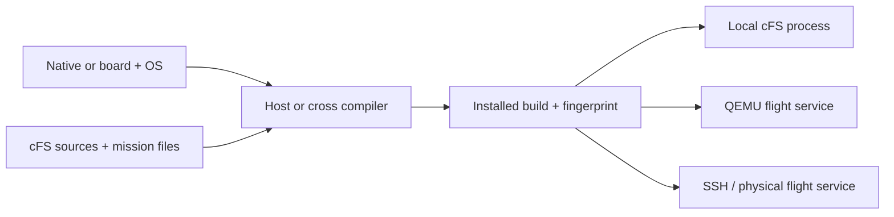

# Execution targets

The browser and CLI share `HardwareManager`, build fingerprints and a workspace
execution lock. One cFS instance runs at a time.

## Native

A fresh project has no board or OS selected. Build with the host compiler:

```sh
./start --no-ui build
./start --no-ui run
./start --no-ui logs
./start --no-ui stop
```

The installed mission is `cFS/build-native/exe/cpu1/`. Output is also available
in `hardware/.runtime/native.log`.

## QEMU

```sh
./start --no-ui profile --board raspi4b --os raspios
./start --no-ui setup --target qemu
./start --no-ui build --target qemu
./start --no-ui boot --target qemu
./start --no-ui run --target qemu
./start --no-ui stop --target qemu
./start --no-ui shutdown --target qemu
```

Profile selection generates the board/OS toolchain. The cross compiler runs in
Docker; the installed mission is `cFS/build-flight/exe/cpu1/`.

**Start QEMU + Linux** boots the emulator. **Stop QEMU** stops it. **Retry QEMU
connection** reconnects to an existing boot attempt. `logs --kind boot` opens
Linux output; `logs --kind flight` opens cFS output.

## Physical board

Select the matching board/OS profile, then connect to its running Linux system:

```sh
./start --no-ui connect --target physical --host raspberrypi.local --user pi
./start --no-ui build --target physical
./start --no-ui run --target physical
./start --no-ui stop --target physical
```

OpenSSH supplies keys, aliases and known hosts. Connection setup checks Linux,
I²C and service access, and reports the command to install `cfs-studio.service`.
Deployments use versioned directories under `~/cfs-arm64/releases/` on the board.
For a board without attached sensors, use `--sensorless` with Build and Run.

`run` follows output. `--no-follow` returns after startup; Ctrl+C closes a log
reader. `stop` stops cFS. Physical OS poweroff is available explicitly through
`shutdown --target physical`.



## Drivers

The board catalog supplies bus, address and model capabilities. Adding a device
provisions its native sensor library and dependencies from `project/drivers/`.
Selecting a Linux profile alone installs no I²C or UART library. Synthetic QMP
samples apply to emulated sensors.

- [Linux I²C](../project/drivers/linux_i2c_lib/README.md)
- [Linux UART](../project/drivers/linux_uart_lib/README.md)
- [TMP105](../project/drivers/tmp105_lib/README.md)
- [LSM303DLHC](../project/drivers/lsm303dlhc_mag_lib/README.md)

## Python

```python
from pathlib import Path
from hardware.manager import HardwareManager

manager = HardwareManager(Path.cwd())
manager.execute("build", target="native", emit=print)
manager.execute("run", target="native", emit=print)
manager.execute("stop", target="native", emit=print)
```

Runtime records and locks live in `hardware/.runtime/`.
