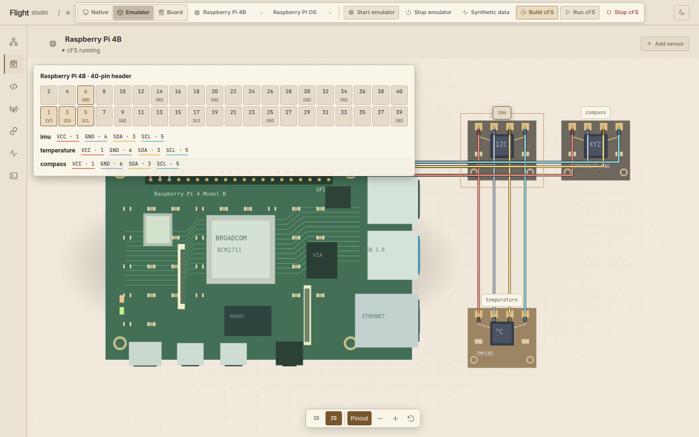
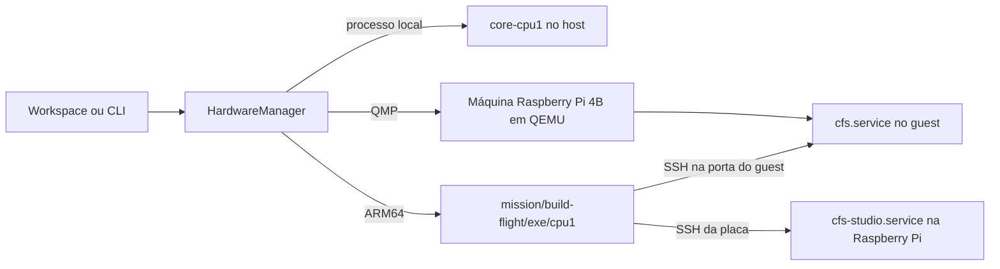

# Execução e hardware

O Flight Studio executa o cFS no computador Linux, em um Raspberry Pi 4B emulado com QEMU ou em uma placa física com Raspberry Pi OS ARM64. A interface e a CLI usam o mesmo gerenciador. Antes de iniciar uma instância, ele verifica os destinos em que esse projeto pode ter deixado o cFS em execução. [Gerenciador](manager.py)

Na configuração inicial, selecione o destino e abra o workspace. Na bancada **Hardware**, Native representa o computador local. Emulator e Board mostram a placa e os dispositivos configurados. Em **2D → Pinout**, consulte os 40 números físicos do conector e os sinais correspondentes. Na placa vazia, comece por **Add bus**. Em seguida, **Connect sensor** mostra os modelos compatíveis. Selecione **Link HAL** para ligar o sensor a um leitor de uma app de voo. [Instalação e primeiro acesso](../README.md)



| Destino | Como compila | Onde executa |
| --- | --- | --- |
| Native | Compilador do Linux local | Processo `core-cpu1` no computador |
| Emulator | Cross-compiler ARM64 do contêiner `cfs-builder:local` | Serviço `cfs.service` no Raspberry Pi OS emulado |
| Board | O mesmo perfil de voo ARM64 | Serviço `cfs-studio.service` na placa ligada por SSH |

Os três perfis usam o checkout independente da NASA em `cFS/` e as definições da missão em `mission/`. Os campos de conexão e os registros de execução são locais, em `hardware/.runtime/`. A escolha de placa e sistema operacional da missão fica em `project/config.json`. As chaves são gerenciadas pelo OpenSSH.



## Native

```sh
./start --no-ui profile --native
./start --no-ui build
./start --no-ui run --no-follow
./start --no-ui logs
./start --no-ui stop
```

O build instala o executável e os módulos em `mission/build-native/exe/cpu1/`. A saída do processo também é gravada em `hardware/.runtime/native.log`. Selecionar Native preserva o perfil de placa e os sensores configurados para os outros destinos. Uma app que acessa hardware usa os dispositivos disponíveis neste host.

Por padrão, `run` acompanha os logs após iniciar. Com `--no-follow`, retorna depois da partida. Durante o acompanhamento, Ctrl+C encerra a leitura dos logs. Use `stop` para parar o cFS.

## Emulator

Na configuração do emulador, escolha a imagem e a porta SSH local. Depois que o setup instalar o ambiente, a seguinte sequência usa o perfil Raspberry Pi 4B.

```sh
./start --no-ui profile --board raspi4b --os raspios
./start --no-ui build --target qemu
./start --no-ui boot --target qemu
./start --no-ui run --target qemu --no-follow
./start --no-ui stop --target qemu
./start --no-ui shutdown --target qemu
```

**Start emulator** inicia o contêiner `pi4-cfs`. O QEMU usa a máquina `raspi4b` e o disco persistente `board/raspios.qcow2`. A porta SSH configurada fica publicada no loopback do host e chega à porta 22 do guest por meio da porta 2222 do contêiner.

O setup guarda a chave do cliente em `~/.ssh/cfs-emulator/`. Ao iniciar ou retomar o emulador, o Studio confere a montagem do disco e a porta publicada pelo Docker. Então lê a chave pública do guest pela porta interna do contêiner e a grava em `board/known_hosts`. Na conexão SSH, o guest deve apresentar essa mesma chave. Um disco recém-criado recebe uma nova identidade nesse arquivo do workspace.

O projeto começa com a lista `buses` vazia. No boot do QEMU, o Studio gera `board/mission.dtb` a partir do device tree do kernel e habilita os barramentos selecionados em `project/config.json`. Na placa física, os nós disponíveis dependem do Linux instalado. Após trocar dispositivos, barramentos ou endereços, desligue o emulador e inicie novamente. Uma alteração de placa, sistema ou infraestrutura do emulador requer que o QEMU esteja parado. Se o guest já iniciou, a opção de tentar a conexão novamente repete o teste SSH. Os logs do boot ficam em `logs/latest.log` e podem ser acompanhados com `./start --no-ui logs --target qemu --kind boot`. Um contêiner encerrado conserva a saída para inspeção até o próximo boot.

O payload de voo fica em `mission/build-flight/exe/cpu1/`. **Run cFS** envia o build por SSH para uma pasta temporária no guest, troca a instalação em uma operação, inicia o serviço e consulta seu estado. Para confirmar que o cFE chegou à operação, consulte os logs de voo e a telemetria. [Conferir pela estação de solo](../ground_station/README.md#enviar-um-comando-e-confirmar-a-resposta)

`./run.sh` delega à CLI do Studio. Os atalhos `./boot.sh`, `./stop.sh` e `./logs.sh` iniciam o guest, solicitam seu desligamento e acompanham o console do emulador, respectivamente.

## Board

No setup de **Physical board**, configure o nome ou alias SSH, usuário, porta e diretório da missão. O diretório é relativo à pasta pessoal do usuário remoto. Um arquivo de identidade específico é opcional. **Test SSH** consulta modelo, arquitetura, sistema, nós de dispositivo e estado do serviço. **Prepare cFS service** instala a autorização para administrar o serviço do Studio.

```sh
./start --no-ui profile --board raspi4b --os raspios
./start --no-ui connect --target physical --host raspberrypi.local --user pi
./start --no-ui build --target physical
./start --no-ui run --target physical --no-follow
./start --no-ui stop --target physical
```

Os valores de host e usuário acima são exemplos. A CLI também aceita `--ssh-port`, `--identity-file` e `--directory`. Com sudo sem senha, o Studio prepara o serviço e confere sua prontidão. Quando a autorização exige interação, o setup fornece o comando específico para executar no terminal. O script instala `cfs-studio.service`, que roda `core-cpu1` como root em `studio/current/cpu1` dentro da pasta da missão. A regra sudo permite administrar esse serviço, consultar seu journal, carregar `i2c-dev` e solicitar o desligamento do Linux. [Preparação da placa](setup_board.py)

Cada upload vai para uma pasta nova em `releases/`. A ativação troca o link `studio/current`, inicia o serviço e verifica seu estado. Uma falha restaura o link anterior e preserva o upload para inspeção. Depois da partida saudável, o Studio guarda a versão ativa e a anterior. A limpeza alcança apenas versões antigas com nome e marcador de ativação válidos. [Ativação e rollback](activate_release.py)

Com leitores na missão, o Studio carrega `i2c-dev` e os drivers usam os dispositivos físicos da placa. Uma leitura falha atualiza a telemetria do sensor com `Valid = 0` e o erro em `Status`. Por exemplo, `-2` (`ENOENT`) indica que o nó de dispositivo procurado está ausente. Verifique a configuração do I²C, o barramento e o endereço do sensor.

O perfil isolado permite verificar o restante da missão em uma placa sem os sensores configurados.

```sh
./start --no-ui build --target physical --sensorless
./start --no-ui run --target physical --sensorless --no-follow
```

O Studio prepara `hardware/.runtime/sensorless/` com uma cópia do upstream, das fontes e das definições locais. Retira dessa cópia as apps com leitores e os dispositivos, recompila a missão e usa um catálogo de solo correspondente. O projeto principal conserva suas associações. A execução com `--sensorless` exercita os módulos incluídos nessa cópia.

`stop` para o cFS. Para desligar o sistema operacional da placa, a ação explícita é `./start --no-ui shutdown --target physical`.

## Barramentos e integração em Python

A placa declara seus barramentos. O modelo do chip declara registradores e canais. Vincular uma instância a uma app seleciona as bibliotecas necessárias. [HAL e modelos de sensores](../project/drivers/README.md) · [Transporte Linux I²C](../project/drivers/buses/linux_i2c/README.md) · [Transporte Linux UART](../project/drivers/buses/linux_uart/README.md)

```python
from pathlib import Path
from hardware.manager import HardwareManager

manager = HardwareManager(Path.cwd())
manager.execute("build", target="native", emit=print)
manager.execute("run", target="native", emit=print)
manager.execute("stop", target="native", emit=print)
```

A interface e a CLI compartilham `hardware/.runtime/execution.lock` para serializar build, boot, execução, parada e desligamento do mesmo checkout. Uma tentativa concorrente recebe o estado ocupado e pode ser repetida depois da operação em andamento.

### Imagem local ou de um fork

No diretório que contém `start`, `./start --no-ui emulator` mostra a imagem e a porta SSH. A interface usa essas mesmas configurações. Para construir no PC, com Docker e Buildx disponíveis, escolha uma tag e use o Dockerfile do projeto:

```sh
./start --no-ui emulator --image flight-studio:local
./scripts/build.sh
./scripts/setup.sh
```

O script usa a tag selecionada e grava na imagem o identificador dos modelos QEMU compilados. A compilação precisa de espaço para a imagem Raspberry Pi OS descompactada, o disco convertido e a árvore de compilação do QEMU. O primeiro boot também precisa de espaço no diretório `board/` para o disco persistente. Para usar outra porta, inclua por exemplo `--port 2223` no comando de seleção, com o emulador desligado.

Para usar GHCR próprio, um mantenedor pode executar o workflow **Publish emulator image** na branch padrão do fork. O workflow publica para Linux amd64 em `ghcr.io/<conta>/<repositorio>`. Depois de publicada a imagem, selecione a tag no cliente, por exemplo `./start --no-ui emulator --image ghcr.io/minha-conta/meu-projeto:latest`, e execute `./scripts/setup.sh`. Para registros privados, autentique o cliente Docker com acesso de leitura.

### Verificação em um host Debian limpo

A receita abaixo instala dependências e baixa o cFS em um sistema de arquivos novo. Ela inclui os fontes de missão, deixando fora os builds, o disco do guest, os estados de execução e as chaves da máquina. O contêiner compila para o alvo nativo. Os ensaios ARM64 usam separadamente o emulador e a placa.

```sh
docker build -f scripts/portability.Dockerfile -t flight-studio-host:local .
docker run --rm --network none flight-studio-host:local
```
