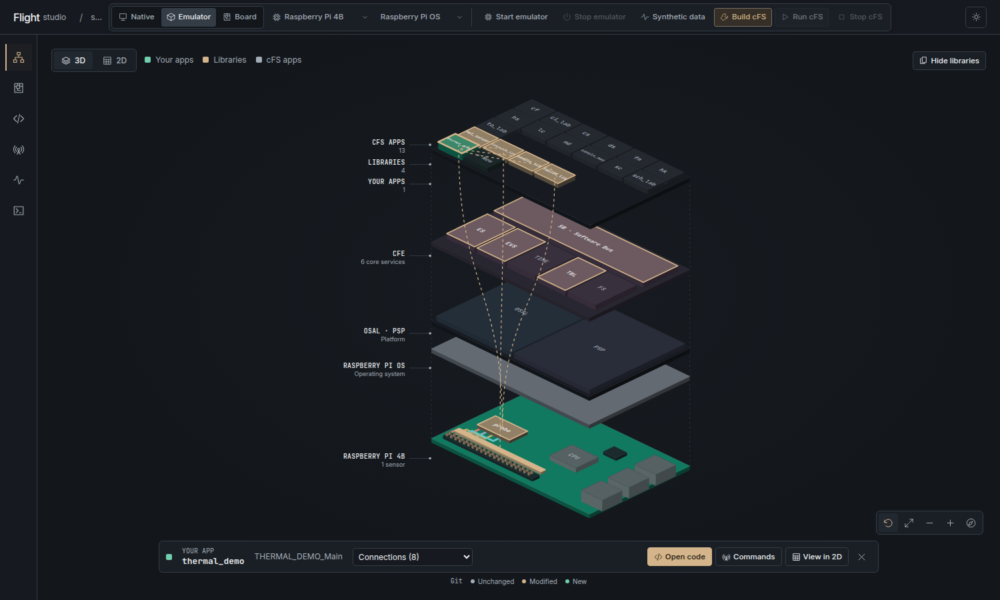
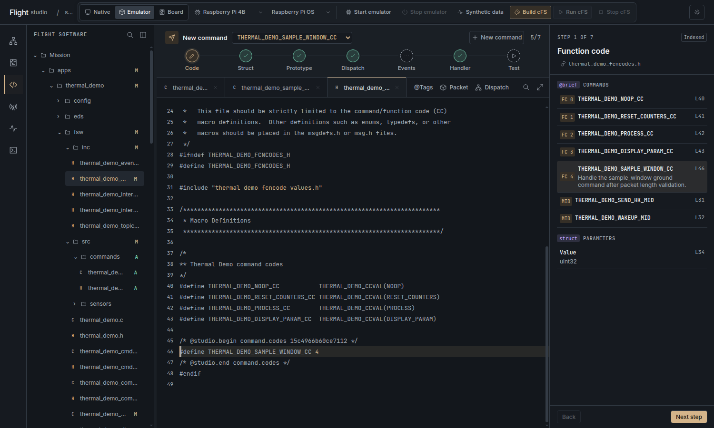

# Interface do Flight Studio

A página inicial em `/` configura o destino e o checkout do cFS. **Open workspace** salva a configuração e abre `/studio` na arquitetura 3D da missão. Para preparar o projeto em um computador novo, siga o [guia de instalação](../README.md).

## Navegação

| Área | O que fazer |
| --- | --- |
| **Architecture** | Alternar entre a pilha 3D e o mapa 2D. Abrir apps, bibliotecas, serviços cFE, OSAL e PSP. |
| **Hardware** | Examinar o computador no modo Native ou a placa nos modos Emulator e Board. Em **2D → Pinout**, consultar a numeração física do conector e os nomes GPIO. |
| **Code** | Navegar na árvore, abrir declarações e editar os arquivos da missão. As marcas **A** e **M** indicam arquivos adicionados e modificados no Git. |
| **Ground station** | Montar um comando do catálogo, enviar ao cFS e observar a telemetria e os eventos. [Operação da estação](../ground_station/README.md) |
| **Ground station → System overview** | Escolher Commands ou Telemetry e abrir os registros da app durante a conexão atual. |
| **Synthetic data** | Selecionar um dispositivo, configurar seus sinais no painel lateral, testar localmente e acompanhar a sessão. [Dados sintéticos](../sensors/README.md) |
| **Terminal** | Acompanhar builds, jobs e shells locais no painel inferior. |

## Editar a missão

Na arquitetura 3D, arraste para girar e use a roda do mouse para aproximar. Selecione um módulo para destacar suas dependências e abrir o código ou seus comandos pela barra inferior. Ao selecionar um sensor, aparecem as conexões configuradas no hardware. Os nomes das camadas levam aos respectivos grupos no mapa 2D. Os controles **New**, **Edit** e a lixeira ficam no cabeçalho de cada grupo. A opção de bibliotecas mostra ou oculta esse grupo. **Build cFS** fica na barra superior. O aviso de recompilação aparece quando um build anterior ficou desatualizado.

- Em **Your apps → New**, escolha o nome e confira o ponto de entrada, a prioridade, a pilha e as frequências de wakeup e housekeeping antes de salvar. Em **Libraries → New**, a biblioteca de missão parte de `sample_lib`.
- No grupo de apps NASA, **New** permite incluir um módulo disponível no checkout. Os módulos necessários ao agendamento ou à comunicação têm restrições de remoção.
- **Edit** abre as operações permitidas para o módulo selecionado. A renomeação de um módulo próprio atualiza os nomes usados no build, no startup e nas referências da missão. Apps próprias também permitem alterar a configuração de execução.
- **Remove** retira o módulo da compilação e do startup da CPU1. Os fontes continuam disponíveis para uma futura inclusão. As dependências que ainda utilizam uma biblioteca aparecem antes da remoção.

Clique em um bloco para abrir seus detalhes em uma aba. A aba da arquitetura retorna ao mapa completo. Em uma app, a navegação percorre inicialização, despacho por MID e código de comando, handlers, tabelas e telemetria. Nas bibliotecas, **Used by** mostra os consumidores e **Public API** lista os símbolos. Um clique numa função ou chamada abre o editor na linha correspondente, com a árvore de arquivos ao lado.

## Ler e editar código

O checkout `cFS/` fica disponível para consulta. Os arquivos editáveis da missão ficam em `mission/`. O painel do editor apresenta **Tags**, **Packet** e **Dispatch**. As anotações `@brief`, `@unit`, `@range` e `@check` levam ao comentário correspondente. Para acrescentar um leitor ou implementar seu comando, consulte o [guia dos templates de app](../project/appgen/README.md).

| Atalho | Ação |
| --- | --- |
| Ctrl+S | Salvar o arquivo ativo |
| Ctrl+F | Buscar no editor |
| Ctrl+P | Buscar arquivo |
| Ctrl+B | Alternar o explorador |
| Ctrl+` | Alternar o terminal |

Arraste os divisores para redimensionar os painéis. O terminal mantém o histórico de cada operação. Fechar uma aba de acompanhamento encerra a visualização de logs e permite continuar usando o serviço que os produz.

## Implementação

O servidor escuta no loopback e entrega o JavaScript e as fontes do próprio repositório. O navegador usa o token de `/api/session` ao gravar. Salvamentos usam hashes do arquivo, da missão ou do rascunho para detectar edições concorrentes. [API e regras de extensão](../docs/backend.md) · [Sistema visual](../docs/design.md)

O índice de fontes analisa assinaturas, inscrições no Software Bus e comparações que associam um MID a um handler. A interface apresenta os casos que a análise consegue resolver e a API registra as rotas pendentes. [Índice de código](backend/source_index.py) · [Análise da arquitetura](backend/architecture_details.py)
