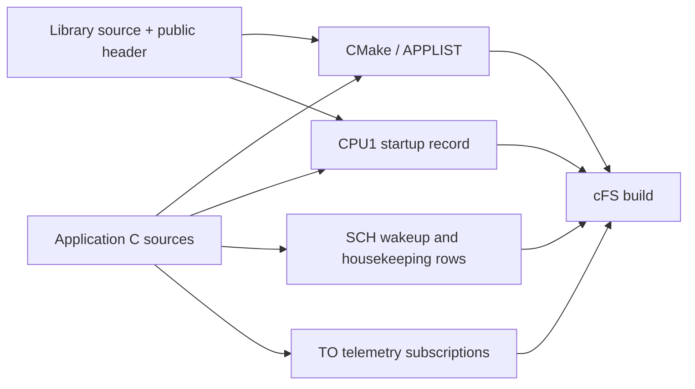
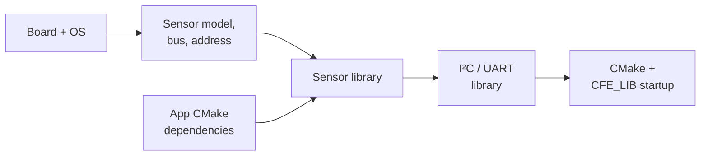

# Project and mission

Applications, libraries and their native cFS configuration live in this checkout.
The web interface and `./start --no-ui app` use the same mission operations. Each
operation prepares all of its files before replacing any, and an operation that fails
partway restores the files it had already replaced.

The diagram shows which native mission files a new app or library adds entries to.



## Unmodified cFS checkout

Opening Flight Studio on an unmodified cFS submodule leaves it unchanged, because the
mission view derives the startup list from the upstream `generate_startup.cmake`.
Mission edits then write `cpu1_cfe_es_startup.scr` and the other files listed under
[Native configuration](#native-configuration), each one when a change first needs it.
The generator itself lives in [`appgen/`](appgen/README.md).

```sh
./start --no-ui profile --board raspi4b --os raspios
./start --no-ui build --target qemu
```

Selecting a board and operating system writes a CMake toolchain file from the build
profile in the board catalog.

## Applications

```sh
./start --no-ui app new attitude_app --priority 60 --stack-size 32768 --wakeup-hz 2 --hk-hz 0.25 --preview
./start --no-ui app new attitude_app --priority 60 --stack-size 32768 --wakeup-hz 2 --hk-hz 0.25
./start --no-ui app edit attitude_app --wakeup-hz 1
./start --no-ui app disable attitude_app
./start --no-ui app enable attitude_app
./start --no-ui app remove attitude_app
./start --no-ui app add attitude_app
./start --no-ui app delete attitude_app
```

`--preview` prints the app's entry point, startup record, CMake statement, schedule
and `_user.c` source without writing anything. `new` writes them and adds the app to
the build and the startup script. `disable` keeps the app in the mission view and
takes it out of startup. `remove` takes the app out of the CPU1 build, the startup
script and the generated schedule while keeping its sources, and `add` brings an
existing app back. `delete` also removes the sources of an app the project created.

Initialization and periodic logic go in `cFS/apps/<name>/fsw/src/<name>_user.c`.
Regenerating an app rewrites its framework files and leaves `<name>_user.c` and
`<name>_user.h` as they are. Libraries follow the layout of `cFS/libs/sample_lib`, with
`fsw/src/`, `fsw/public_inc/` and `CMakeLists.txt`.

```sh
./start --no-ui library new payload_lib --preview
./start --no-ui library new payload_lib
./start --no-ui library list
./start --no-ui library remove payload_lib
./start --no-ui library add payload_lib
./start --no-ui library delete payload_lib
```

The same operations are available in Architecture under Edit, as described in
[Interface](../interface/README.md#editing-the-mission).

## Driver selection

Driver libraries are created from the templates in `project/drivers/` when a
configured device or an app's CMake dependencies need them. Selecting Linux alone adds
no I²C, UART or sensor library. An app can also request a driver with
`add_cfe_app_dependency(app_name library_name)` in its `CMakeLists.txt`. Custom sources
and dependencies go outside the `APPGEN BEGIN` and `APPGEN END` blocks, and
regeneration keeps them.



[`catalog.json`](drivers/catalog.json) names each driver's entry point and the systems
it supports. Dependencies come from the native `CMakeLists.txt` files, and libraries
are loaded before the apps that use them. A generated driver that no device or app
uses anymore leaves the build and the source tree. If its sources were edited, they
stay in `cFS/libs/`. `project/generated/drivers.json` keeps the hash of each generated
file for that check, so the driver directories in cFS hold only their sources.

To support another sensor, add its capability to the board catalog, a native source
template in `project/drivers/<library>/` and an adapter in `project/adapters/<driver>/`.
Library dependencies are declared in the template's `CMakeLists.txt`, and driver
sources follow the layout of `sample_lib`.

## Components

```sh
./start --no-ui project devices
./start --no-ui project add-device "Payload temperature" --id payload_temp --model tmp105 --bus i2c-bus.1 --address 0x49 --value temperature=27000
./start --no-ui project add-sensor attitude_app board_temp --device payload_temp
./start --no-ui project add-command attitude_app set_mode
./start --no-ui project add-telemetry attitude_app temperature --sensor board_temp
./start --no-ui project locate attitude_app
./start --no-ui build
```

`add-command` creates a typed payload and a handler stub. `add-telemetry` creates the
payload and the routine that fills it, and `--sensor` starts it with the sensor's data,
status and validity. `locate` lists the source files and lines of an app's components.
Devices are removed in the Hardware view.

## Native configuration

| File | Contents |
| --- | --- |
| `cFS/sample_defs/targets.cmake` | CPU build lists |
| `cFS/sample_defs/modules.cmake` | CPU1 module additions and removals |
| `cFS/sample_defs/libraries.cmake` | Libraries created by the project, added to the CPU1 build |
| `cFS/sample_defs/cpu1_cfe_es_startup.scr` | Enabled applications and libraries |
| `cFS/sample_defs/generate_startup.cmake` | Installs the startup script above in place of the generated one |
| `cFS/sample_defs/cpu1/install_custom.cmake` | Lets the SCH_LAB and TO_LAB tables include the generated entries |
| `cFS/sample_defs/toolchain-<architecture>.cmake` | CMake toolchain of the selected board and OS |
| `cFS/sample_defs/default_osconfig.cmake` | OSAL loader capacity and name limits the mission needs |
| `cFS/sample_defs/cfe_core_api_interface_cfg_values.h` | Matching cFE command and telemetry name fields |
| `cFS/sample_defs/tables/sch_lab_table.c` | Periodic command schedule |
| `cFS/sample_defs/tables/to_lab_sub.c` | Telemetry forwarding subscriptions |
| `cFS/sample_defs/generated/` | Generated application integration fragments |
| `project/config.json` | Selected board and OS, devices and app-to-device bindings |
| `project/apps/<app>.json` | Flight Studio settings and components of each app |
| `project/drivers/catalog.json` | Available driver templates and supported systems |
| `project/adapters/<driver>/` | Sensor payload type and native read adapter templates |
| `project/boards/<board>.json` | Supported OSs, buses, sensor models, defaults and driver capabilities |

The board catalog describes the hardware a board supports, and `config.json` selects
devices from it, each with its own ID, bus, address and initial values. An app binding
associates one of the app's sensors with one device ID. Build lists and enabled apps
stay in the native CMake and startup files.

```sh
./start --no-ui project sync
./start --no-ui project check
./start --no-ui project list
```

`sync` writes the generated files that differ from the project settings, `check`
lists them without writing and exits with status 1 when there are any, and `list`
prints the project configuration and the app settings. Build and Run apply source and
mission changes. A change of devices, buses or addresses also needs Stop QEMU and a new
boot, while changes to synthetic data need no build.
