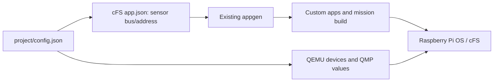

# Project configuration

`project/config.json` owns hardware and custom-app bindings. Each
`cFS/apps/<app>/app.json` owns message IDs, command codes, periods and components.
The existing appgen generates source, CMake, startup, scheduler and TO_LAB entries.



Inspect the project from the repository root:

```sh
./scripts/project.sh devices
./scripts/project.sh list
./scripts/project.sh check
./scripts/project.sh locate thermal_app
```

`devices` lists supported models, properties and drivers. `check` is read-only;
`locate` gives current editing paths and lines. Only registered appgen apps are
editable. Stock apps, cFE, OSAL, PSP, libraries and tools are protected, including
fake stock-app manifests. Invalid references, collisions and symlinks are rejected.

Create an app, physical TMP105, reader, command and sensor telemetry packet:

```sh
./scripts/project.sh add-app attitude_app
./scripts/project.sh add-device "Payload temperature" --id payload_temp --model tmp105 --bus i2c-bus.1 --address 0x49 --value temperature=27000
./scripts/project.sh add-sensor attitude_app board_temp --device payload_temp
./scripts/project.sh add-command attitude_app set_mode
./scripts/project.sh add-telemetry attitude_app temperature --sensor board_temp
./scripts/project.sh locate attitude_app
```

Implement the command's `.h` payload and `.c` handler; it initially returns
`CFE_STATUS_NOT_IMPLEMENTED`. Sensor telemetry copies `GetData()`, including status
and validity. Omit `--sensor` for a custom packet whose payload/fill you implement.
Generated user files are preserved; existing telemetry rebinding never overwrites
them. Bindings record the initial association, not subsequent user-code changes.

```sh
./scripts/build-cfs.sh
./stop.sh
./boot.sh
./run.sh
```

Build automatically synchronizes manifests and records a configuration stamp.
Hardware topology changes need an emulator restart; app code or sensor bus/address
changes need a rebuild. Live values and labels need neither rebuild nor new stamp.
The stamp checks configuration, not C source changes. Run one mutation at a time.

The supported bus maps to `/dev/i2c-1`; addresses must be unique in `0x08..0x77`.
TMP105 temperatures use millidegrees Celsius. `lsm303dlhc_mag` supports QEMU
simulation with `mag-x/y/z` in thousandths of a microtesla, but has no cFS driver.
Actuator models and command actuator bindings are not available.

Use `./scripts/project.sh simulate [device_id ...]` to run the editable Python
models in `sensors/`. Device `values` provide their centers/axis offsets; the
waveforms and periods live in Python. See [simulation configuration](../README.md#python-sensor-simulation).
Stopping the simulator preserves the last sample; `./scripts/project.sh values`
restores the configured static values.

Tests use temporary copies: `PYTHONDONTWRITEBYTECODE=1 python3 -m unittest discover -s project/tests -v`.
