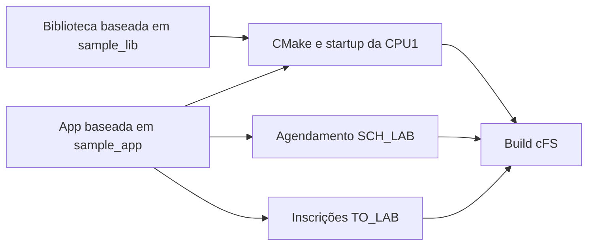

# Projeto e missão

A NASA fornece o framework, as apps padrão e os exemplos em um checkout independente, `cFS/`. A configuração distribuída começa sem apps próprias nem sensores vinculados. As adições feitas pela pessoa ficam fisicamente em `cFS/apps/` e `cFS/libs/`, sobre o clone oficial. Os scripts, templates e as escolhas do projeto ficam fora desse clone, em `project/`. Para baixar o upstream e abrir o primeiro workspace, siga o [guia inicial](../README.md).

Ao preparar uma missão nova, o Studio cria os aliases `mission/apps → ../cFS/apps` e `mission/libs → ../cFS/libs`. As definições ficam separadas, em `mission/sample_defs/`, inicializadas a partir dos arquivos oficiais de `cFS/sample_defs/`. O build recebe essas definições em `MISSION_DEFS`, resolve os módulos usando `CFS_APP_PATH` e grava seus resultados em `mission/build-native/` ou `mission/build-flight/`. Missões existentes preservam seus fontes e suas definições locais.

O Git do Studio ignora o checkout `cFS/`, a árvore local `mission/`, os manifestos de apps em `project/apps/` e os artefatos em `project/generated/`. Esses arquivos pertencem ao workspace local; as regras de ignore não os apagam. Os fontes completos em `interface/tests/fixtures/bancada/` são dados de testes isolados, não módulos instalados na configuração inicial.



## Aplicações e bibliotecas

Na arquitetura 2D, **New** cria ou inclui um módulo no grupo selecionado. Para uma app própria, o rascunho mostra ponto de entrada, prioridade, pilha, frequência de wakeup e frequência de housekeeping. Salvar aplica as definições ao build e ao startup. Os quatro comandos padrão da cópia de `sample_app` continuam disponíveis. [Navegação e ações no workspace](../interface/README.md#editar-a-missão)

```sh
./start --no-ui app new attitude_app --priority 60 --stack-size 32768 --wakeup-hz 2 --hk-hz 0.25 --preview
./start --no-ui app new attitude_app --priority 60 --stack-size 32768 --wakeup-hz 2 --hk-hz 0.25
./start --no-ui app edit attitude_app --wakeup-hz 1
./start --no-ui library new payload_lib --preview
./start --no-ui library new payload_lib
```

| Operação | Efeito |
| --- | --- |
| **Edit → Rename module** | Renomeia um módulo próprio e atualiza arquivos, símbolos, referências, CMake e startup. Os identificadores dos módulos oficiais permanecem os da NASA. |
| `app disable` / `app enable` | Controla a inicialização da app incluída no build. |
| `app remove` / `library remove` | Retira o módulo da missão e preserva os fontes para uma inclusão futura. |
| `app add` / `library add` | Inclui um módulo existente e suas dependências. |
| `app delete` / `library delete` | Exclui os fontes de um módulo próprio após as verificações do backend. |
| `app list` / `library list` | Mostra a seleção de apps ou as bibliotecas disponíveis. |

Essas operações de CLI recebem o prefixo `./start --no-ui`. Por exemplo, `./start --no-ui app remove attitude_app` retira a app da missão e `./start --no-ui app add attitude_app` volta a incluí-la. A CLI e o navegador usam a mesma implementação. Uma falha de gravação restaura os arquivos da transação.

As apps de missão mantêm handlers, payloads e lógica periódica editáveis. O gerador usa marcadores nos trechos de integração do `sample_app` para preservar a implementação manual nas sincronizações seguintes. A biblioteca gerada a partir de `sample_lib` oferece as pastas `fsw/src/` e `fsw/public_inc/`. [Templates e pontos de edição](appgen/README.md)

## Vincular um sensor e enviar telemetria

O perfil Raspberry Pi disponibiliza o barramento I²C. O exemplo abaixo utiliza `attitude_app`, criada acima, e um TMP105 no endereço 0x49. Em uma placa física, escolha o endereço de sete bits do seu dispositivo.

```sh
./start --no-ui profile --board raspi4b --os raspios
./start --no-ui project add-bus i2c-bus.1
./start --no-ui project add-device "Payload temperature" --id payload_temp --model tmp105 --bus i2c-bus.1 --address 0x49 --value temperature=27000
./start --no-ui project add-sensor attitude_app board_temp --device payload_temp
./start --no-ui project add-command attitude_app set_mode
./start --no-ui project add-telemetry attitude_app temperature --sensor board_temp
./start --no-ui project locate attitude_app
```

Em **Hardware**, selecione **Add bus**, escolha o conector da placa e use **Add sensor** para definir modelo e endereço. Ao clicar no sensor, **Link HAL** permite escolher uma app de missão ou criar uma a partir de `sample_app`. O código C do leitor fica acessível no vínculo. Na CLI, `link-hal science temperature --device payload_temp --new-app` cria a app e o leitor na mesma operação. Para usar uma app existente, omita `--new-app`.

`add-device` cria uma instância com ID, barramento e endereço. `add-sensor` vincula um leitor daquela app à instância. `add-command` cria a estrutura da mensagem e um handler para implementar. `add-telemetry --sensor` prepara o pacote com dados, status e validade do leitor. `locate` informa o caminho e a linha de cada ponto editável. A remoção de um leitor e a remoção do dispositivo físico são operações distintas.

A biblioteca do chip usa `hal_sensor`. O leitor associa o dispositivo ao transporte informado pela placa. Leitores vinculados e dependências CMake determinam quais bibliotecas entram no build e em que ordem o cFE as carrega. Para um chip novo, registre uma definição em **Hardware** ou use `./start --no-ui project register-model <arquivo>`. [Modelos, barramentos e HAL](drivers/README.md)

Para solicitar uma amostra também por comando, preencha **Read command** ao vincular o HAL ou use a opção equivalente no terminal.

```sh
./start --no-ui project link-hal hal_payload temp --device payload_temp --new-app --read-command read_now
```

O comando gerado recebe apenas o cabeçalho, chama o mesmo leitor da aquisição periódica e publica a telemetria com valor, status e validade. O código do comando é alocado entre os códigos livres da aplicação. O contador de comandos registra o resultado do leitor. Para retirar esse vínculo e manter a aplicação, remova seus componentes na ordem de dependência.

```sh
./start --no-ui project remove-command hal_payload read_now
./start --no-ui project remove-sensor hal_payload temp
```

As bibliotecas de missão criadas com `library new` incluem pontos `@studio.edit library.init` e `@studio.edit library.function` no código copiado de `sample_lib` quando essas funções estão presentes. O vínculo com um sensor I²C materializa e inclui automaticamente a biblioteca de transporte `linux_i2c_lib`, reutilizada pelos leitores do barramento.

## Mapa dos arquivos

| Arquivo | Responsabilidade |
| --- | --- |
| `project/config.json` | Placa e SO selecionados, dispositivos e vínculos com módulos de missão |
| `project/apps/<app>.json` | MIDs, desempenho, agendamento, comandos, leitores e telemetria da app |
| `project/boards/<placa>.json` | Perfil de build, sistemas, barramentos e catálogo da placa |
| `project/drivers/models/<id>/model.json` | Identidade, registradores, conversões, canais e ABI do sensor |
| `project/drivers/catalog.json` | HAL e transportes compartilhados |
| `project/generated/drivers.json` | Assinaturas dos arquivos materializados para preservar edições locais |
| `cFS/apps/`, `cFS/libs/` | Fontes oficiais e módulos adicionados pela pessoa no clone local |
| `mission/apps`, `mission/libs` | Aliases para `../cFS/apps` e `../cFS/libs` em missões novas |
| `mission/modules.cmake`, `mission/libraries.cmake` | Seleção própria de módulos da CPU1 e bibliotecas da missão |
| `mission/cpu1_cfe_es_startup.scr` | Módulos ativos e receitas arquivadas de inicialização |
| `mission/sample_defs/targets.cmake` | Listas de módulos por CPU |
| `mission/sample_defs/toolchain-<arquitetura>.cmake` | Toolchain para o perfil ativo |
| `mission/sample_defs/default_osconfig.cmake`, `cfe_core_api_interface_cfg_values.h` na mesma pasta | Limites do carregador, nomes de módulos e campos correspondentes no cFE |
| `mission/sample_defs/generate_startup.cmake`, `cpu1/install_custom.cmake` sob `sample_defs/` | Instalação do startup e das tabelas da missão |
| `mission/sample_defs/tables/`, `mission/sample_defs/generated/` | Tabelas de SCH_LAB/TO_LAB e fragmentos de integração gerados |
| `mission/build-native/`, `mission/build-flight/` | Artefatos locais de compilação, fora do clone oficial |

## Conferir e compilar

```sh
./start --no-ui project list
./start --no-ui project check
./start --no-ui project sync
./start --no-ui build --target qemu
```

`check` informa diferenças e retorna código 1 se houver alterações geradas pendentes. `sync` aplica essas alterações. Depois de modificar fontes ou membros da missão, compile e execute a nova versão no destino desejado. Para alterar dispositivos, endereços ou barramentos emulados, reinicie o QEMU para carregar a topologia. Os ajustes de sinal sintético podem ser aplicados na sessão de dados. [Execução por destino](../hardware/README.md)

[Auditoria da origem NASA, caminhos locais e geradores](../docs/cfs-wrapper.md) (23/11/2026).
