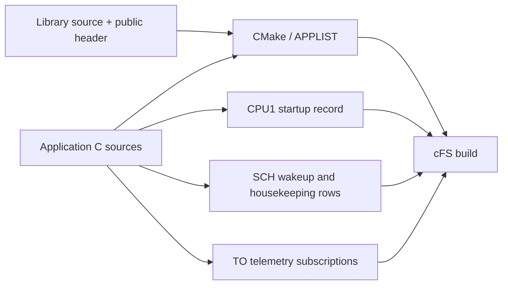
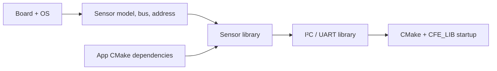

# Project and mission

Applications, libraries and their native cFS configuration live in this checkout.
The web interface and `./start --no-ui app` use the same atomic mission operations.



## Fresh cFS checkout

Without a board, the official cFS mission builds natively. Opening Studio reads
the upstream startup generator without changing the checkout. The first mission
edit creates the CPU1 startup override and the required native integration files.
The generator itself lives in `project/appgen/`.

```sh
./start --no-ui profile --board raspi4b --os raspios
./start --no-ui build --target qemu
```

The board catalog's build profile supplies architecture and CMake toolchain
settings. Driver libraries are created only when devices or app dependencies
require them.

## Applications

```sh
./start --no-ui app new attitude_app --priority 60 --stack-size 32768 --wakeup-hz 2 --hk-hz 0.25 --preview
./start --no-ui app new attitude_app --priority 60 --stack-size 32768 --wakeup-hz 2 --hk-hz 0.25
./start --no-ui app edit attitude_app --wakeup-hz 1
./start --no-ui app disable attitude_app
./start --no-ui app enable attitude_app
./start --no-ui app remove attitude_app
./start --no-ui app add attitude_app
./start --no-ui app delete attitude_app
```

`--preview` shows the source, CMake, startup and scheduler plan without writing.
**New** saves that plan and includes the app in the build and startup. **Disable**
keeps its mission block while excluding it from startup. **Remove** preserves
source files while removing it from the CPU1 build, startup and generated schedule;
**Add** includes the existing app again. **Delete** also removes a project-created
app's source files.

Edit `cFS/apps/<name>/fsw/src/<name>_user.c` for initialization and periodic logic.
App templates preserve user-owned files when regenerating framework code.
Libraries follow the `cFS/libs/sample_lib` layout: `fsw/src/`, `fsw/public_inc/`
and `CMakeLists.txt`.

```sh
./start --no-ui library new payload_lib --preview
./start --no-ui library new payload_lib
./start --no-ui library list
./start --no-ui library remove payload_lib
./start --no-ui library add payload_lib
./start --no-ui library delete payload_lib
```

In Architecture, enter **Edit** and use the block's **−** control to remove it.
Libraries must be detached from their consumers before removal.

## Driver selection

Drivers are provisioned from `project/drivers/` when required by configured
devices or native module dependencies. Selecting Linux alone adds no I²C, UART
or sensor library. An app can also request a driver with
`add_cfe_app_dependency(app_name library_name)` in its `CMakeLists.txt`.
Keep custom sources and dependencies outside the marked `APPGEN` blocks;
regeneration preserves these native edits.



The catalog declares each driver's entry point and supported OS families.
Dependencies come from the native `CMakeLists.txt`; libraries load before their
consumers. Removing the last consumer removes unused generated drivers from
the build and source tree. Locally edited driver sources are preserved.

To support another sensor, add its board capability, native source template in
`project/drivers/<library>/` and adapter in `project/adapters/<driver>/`. Declare
library dependencies in the template's `CMakeLists.txt`. Driver sources follow
`sample_lib`; no generator metadata is written inside cFS.

## Components

```sh
./start --no-ui project devices
./start --no-ui project add-device "Payload temperature" --id payload_temp --model tmp105 --bus i2c-bus.1 --address 0x49 --value temperature=27000
./start --no-ui project add-sensor attitude_app board_temp --device payload_temp
./start --no-ui project add-command attitude_app set_mode
./start --no-ui project add-telemetry attitude_app temperature --sensor board_temp
./start --no-ui project locate attitude_app
./start --no-ui build
```

Command generation creates a typed payload and handler stub. Telemetry generation
creates its payload and fill routine; `--sensor` starts with the sensor's data,
status and validity. `locate` reports the relevant source paths and lines.

## Native configuration

| Source | Purpose |
| --- | --- |
| `cFS/sample_defs/targets.cmake` | CPU build lists |
| `cFS/sample_defs/modules.cmake` | CPU1 module additions and removals |
| `cFS/sample_defs/libraries.cmake` | Project-created library roots |
| `cFS/sample_defs/cpu1_cfe_es_startup.scr` | Enabled applications and libraries |
| `cFS/sample_defs/default_osconfig.cmake` | OSAL loader capacity and name limits required by the mission |
| `cFS/sample_defs/cfe_core_api_interface_cfg_values.h` | Corresponding cFE command/telemetry name fields |
| `cFS/sample_defs/tables/sch_lab_table.c` | Periodic command schedule |
| `cFS/sample_defs/tables/to_lab_sub.c` | Telemetry forwarding subscriptions |
| `cFS/sample_defs/generated/` | Generated application integration fragments |
| `project/config.json` | Selected board/OS, instantiated devices and app-to-device bindings |
| `project/apps/<app>.json` | Studio app settings and component registration |
| `project/drivers/catalog.json` | Available driver templates and supported systems |
| `project/adapters/<driver>/` | Sensor payload type and native read adapter templates |
| `project/boards/<board>.json` | Supported OSs, buses, sensor models, defaults and driver capabilities |

The board catalog describes available hardware. `config.json` selects instances
from that catalog: each device has its own ID, bus, address and initial values.
App bindings associate a source sensor with one device ID. Build lists and enabled
apps remain in native CMake/startup files.

```sh
./start --no-ui project sync
./start --no-ui project check
./start --no-ui project list
```

Build and Run apply source and mission changes. Device topology changes also
require emulator shutdown and boot. Sensor waveform changes do not require a build.
