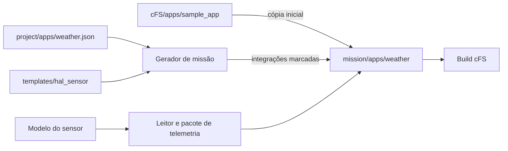

# Apps de missão e templates HAL

Ao criar uma app no Studio, o gerador lê a versão de `sample_app` baixada na configuração inicial. A cópia em `mission/apps/<nome>/` recebe o nome da missão e conserva o loop de execução, os comandos padrão, as tabelas e a licença da NASA. Uma biblioteca criada pela pessoa parte de `sample_lib` e fica em `mission/libs/<nome>/`.



## Onde editar

| O que você quer mudar | Onde fica |
| --- | --- |
| A lógica executada a cada wakeup | `fsw/src/<app>_user.c` |
| O comportamento de um comando de missão | `fsw/src/commands/<app>_<nome>_cmd.c` |
| Os campos que esse comando recebe | `fsw/src/commands/<app>_<nome>_cmd.h` |
| A transformação ou o envio de uma leitura | `fsw/src/sensors/<app>_<nome>_sensor.c` |
| A configuração compartilhada por dispositivos do mesmo modelo | `project/drivers/models/<modelo>/model.json` |
| O endereço de um dispositivo ligado à placa | Dispositivo no hardware da missão, em `project/config.json` |
| O período, os MIDs e as associações de componentes | `project/apps/<app>.json` e `project/config.json` |

Os caminhos `fsw/` da tabela são relativos à app em `mission/apps/`. O navegador de código e o comando abaixo localizam os componentes de uma app.

```sh
python3 project/manage.py locate weather
```

O comando procura marcadores como `/* @studio.edit sensor.probe.read */` nos arquivos de voo atuais. Ele retorna o caminho e a linha onde editar. Implementações de EDS e stubs de testes têm árvores próprias. As apps geradas usam o perfil de compilação sem EDS.

## O que acontece ao adicionar um sensor

1. A missão associa um dispositivo físico a uma app e aloca um MID de telemetria para o leitor.
2. Na cópia de `sample_app`, o gerador localiza a inicialização e o despacho pelo símbolo C. Os fragmentos [subscribe.c.in](templates/hal_sensor/subscribe.c.in) e [wakeup.c.in](templates/hal_sensor/wakeup.c.in) ligam a execução periódica do leitor ao Software Bus.
3. Os [templates do leitor](templates/hal_sensor/) definem o estado, o pacote e os pontos editáveis para aquela instância. No [template de vínculo I²C](templates/hal_sensor/i2c_binding.c.in), os marcadores `@studio.fragment` identificam os includes, o estado, a inicialização e a leitura pelo nome. Dois dispositivos iguais recebem contextos, endereços e pacotes independentes.
4. O build utiliza a lista de fontes, dependências, startup, agendamento e subscrições em `mission/`. O modelo do chip e a interface do barramento são descritos no [guia do HAL](../drivers/README.md).

## Como a sincronização preserva o código

Em uma app nova, o gerador insere pares de comentários `@studio.begin` e `@studio.end` na cópia de missão. Cada par tem um identificador local, como `dispatch.commands`, e uma assinatura do último conteúdo gerado. Nas próximas sincronizações, o gerador procura essas regiões no arquivo atual. Um include manual, uma função extra ou um comentário fora da região acompanha a próxima compilação. Os handlers e os payloads criados para a pessoa editar são escritos uma vez.

Uma edição dentro de uma região gerada, ou um marcador duplicado ou ausente, interrompe a operação e identifica o arquivo e a região. A pessoa pode mover a lógica própria para um hook ou para fora do trecho e repetir a operação. Para adotar uma app antiga baseada em `sample_app`, o gerador reconstrói o conteúdo anterior das configurações salvas e faz uma mesclagem de três vias. Um conflito interrompe o plano antes da gravação. Apps anteriores com `schema_version: 1` conservam seus templates e o despacho originais.

O CMake mantém seções `APPGEN BEGIN/END` para fontes e dependências. Os arquivos em `mission/sample_defs/generated/` são derivados por inteiro das configurações da missão.

## Anotações na navegação de código

O painel de código lê as anotações diretamente dos comentários C. Clique em uma anotação para ir à linha correspondente. Os exemplos abaixo mostram como documentar um campo e uma regra do handler.

```c
/** @brief Altera a frequência de aquisição. */
uint16 Rate_Hz; /**< @unit Hz @range 1..50 */

/** @check Frequências acima de 50 Hz excedem o período de aquisição. */
if (Rate_Hz < 1 || Rate_Hz > 50)
{
    return CFE_SB_BAD_ARGUMENT;
}
```

`@unit` e `@range` documentam a interface. A validação em tempo de voo é implementada no handler. As anotações também aceitam a grafia Doxygen com barra invertida.

## Conferir a missão antes de compilar

```sh
python3 project/manage.py check
python3 project/manage.py sync
```

`check` lista alterações pendentes e `sync` aplica o plano. A validação detecta colisões entre IDs e confere as capacidades do SCH e do TO que consegue resolver na configuração ativa. Nas apps derivadas de `sample_app`, os quatro códigos de comando originais são reservados. Os comandos da missão recebem códigos a partir de 4. Os intervalos automáticos são `0x1A00..0x1AFF` para MIDs de comando, `0x0A00..0x0AFF` para MIDs de telemetria e `100..127` para IDs de desempenho.

O [fluxo de configuração do projeto](../README.md) descreve as operações de criação, associação e compilação de uma missão.
