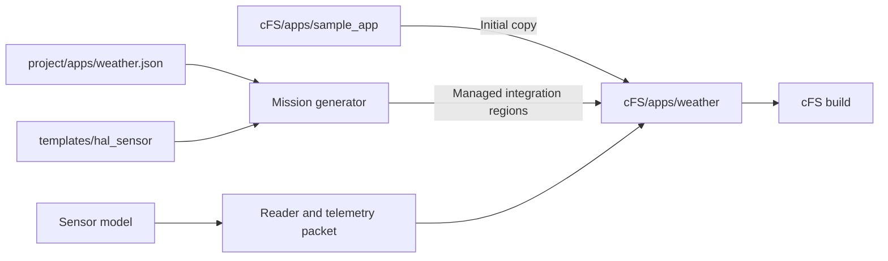

# Mission apps and HAL templates

App creation reads the official `sample_app` installed during source setup. The copy receives the chosen module name while retaining NASA's execution loop, standard commands, tables and license. User libraries are copied separately from `sample_lib`. In new missions, sources live in `cFS/apps/<name>/` and `cFS/libs/<name>/`, with aliases under `mission/`.



## Edit locations

| Change | Location |
| --- | --- |
| Logic executed on each wakeup | `fsw/src/<app>_user.c` |
| Mission command behavior | `fsw/src/commands/<app>_<name>_cmd.c` |
| Command input fields | `fsw/src/commands/<app>_<name>_cmd.h` |
| Transforming or publishing a sample | `fsw/src/sensors/<app>_<name>_sensor.c` |
| Shared model configuration | `project/drivers/models/<model>/model.json` |
| Device address | Hardware instance in `project/config.json` |
| Period, MIDs and component links | `project/apps/<app>.json` and `project/config.json` |

`fsw/` paths are relative to the app directory. Locate current edit points from the repository root:

```sh
./start --no-ui project locate weather
```

This searches current sources for markers such as `/* @studio.edit sensor.probe.read */` and returns their paths and lines. EDS implementations and unit-test stubs have separate trees. Generated apps use the non-EDS build profile.

## Adding a sensor

1. The mission links a device instance to an app and allocates a telemetry MID for its reader.
2. The generator finds initialization and dispatch by C symbol in the copied `sample_app`. [subscribe.c.in](templates/hal_sensor/subscribe.c.in) and [wakeup.c.in](templates/hal_sensor/wakeup.c.in) connect the periodic reader to the Software Bus.
3. [Reader templates](templates/hal_sensor/) define instance state, packets and edit points. Named `@studio.fragment` regions in [i2c_binding.c.in](templates/hal_sensor/i2c_binding.c.in) identify includes, state, initialization and acquisition. Two devices of the same model have independent contexts, addresses and packets.
4. The build consumes mission source lists, dependencies, startup, scheduling and subscriptions. See the [HAL guide](../drivers/README.md) for chip models and bus interfaces.

## Preserving manual code

New apps receive paired `@studio.begin` and `@studio.end` comments. Each region has a local identifier, such as `dispatch.commands`, and a signature of its last generated content. Later synchronization locates these regions in the current source. Manual includes, functions and comments outside them survive. Editable handlers and payloads are created only once.

An edit inside a generated region, or a missing or duplicated marker, stops the operation and identifies the affected file and region. Move custom logic into a hook or outside that region before retrying. Adopting an older `sample_app` copy reconstructs its previous configuration and uses a three-way merge; conflicts stop the plan before writing. Apps with `schema_version: 1` retain their legacy templates and dispatch.

CMake keeps `APPGEN BEGIN/END` sections for sources and dependencies. Files under `mission/sample_defs/generated/` are fully derived from mission configuration.

## Source annotations

C comments can document fields and handler constraints:

```c
/** @brief Change the acquisition frequency. */
uint16 Rate_Hz; /**< @unit Hz @range 1..50 */

/** @check Frequencies above 50 Hz exceed the acquisition period. */
if (Rate_Hz < 1 || Rate_Hz > 50)
{
    return CFE_SB_BAD_ARGUMENT;
}
```

`@unit` and `@range` describe the interface; flight-time validation must be implemented in the handler. Doxygen's backslash spelling is also supported.

## Checking before building

```sh
./start --no-ui project check
./start --no-ui project sync
```

`check` reports pending changes and `sync` applies them. Validation detects ID collisions and checks SCH/TO capacities that can be resolved in the active configuration. The four original `sample_app` command codes are reserved, so generated mission commands start at 4. Automatic allocation uses command MIDs `0x1A00..0x1AFF`, telemetry MIDs `0x0A00..0x0AFF` and performance IDs `100..127`.

The [project guide](../README.md) covers creation, linking and build operations.
