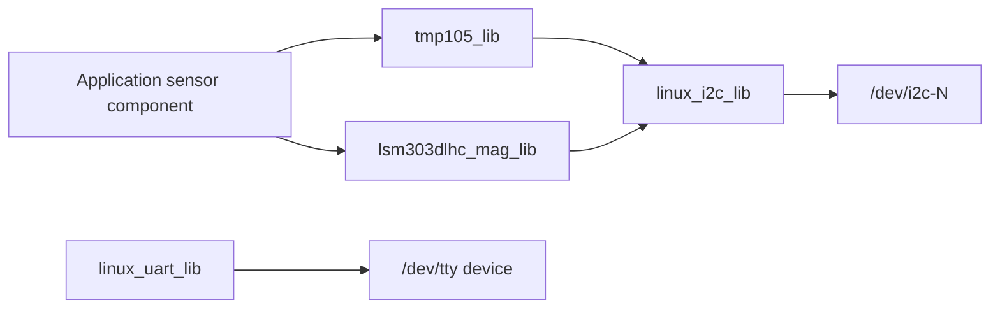

# cFS application generator

This internal generator writes the C sources of CPU1 applications and of libraries
with the `sample_lib` layout. Application drafts, mission membership and device
bindings go through the [project workflow](../README.md).

## Source ownership

| Files under `apps/<app>/` | Owner |
| --- | --- |
| `fsw/src/<app>_user.c/.h` | User initialization and periodic logic |
| `fsw/src/sensors/`, `commands/`, `telemetry/` implementations | User sampling, handlers and payloads |
| Main loop, dispatch, standard commands and component registration | Generator |
| Sensor `*_cfg.h`, `config/default_*.h`, CMake integration | Generator |

Generator settings live in `project/apps/<app>.json`, outside the cFS source tree.

User files are created once and preserved during regeneration. Packet layouts
are defined in C headers. `sample_defs/generated/` contains the generated CMake,
startup, scheduler and telemetry-subscription fragments consumed by the native
mission files.

## Sensor libraries



Sensors with the `tmp105` and `lsm303dlhc_mag` drivers use the shared device
libraries above, and a `custom` sensor gets an implementation stub instead. The app's
sensor components sample the device and publish its telemetry. Library sources and
public headers follow `libs/sample_lib/fsw/src/` and `fsw/public_inc/`.

## Generator commands

The commands below run from the repository root.

```sh
python3 project/appgen/appgen.py list
python3 project/appgen/appgen.py locate attitude_app
python3 project/appgen/appgen.py sync --check
python3 project/appgen/appgen.py sync
```

`sync --check` reports pending generated changes without writing. `locate`
returns current source paths and lines from `APPGEN: USER` markers.

Generated apps include NOOP, RESET_COUNTERS, housekeeping and periodic wakeup
handling. Custom commands receive CCs from 2 onward. Command MIDs use
`0x1A00..0x1AFF`, telemetry MIDs `0x0A00..0x0AFF`, and performance IDs `100..127`.
Validation rejects collisions and checks the SCH and TO table capacities it can read
from the selected mission sources. Capacities it cannot read are checked by the
native build.

`appgen.py` owns validation and file plans, `render.py` renders templates, and
`mission_capacity.py` checks table usage. The Flight Studio backend applies those
plans together with the native mission changes in one transaction.
