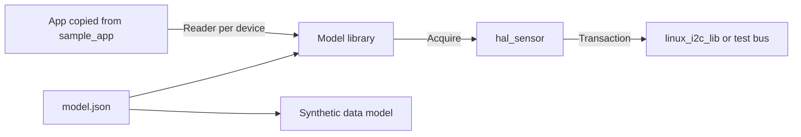

# Flight sensor drivers

A cFS app holds a device instance for each linked sensor and publishes telemetry. Each model describes its protocol and channels in `models/<id>/model.json`. `hal_sensor` configures the device, acquires a complete sample and returns a status. The app binds the device to a bus: `linux_i2c_lib` performs Linux transactions on the Pi, while tests can supply a memory-backed bus to the same driver.

This directory contains platform definitions, templates and shared sources outside the NASA checkout. A new project has no installed HAL apps or linked sensors. Linking a sensor or including a dependency materializes the required modules in `cFS/libs/`; its reader app is in `cFS/apps/`. New missions expose these directories through `mission/libs` and `mission/apps` aliases. Definitions in `mission/sample_defs/` and build outputs remain outside the checkout.

| Location | Responsibility |
| --- | --- |
| `models/<id>/model.json` | Chip identity, initialization writes, output registers, units and sensitivity |
| `models/<id>/driver.c`, optional | Chip-specific operations requiring C code |
| `hal/include/`, `hal/src/` | Common acquisition, configuration and register-access contract |
| `buses/linux_i2c/`, `buses/linux_uart/` | Shared Linux transports |
| `../appgen/templates/hal_sensor/` | Fragments connecting a `sample_app` reader to its model library |
| `project/config.json` or **Hardware → Configure bus and address** | Device instance, bus, address and initial values |
| `sensors/<id>.py` or **Synthetic data** | Channel waveforms in physical units |
| `cFS/libs/<id>_lib/` | Materialized flight library selected by project links and dependencies |



A second device of a known model needs only another hardware instance. A new I²C chip with signed 16-bit outputs can use a register profile. Other protocols can provide C operations. Bus code is shared across models. UART has a separate stream API; the register-model template uses I²C.

## Registering a sensor model

In **Hardware → Connections → Connect sensor → New I²C model**, enter the model ID, decimal seven-bit address, identity register and channels. **Apply** saves the model; return to **Connect sensor** to attach an instance. For an empty project, first select the Raspberry Pi 4B profile and add an I²C bus. An installed sensor's **Model definition** opens its source definition.

The CLI accepts an edited copy of the [example model](templates/model.json):

```sh
cp project/drivers/templates/model.json /tmp/lab_sensor.json
# Edit the ID, identity, configuration and outputs before registering.
./start --no-ui project register-model /tmp/lab_sensor.json
```

Registration saves the model and waveform. For a Raspberry Pi 4B profile with address `0x4a` available, include that address in the model and create an instance:

```sh
./start --no-ui project add-bus i2c-bus.1
./start --no-ui project add-device "Bench temperature" --id bench_temp --model lab_sensor --bus i2c-bus.1 --address 0x4a
./start --no-ui project link-hal bench_app temperature --device bench_temp --new-app
./start --no-ui build --target qemu
```

Using a new device model in QEMU requires rebuilding the emulator image and booting it. The flight library and generated virtual device derive from the same definition. Register checks can run before guest Linux boots:

```sh
./start --no-ui emulator --image flight-studio:local-sensors
./scripts/build.sh
./start --no-ui model-test --target qemu --device bench_temp
```

The interface offers image installation in **Set up emulator** and register checks through **Validate model**. To check acquisition by a cFS app, build and run the mission on the selected target. A physical board uses the flight library and the sensor at the configured address.

## Register-model fields

Register profiles support 1–16 signed 16-bit words, high byte first, in a read of up to 32 bytes. Custom units such as `Pa` are displayed directly. The order of `outputs` defines telemetry field order; each `outputs[].register` identifies that channel on the bus. Preserve names and ordering when existing consumers depend on the packet layout.

| Field | Meaning |
| --- | --- |
| `name`, `address`, `addresses` | Model ID, default seven-bit address and optional allowed-address list |
| `id_register`, `id_value` | Identity checked before the first write; the generated emulator returns the declared byte |
| `controls[]` | Ordered writes of `setup` to `register`; QEMU uses `reset`, `reset_mask` and `sleep_mask` to model chip state |
| `outputs[]` | Channel name, high-byte register, unit, initial value and conversion: `raw × divisor / counts + offset`, using integer division |
| `scales`, `outputs[].scale` | Named conversions shared by channels, such as MPU6050 acceleration or magnetometer horizontal axes |
| `range_register`, `range_shift` | Two-bit range selection multiplying sensitivity by 1, 2, 4 or 8; QEMU applies the inverse conversion |

Native QEMU model definitions can additionally describe multi-byte identities, data-ready bits, reserved bits and gain tables.

| Model | Behavior |
| --- | --- |
| [TMP105](models/tmp105/model.json) | Reads temperature without startup configuration, rejects the four reserved bits and preserves negative values. |
| [LSM303DLHC](models/lsm303dlhc_mag/model.json) | Checks H43 identity and data-ready status, reorders X/Z/Y to X/Y/Z, uses each axis's current gain and detects saturation. |
| [MPU6050](models/mpu6050/model.json) | Checks identity, wakes the chip and reads seven outputs in one 14-byte transaction; acceleration and gyroscope ranges are independent. |

## Acquisition frequency

Bus and address identify an instance; its register map describes the chip. Output definitions determine sample channels and telemetry units. Startup configuration can select range or operating mode. A chip requiring conversion or calibration delays can implement them in a custom driver.

Set the app reader rate with **Edit app** or `./start --no-ui app edit <app> --wakeup-hz <Hz>`. Its period must be an integer number of SCH_LAB ticks. `--hk-hz` sets app housekeeping frequency. Each HAL acquisition publishes a sample with status and validity.

Choose a period supported by the component. TMP105 resolution changes its typical conversion time from 27.5 to 220 ms. LSM303DLHC magnetic output rate depends on CRA_REG_M. MPU6050 sample division and filtering determine register update frequency. Polling faster may repeat a sample. See the [TMP105 datasheet](https://www.ti.com/lit/ds/symlink/tmp105.pdf), [LSM303DLHC datasheet](https://www.st.com/resource/en/datasheet/lsm303dlhc.pdf) and [MPU-6000/MPU-6050 register map](https://www.invensense.com/wp-content/uploads/2015/02/MPU-6000-Register-Map1.pdf).

## Custom operations

The CLI accepts a team-supplied C driver for protocols outside the graphical I²C register-profile form. The [custom model example](templates/custom-model.json) declares an eight-bit counter and its address; [driver.c.example](templates/driver.c.example) implements its transaction and conversion. Register both together:

```sh
./start --no-ui project register-model project/drivers/templates/custom-model.json \
  --driver project/drivers/templates/driver.c.example
```

With `protocol: "custom"`, HAL delegates acquisition to `<PREFIX>_Ops` in `driver.c`, using the uppercase model ID as the prefix. `emulator: "external"` means a separate QEMU implementation is required. The physical board runs the C driver directly.

A register model can override only `Configure` or `Read` with `driver.c`; omitted operations retain register-profile behavior. `Read` fills one element per channel and returns zero on success or an error code. HAL releases the sample only after all operations succeed. A failed initialization can be retried on the next acquisition.

For calibration or state retained between reads, declare `<PREFIX>_State_t` in the model's `state.h`, or pass `--state-header` at registration. Generated apps allocate one context per device and expose it through `device->DriverContext`. Handwritten flight code can declare `<PREFIX>_State_t state`, call `<PREFIX>_Bind(bus, &state)` and acquire with `<PREFIX>_Acquire(&device, &sample)`.

The [public HAL header](hal/include/hal_sensor.h) defines the contract and register helpers. Linux I²C preserves repeated START. The [UART library](buses/linux_uart/README.md) provides an independent stream interface. Timing, CRC or framing behavior requires a corresponding emulator implementation to reproduce it.

## Existing missions

Synchronization migrates generated libraries whose sources still match the signatures in `project/generated/drivers.json`. Existing readers retain their flight symbols. If an older pre-HAL library contains local edits, Studio preserves its source set and records that decision under `retained` in the same manifest.
