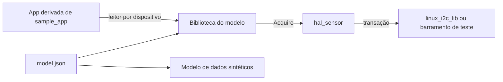

# Sensores de voo

A app cFS mantém um dispositivo por sensor e publica a telemetria. Cada modelo descreve o protocolo e os canais em `models/<id>/model.json`. O `hal_sensor` executa a sequência de configuração, obtém uma amostra completa e devolve um status. A app fornece o barramento ao vincular o dispositivo. No Raspberry Pi, `linux_i2c_lib` executa a transação no dispositivo Linux. Em testes, o mesmo driver pode receber um barramento de memória.

Este diretório contém definições, templates e fontes compartilhados usados pelos geradores, fora do clone da NASA. Eles não instalam apps HAL nem sensores na configuração inicial. Ao vincular um sensor ou incluir uma dependência, o Studio materializa os módulos necessários em `cFS/libs/`; a app que usa o leitor fica em `cFS/apps/`. Em missões novas, `mission/libs` e `mission/apps` são aliases para esses diretórios. As definições em `mission/sample_defs/` e os builds em `mission/build-native/` ou `mission/build-flight/` continuam externos ao clone.

| Onde editar | Responsabilidade |
| --- | --- |
| `models/<id>/model.json` | Identidade do chip, escritas de inicialização, registradores de saída, unidades e sensibilidade |
| `models/<id>/driver.c` (opcional) | Operações específicas do chip que exigem código C |
| `hal/include/` e `hal/src/` | Contrato e implementação comuns de aquisição, configuração e leitura de registradores |
| `buses/linux_i2c/` e `buses/linux_uart/` | Implementações compartilhadas de transporte para Linux |
| `../appgen/templates/hal_sensor/` | Trechos que ligam o leitor da app baseada em `sample_app` à biblioteca do modelo |
| `project/config.json` ou **Hardware → Configure bus and address** | Instância instalada, barramento, endereço escolhido e valores iniciais |
| `sensors/<id>.py` ou **Synthetic data** | Forma de onda de cada canal em unidades físicas |
| `cFS/libs/<id>_lib/` | Biblioteca de voo materializada conforme os vínculos e as dependências do projeto; acessível também pelo alias `mission/libs/` em missões novas |



Escolha o primeiro ponto que descreve o hardware novo. Um segundo dispositivo de um modelo conhecido precisa apenas de uma instância em **Hardware**. Um novo chip I²C com saídas de 16 bits pode usar um perfil de registradores. Um chip que exige outro protocolo pode fornecer operações próprias em C. A camada de barramento é compartilhada entre modelos. UART oferece uma API de fluxo separada, enquanto o template de modelo de registradores usa I²C.

## Cadastrar um sensor

No Studio, abra **Hardware → Connections → Connect sensor → New I²C model**. Informe o ID do tipo, endereço de sete bits em decimal, registrador de identidade e os canais. Use **Apply** para gravar o modelo. Volte a **Connect sensor** para conectar uma instância ao barramento. Em um projeto vazio, configure primeiro o perfil Raspberry Pi 4B e adicione o barramento I²C. Em um sensor instalado, **Model definition** abre o arquivo que originou o driver. Pela linha de comando, o mesmo cadastro aceita uma cópia editada do [modelo de exemplo](templates/model.json).

```sh
cp project/drivers/templates/model.json /tmp/lab_sensor.json
# Edite o ID, a identidade, a configuração e as saídas antes de registrar.
./start --no-ui project register-model /tmp/lab_sensor.json
```

O cadastro grava o modelo e a forma de onda. Para exercitar o exemplo em uma missão com o perfil Raspberry Pi 4B e o endereço 0x4a livre (inclua-o em `address` no modelo), crie uma instância e vincule-a a uma app.

```sh
./start --no-ui project add-bus i2c-bus.1
./start --no-ui project add-device "Temperatura de bancada" --id bench_temp --model lab_sensor --bus i2c-bus.1 --address 0x4a
./start --no-ui project link-hal bench_app temperature --device bench_temp --new-app
./start --no-ui build --target qemu
```

Após o cadastro, a lista de tipos passa a incluir o novo sensor. Para usá-lo na máquina emulada é preciso compilar o dispositivo dentro do QEMU e iniciar o emulador com a nova imagem. A biblioteca de voo e o dispositivo virtual são gerados a partir da mesma definição. O teste de registradores da imagem pode ser feito antes de iniciar o Linux da placa virtual.

```sh
./start --no-ui emulator --image flight-studio:sensores-locais
./scripts/build.sh
./start --no-ui model-test --target qemu --device bench_temp
```

Na interface, use a instalação de imagem em **Set up emulator**. De volta à bancada, selecione o sensor e use **Validate model** para executar a verificação dos registradores. Para conferir a aquisição pela aplicação cFS, compile a missão e execute-a no alvo. Uma placa física usa a biblioteca de voo e o sensor conectado ao endereço configurado.

## Preencher o modelo

A descrição de registradores suporta de 1 a 16 palavras de 16 bits com sinal e byte alto primeiro, dentro de uma leitura de até 32 bytes. Em `unit`, uma unidade própria como `Pa` é exibida diretamente. A ordem de `outputs` define a ordem dos campos da telemetria. `outputs[].register` define onde cada campo está no barramento. Preserve os nomes e a ordem dos campos de um pacote que já tem consumidores.

| Campo | Como é usado |
| --- | --- |
| `name`, `address`, `addresses` | ID do modelo, endereço padrão de sete bits e, opcionalmente, lista de endereços válidos |
| `id_register`, `id_value` | O HAL verifica a identidade antes da primeira escrita. O emulador gerado responde com o byte declarado. |
| `controls[]` | O HAL escreve `setup` em cada `register` na ordem da lista. O modelo QEMU usa `reset`, `reset_mask` e `sleep_mask` para reproduzir o estado do chip. |
| `outputs[]` | Cada canal tem nome, endereço do byte alto, unidade, valor inicial e conversão. O valor de voo é `raw × divisor / counts + offset`, com divisão inteira. |
| `scales` e `outputs[].scale` | Eixos que têm a mesma conversão referenciam uma escala pelo nome. No MPU6050, os três eixos de aceleração usam `accel`. No magnetômetro, X e Y compartilham a tabela `horizontal`. |
| `range_register`, `range_shift` | Para uma faixa selecionável, o HAL lê os dois bits de escala e multiplica a sensibilidade por 1, 2, 4 ou 8. O QEMU aplica a conversão inversa. |

Os modelos nativos do QEMU também podem descrever identidades de vários bytes, bits de dado pronto, bits reservados e tabelas de ganho. Os três sensores mostram quando usar cada recurso.

| Modelo | Particularidade |
| --- | --- |
| [TMP105](models/tmp105/model.json) | Lê temperatura sem configuração inicial. Rejeita os quatro bits reservados e preserva temperaturas negativas. |
| [LSM303DLHC](models/lsm303dlhc_mag/model.json) | Verifica a identidade H43 e o estado de dado pronto. Reordena X/Z/Y para X/Y/Z, usa o ganho corrente de cada eixo e identifica saturação. |
| [MPU6050](models/mpu6050/model.json) | Confere a identidade, acorda o chip e lê sete saídas em uma transação de 14 bytes. Aceleração e giro têm seletores de escala independentes. |

## Escolher a frequência de aquisição

O endereço e o barramento identificam a instância. O mapa de registradores descreve o chip. A lista de saídas determina o número de canais da amostra e as unidades definem o significado da telemetria. A sequência de inicialização pode selecionar a faixa ou o modo de operação. Um chip que exige aguardar conversão ou calibração pode implementar essa lógica em um driver próprio.

O período de leitura da aplicação é configurado em **Edit app** ou com `./start --no-ui app edit <app> --wakeup-hz <Hz>`. Ele deve corresponder a um número inteiro de ticks do SCH_LAB. O parâmetro `--hk-hz` ajusta a frequência do pacote de estado da aplicação. Cada aquisição do HAL publica o pacote de amostra, incluindo o status e o indicador de validade.

Consulte a documentação do componente para escolher o período. No TMP105, a escolha de resolução altera o tempo típico de conversão de 27,5 a 220 ms. No LSM303DLHC, a taxa magnética depende da configuração de CRA_REG_M. No MPU6050, o divisor de amostragem e o filtro digital determinam a frequência de atualização dos registros. Uma aplicação que consulta os registros mais rapidamente pode reler a mesma amostra. [Texas Instruments, TMP105](https://www.ti.com/lit/ds/symlink/tmp105.pdf) · [STMicroelectronics, LSM303DLHC](https://www.st.com/resource/en/datasheet/lsm303dlhc.pdf) · [InvenSense, MPU-6000/MPU-6050 Register Map](https://www.invensense.com/wp-content/uploads/2015/02/MPU-6000-Register-Map1.pdf)

## Implementar operações próprias

Para sensores que precisam de um protocolo próprio, a linha de comando também aceita um driver C fornecido pela equipe. O formulário gráfico atende ao perfil de registradores I²C. O segundo template lê um contador de 8 bits. O [modelo](templates/custom-model.json) declara o endereço e os canais. A implementação da transação e da conversão fica em [driver.c.example](templates/driver.c.example). Registre os dois arquivos juntos.

```sh
./start --no-ui project register-model project/drivers/templates/custom-model.json \
  --driver project/drivers/templates/driver.c.example
```

Com `protocol: "custom"`, o HAL delega a leitura à tabela `<PREFIX>_Ops` em `driver.c`. O nome do símbolo usa o ID em maiúsculas. `emulator: "external"` indica que o modelo do QEMU precisa ser fornecido separadamente para emular esse protocolo. A placa física usa diretamente a implementação em C.

Um modelo de registradores também pode ter um `driver.c` para substituir apenas `Configure` ou `Read`. A operação omitida usa o perfil de registradores. `Read` preenche uma posição por canal e retorna zero no sucesso ou um código de erro. O HAL só entrega a amostra quando todas as operações terminam com sucesso. Uma falha na inicialização permite uma nova tentativa na leitura seguinte.

Se o chip precisar guardar calibração ou estado entre leituras, declare `<PREFIX>_State_t` em um `state.h` na pasta do modelo, ou passe o arquivo com `--state-header` no cadastro. As apps geradas criam uma instância dessa estrutura para cada sensor e a disponibilizam em `device->DriverContext`. No código de voo escrito à mão, declare uma variável `<PREFIX>_State_t state`, use `<PREFIX>_Bind(bus, &state)` e chame `<PREFIX>_Acquire(&device, &sample)`.

O contrato do HAL e as funções de leitura e escrita de registradores estão no [cabeçalho público](hal/include/hal_sensor.h). O backend Linux preserva o *repeated START* do I²C. A [biblioteca UART](buses/linux_uart/README.md) fornece uma interface de fluxo independente. Um protocolo físico com temporização, CRC ou quadros próprios precisa de uma implementação correspondente no emulador para reproduzir esse comportamento.

## Missões existentes

Ao sincronizar, o Studio migra as bibliotecas geradas que ainda correspondem aos arquivos registrados em `project/generated/drivers.json`. Os leitores existentes continuam usando seus símbolos de voo originais. Quando encontra edições locais no código de uma biblioteca anterior ao HAL, preserva o conjunto de fontes dessa biblioteca e registra a decisão em `retained` no mesmo arquivo.
