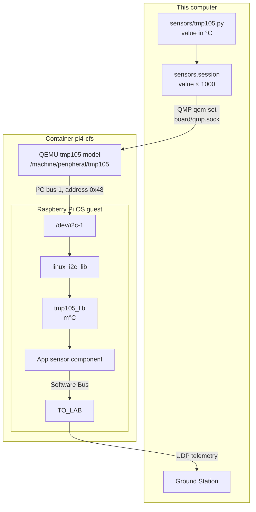

# Synthetic sensor data

In QEMU, Python functions set the readings of the emulated sensors. The flight
software reads them with the same drivers it uses on a board, from the Linux I²C
device node onward. Each value is written in physical units, °C for the TMP105 and µT
for each LSM303DLHC axis, and Flight Studio multiplies it by 1000 before handing it to
QEMU.

The diagram follows one TMP105 reading from the Python function to the Ground Station.
The edge labels name the channel used at each step.




## In Flight Studio

Open Synthetic data in the left rail, or the settings button next to Start synthetic
data. The left side shows the board with its sensors and their live values. On the
right, Widgets select the sensors, the update interval and each signal's initial value
and function, and Code edits the sensor's Python file. Both views change the same
Python settings, and Save writes them.

Test code prints eight samples in the terminal without sending anything, so it works
without QEMU and without a board. Start synthetic data sends the selected signals to
QEMU, which must already be running, and Stop synthetic data ends the session. Buses
and addresses belong to the Hardware view, and changing them requires a new QEMU boot.

## Sensor modules

Each `sensors/<model>.py` holds the signal settings in `SIGNALS`, a `sample()`
function and any custom functions. Each signal names one function.

| Function | Value at time t |
| --- | --- |
| `script` | Returned by the module's `sample(seconds, initial)` |
| `constant` | `initial` |
| `sine` | `initial + amplitude × sin(2π t / period)`, with amplitude 1 and period 30 s by default |
| `ramp` | `initial + slope × t`, with a slope of 1 per second by default |
| Name of a function in the module | Returned by that function, called with `(seconds, initial)` |

```python
# sensors/tmp105.py
SIGNALS = {"temperature": {"initial": 23.5, "function": "warm_up"}}

def warm_up(seconds, initial):
    return initial + min(seconds, 10) * 0.2
```

`seconds` counts from the start of the session. Without `initial`, a signal starts at
the device's value in `project/config.json`. For the LSM303DLHC, `sample()` receives
and returns the three axes together. Flight Studio rejects an initial value outside
the sensor's range and a sine whose amplitude would leave it. Devices of the same
model can have their own settings in an `INSTANCES` dictionary keyed by device ID.

[`signals.py`](signals.py) holds the update interval and the selected sensors.

```python
SESSION = {"interval": 1.0, "sensors": None}  # every configured sensor
# Select device IDs instead: {"tmp105": True}
```

## Terminal

```sh
# Preview a model, with no project hardware needed
python3 -m sensors.tmp105 --steps 8
python3 -m sensors.lsm303dlhc_mag --steps 8

# Preview the configured session without QEMU
python3 -m sensors.session --dry-run --steps 20
python3 -m sensors.session --dry-run --device tmp105 --steps 20

# Send values to a running QEMU
python3 -m sensors.session
./start --no-ui simulate tmp105 --interval 0.5 --steps 20

# Same preview as Test code
./start --no-ui simulate-preview --model tmp105
```

Ctrl+C stops sending. A session loads the Python files when it starts, so edits apply
from the next session. `./start --no-ui values` sets every emulated sensor back to its
value in `project/config.json`, like Reset all signals in the Hardware view.

## What each output confirms

The preview shows what the Python functions produce, and nothing reaches QEMU. During
a session, `OK` after a `qom-set` command means that QEMU accepted the new value. It
does not show that cFS read it. cFS read the value when the app's sensor telemetry
carries it with `Status` 0 and `Valid` 1, while `ReadCounter` grows with each read and
`ErrorCounter` with each failure. The TMP105 driver never changes the sensor's
configuration register, so readings keep the power-on resolution of 0.5 °C. In QEMU,
the temperature in telemetry therefore moves in 0.5 °C steps while the Python value
changes smoothly.

## Design notes

### Values enter through QEMU's device models

Synthetic values are only useful for testing the flight driver if they take the same
path as real readings, including the register encoding and the Linux I²C interface.
Python therefore sets properties of QEMU's own TMP105 and LSM303DLHC models over QMP,
QEMU produces the register bytes, and cFS reads them through `/dev/i2c-1`. Only sensor
models that QEMU implements can be driven this way, and only in the emulator.

### The emulator patches the LSM303DLHC model for negative fields

QEMU's LSM303DLHC model converts field values with `muldiv64`, which is unsigned, so
negative fields are not converted correctly. The emulator image builds QEMU 11.1.2 from
source with [`qemu-lsm303dlhc-signed.patch`](../scripts/qemu-lsm303dlhc-signed.patch),
which converts the magnitude and then restores the sign. `scripts/setup.sh` rebuilds an
installed image that lacks this patch.

QEMU implements the two models in
[`tmp105.c`](https://github.com/qemu/qemu/blob/master/hw/sensor/tmp105.c) and
[`lsm303dlhc_mag.c`](https://github.com/qemu/qemu/blob/master/hw/sensor/lsm303dlhc_mag.c).
