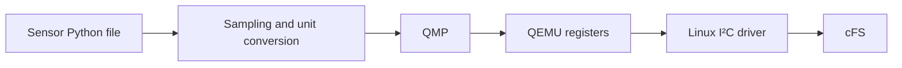

# Synthetic data

Python functions generate sensor values in physical units. QMP updates the
emulated sensor registers; cFS reads them through its normal drivers.



## Studio

Open **Synthetic data**, select a sensor, then choose **Widgets** or **Code**.

| Control | Action |
| --- | --- |
| Widgets | Set initial values and choose Python, constant, sine, ramp or a custom function |
| Code | Edit the selected sensor's Python file |
| Save | Save the same settings used by both views |
| Test code | Run eight samples in the terminal without a running board |
| Start / Stop | Send the selected signals to QEMU / stop sending |

Each sensor module contains its signal settings and functions. **Edit sample()**
or **Edit function()** opens the corresponding definition.

```python
# sensors/tmp105.py
SIGNALS = {"temperature": {"initial": 23.5, "function": "warm_up"}}

def warm_up(seconds, initial):
    return initial + min(seconds, 10) * 0.2
```

Custom functions receive elapsed seconds and the signal's initial value. Return
°C for TMP105 or µT for each LSM303DLHC axis. Select `script` to use the module's
`sample()` function. Saving Widgets updates `SIGNALS` and preserves Python
functions. Multiple devices using the same model can have per-device settings
in `INSTANCES` in that module.

`signals.py` contains only the update interval and sensor selection:

```python
SESSION = {"interval": 1.0, "sensors": None}  # All configured sensors
# Select individual device IDs: {"temp1": True, "mag1": False}
```

## Terminal

```sh
# Test a model without selecting hardware
python3 -m sensors.tmp105 --steps 8
python3 -m sensors.lsm303dlhc_mag --steps 8

# Test the configured session without QEMU
python3 -m sensors.session --dry-run --steps 20
python3 -m sensors.session --dry-run --device temp1 --steps 20

# Send configured waveforms to QEMU
./start --no-ui boot
python3 -m sensors.session
./start --no-ui simulate temp1 --interval 0.5 --steps 20
```

Device IDs come from the hardware workbench. **Test code** also runs from the
command line: `./start --no-ui simulate-preview --model tmp105`.
Ctrl+C stops the runner. Save and restart to apply Python changes.

QEMU models: [TMP105](https://github.com/qemu/qemu/blob/master/hw/sensor/tmp105.c),
[LSM303DLHC](https://github.com/qemu/qemu/blob/master/hw/sensor/lsm303dlhc_mag.c).
