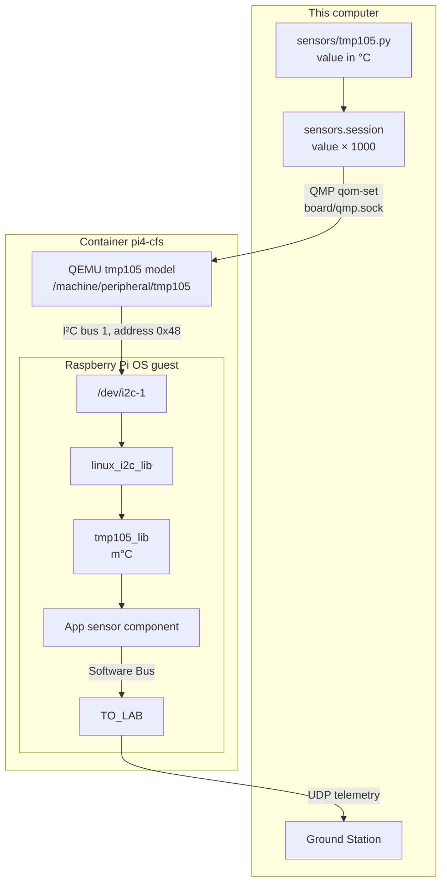

# Synthetic sensor data

In QEMU, Python functions set the readings of the emulated sensors. The flight
software reads them with the same drivers it uses on a board, from the Linux I²C
device node onward. Each value is written in physical units, °C for the TMP105 and µT
for each LSM303DLHC axis, and Flight Studio multiplies it by 1000 before handing it to
QEMU.

The diagram follows one TMP105 reading from the Python function to the Ground Station.
The edge labels name the channel used at each step.




## In Flight Studio

Open **Synthetic data** in the left rail and select a sensor on the board.
Each output has a baseline, waveform, noise type and amplitude-over-time plot.
Enable the outputs you want, choose the sample interval, then press **Save**.

**Dry run** samples the configured outputs locally and prints the values in the console.
To inject the same signals into the emulated devices, start the emulator and choose
**Start simulation**. In Board mode the plots can still be tested locally. The
physical sensor supplies its own measurements. Configure I²C buses and addresses
in Hardware and restart the emulator after changing them.

## Sensor modules

Each `sensors/<model>.py` holds the signal settings in `SIGNALS`, a `sample()`
function and any custom functions. Each signal names one function.

| Function | Value at time t |
| --- | --- |
| `script` | Returned by the module's `sample(seconds, initial)` |
| `constant` | `initial` |
| `sine` | `initial + amplitude × sin(2π t / period)`, with amplitude 1 and period 30 s by default |
| `ramp` | `initial + slope × t`, with a slope of 1 per second by default |
| Name of a function in the module | Returned by that function, called with `(seconds, initial)` |

```python
# sensors/tmp105.py
SIGNALS = {"temperature": {"initial": 23.5, "function": "warm_up"}}

def warm_up(seconds, initial):
    return initial + min(seconds, 10) * 0.2
```

`seconds` counts from the start of the session. Without `initial`, a signal starts at
the device's value in `project/config.json`. For the LSM303DLHC, `sample()` receives
and returns the three axes together. Flight Studio rejects an initial value outside
the sensor's range and a sine whose amplitude would leave it. Devices of the same
model can have their own settings in an `INSTANCES` dictionary keyed by device ID.

[`signals.py`](signals.py) holds the update interval and the selected sensors.

```python
SESSION = {"interval": 1.0, "sensors": None}  # every configured sensor
# Select device IDs instead: {"tmp105": True}
```

## Terminal

```sh
# Preview a model, with no project hardware needed
python3 -m sensors.tmp105 --steps 8
python3 -m sensors.lsm303dlhc_mag --steps 8

# Preview the configured session without QEMU
python3 -m sensors.session --dry-run --steps 20
python3 -m sensors.session --dry-run --device tmp105 --steps 20

# Send values to a running QEMU
python3 -m sensors.session
./start --no-ui simulate tmp105 --interval 0.5 --steps 20

# Same preview as Test code
./start --no-ui simulate-preview --model tmp105
```

Ctrl+C stops sending. A session loads the Python files when it starts, so edits apply
from the next session. `./start --no-ui values` sets every emulated sensor back to its
value in `project/config.json`, like Reset all signals in the Hardware view.

## What each output confirms

The preview shows what the Python functions produce, and nothing reaches QEMU. During
a session, `OK` after a `qom-set` command means that QEMU accepted the new value. It
does not show that cFS read it. cFS read the value when the app's sensor telemetry
carries it with `Status` 0 and `Valid` 1, while `ReadCounter` grows with each read and
`ErrorCounter` with each failure. The TMP105 driver never changes the sensor's
configuration register, so readings keep the power-on resolution of 0.5 °C. In QEMU,
the temperature in telemetry therefore moves in 0.5 °C steps while the Python value
changes smoothly.

## Design notes

### Values enter through QEMU's device models

Synthetic values are only useful for testing the flight driver if they take the same
path as real readings, including the register encoding and the Linux I²C interface.
Python therefore sets properties of QEMU's own TMP105 and LSM303DLHC models over QMP,
QEMU produces the register bytes, and cFS reads them through `/dev/i2c-1`. Only sensor
models that QEMU implements can be driven this way, and only in the emulator.

### The emulator patches the LSM303DLHC model for negative fields

QEMU's LSM303DLHC model converts field values with `muldiv64`, which is unsigned, so
negative fields are not converted correctly. The emulator image builds QEMU 11.1.2 from
source with [`qemu-lsm303dlhc-signed.patch`](../scripts/qemu-lsm303dlhc-signed.patch),
which converts the magnitude and then restores the sign. `scripts/setup.sh` rebuilds an
installed image that lacks this patch.

QEMU implements the two models in
[`tmp105.c`](https://github.com/qemu/qemu/blob/master/hw/sensor/tmp105.c) and
[`lsm303dlhc_mag.c`](https://github.com/qemu/qemu/blob/master/hw/sensor/lsm303dlhc_mag.c).

## Orbital temperature

A new TMP105 uses the single-node thermal model. In **Signals**, select the
temperature output and **Orbit physics**. Pick a spacecraft size, mass, surface
absorptivity, emissivity and internal heat. The readouts show the minimum and
maximum of the displayed orbit and two steady equilibria. Sun uses a surface
facing the Sun at perigee. Shadow uses Earth infrared at apogee. Temperatures are
computed in kelvin, then displayed in °C.

| Size | Projected area (m²) | Surface area (m²) | Mass (kg) |
| --- | --- | --- | --- |
| 1U | 0.015 | 0.060 | 0.8–2 |
| 3U | 0.039 | 0.156 | 2–6 |
| 6U | 0.071 | 0.284 | 6–14 |

With Earth view factor `F = (R/r)²` and solar zenith cosine `z`, absorbed power is
`α A_p × 1361 × (lit + 0.3 F max(0,z)) + ε A_p × 239 F + P` in watts. The
thermal capacity is `mass × 900 J/(kg K)`, and radiated power is
`ε × 5.67e−8 × A × T⁴`. The orbit preview, Python dry run and QMP writer all sample
the same integrated trajectory. Legacy `orbit.sunlight` waveforms retain their
original base, offset and time constant.

## Test scenarios

In **Test**, select a configured sensor, choose a scenario and click **Run**.
Each job compiles the register profile and the same C HAL used by the mission.
A local register bus receives the Python values and records the HAL's decoded
readings. The graph and checks use these actual results. **One orbit** samples a
revolution. **Eclipse entry** samples forty minutes around the propagated shadow
transition. **Sensor drops out** returns a bus error for six seconds, then checks
the next successful read. Quantization follows the model's register width and
sensitivity. A custom C protocol needs its own device implementation.

**Python → Dry run** prints 24 samples locally. **Send to QEMU** uses the live
emulator and continues until stopped. In **QEMU**, a completed write supplies
the Python and integer columns. The cFS column requires a connected Ground
Station and a valid packet from the linked app. A missing observation shows a dash.
