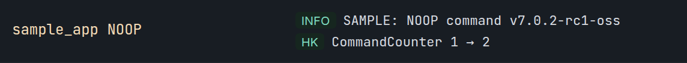

# Native NOOP illustration

This package contains **real screenshots of the running Flight Studio**, captured on 23 November 2026 after the quantitative campaign. One additional `sample_app` NOOP was sent in the already running Native session. It is an illustration, **not one of the 108 measured Q1 transmissions**, and does not replace or add observations to the published campaign.

The original campaign records and their checksums remain unchanged. Its first Native NOOP changed the counter from 0 to 1; this later illustration changed it from 1 to 2. No reset, build, start, or stop was performed for these screenshots.

## Recommended image

[**sample_app-noop-row-compact.png**](sample_app-noop-row-compact.png) shows the selected application's command, its returned event, and the confirmed counter change in one readable strip. It is a screenshot of the actual `.contact-history-row` element in the application's normal responsive layout at a 1100 × 1000 CSS-pixel viewport. The PNG is 1144 × 106 pixels at device scale factor 2. No simulated page, replacement values, or image-generated content was used.



The [housekeeping panel after reception](sample_app-hk-after.png) separately shows `CommandCounter=2` and `CommandErrorCounter=0`. The [full viewport](context-after.png) retains the surrounding interface. Other images preserve the command form, baseline panel, wider history panel, and a tighter response-only crop. The later compact crops display the same response and were obtained through read-only requests, without another command.

## Recorded confirmation

[capture.json](capture.json) contains the before/after packets, the sent command, the event, the receipt, screenshot dimensions and hashes, and the single permitted mutating request.

| Observation | Local record ID | Packet sequence | Recorded value |
| --- | ---: | ---: | --- |
| Baseline housekeeping | 12930 | 1321 | Commands 1; errors 0 |
| Sent NOOP | 12939 | — | MID `0x1882`, function code 0, bytes `1882c000000100a4` |
| Application event | 12941 | 32 | `SAMPLE: NOOP command v7.0.2-rc1-oss` |
| New housekeeping | 12947 | 1322 | Commands 2; errors 0 |

The send occurred at 13:50:29 UTC. The application event arrived at 13:50:30 UTC and the newer housekeeping packet at 13:50:32 UTC. The interface displays local time (10:50). Local record IDs identify receiver observations; they are different from CCSDS packet sequence numbers. The receipt links send ID 12939 to event ID 12941 and housekeeping ID 12947.

## Revisions and scope

- Repository Git HEAD at capture: [`ee682900017eaac2145ac7468caf3cc520d909c2`](https://github.com/Raiagues/cfs_emulator/tree/ee682900017eaac2145ac7468caf3cc520d909c2). This was the user's existing Native session, not a new isolated measurement checkout. Its build fingerprint is preserved in `capture.json`.
- Quantitatively measured platform: [`64add2472dbf6869563612cf6b2c427b181dba5d`](https://github.com/Raiagues/cfs_emulator/tree/64add2472dbf6869563612cf6b2c427b181dba5d).
- Original Q1 evidence: [final/raw/native/commands.json](../../final/raw/native/commands.json) and [the final campaign guide](../../final/README.md).

To illustrate this behavior again, open Ground in a connected Native session, select `sample_app` → `NOOP`, expand its housekeeping fields, and note the current command/error counters. Send NOOP once. Capture the application's response and the subsequent housekeeping packet with the counter incremented by one. Label the result as a new illustration; do not substitute it for a previous measurement. This capture used Chrome through Playwright, with an isolated browser context and dark theme; the displayed page and packets came from the real local server.

## Integrity check

From this directory:

```sh
sha256sum -c SHA256SUMS
```

The package manifest covers `capture.json`, this README, and every referenced PNG. Each screenshot also has its own hash in `capture.json`. This manifest is separate from those of the quantitative campaign and compilation supplement.
