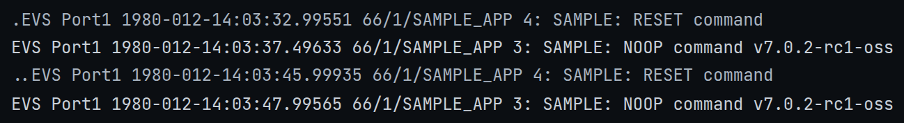

# Native SAMPLE_APP command sequence — real interface captures

These screenshots show a new live illustration on **23 November 2026**, separate from the quantitative Q1 campaign. The original measured results and their checksums were not changed. The sequence is **baseline 0 → NOOP 1 → RESET_COUNTERS 0 → NOOP 1**. Every shown housekeeping packet has `CommandErrorCounter = 0`.

The Native executable was already built. It was started through the existing local server, Ground was connected, and `TO_LAB_OUTPUT_ENABLE_CC` enabled telemetry to `127.0.0.1`. One preparation `RESET_COUNTERS` established the zero baseline. The three illustrated commands then followed. No build, app creation, sensor operation, source edit, or hardware-board command was used for this illustration.

## Four housekeeping screenshots

The images are screenshots of the actual `sample_app` telemetry tree in Flight Studio, including its application name, housekeeping MID, counter fields, and reception time. Each image is 510 × 276 pixels, captured from a 255 × 138 CSS-pixel element at device scale factor 2. No simulated page, replacement values, inserted DOM content, or generated image was used.

| State | Command immediately before capture | Confirmed HK sequence | Command counter | Error counter | Image |
| --- | --- | ---: | ---: | ---: | --- |
| Initial baseline | Preparation RESET_COUNTERS | 3 | 0 | 0 | [Initial 0](sample-app-hk-01-initial.png) |
| First command | NOOP | 4 | 1 | 0 | [After NOOP: 1](sample-app-hk-02-after-noop.png) |
| Reset | RESET_COUNTERS | 5 | 0 | 0 | [After reset: 0](sample-app-hk-03-after-reset.png) |
| Second NOOP | NOOP | 6 | 1 | 0 | [After NOOP: 1](sample-app-hk-04-after-noop.png) |

The initial zero is explicitly a reset baseline, not a claim about an unobserved previous session. The four confirmed HK packets are distinct. Their complete bytes and decoded fields are retained in [capture.json](capture.json), along with the actual sent commands and returned application events. The UI can receive a newer packet with the same counters while painting; the metadata keeps both the confirmed packet and the packet read around each screenshot rather than claiming exact paint-frame synchronization.

## Actual cFS event output

[**sample-app-terminal-events.png**](sample-app-terminal-events.png) is the recommended terminal illustration. It is a browser screenshot clipped to the bounds of the four real SAMPLE_APP event lines. The notification was allowed to expire before capture; text and DOM content were not changed. [sample-app-terminal.png](sample-app-terminal.png) preserves the larger terminal panel and [context-after.png](context-after.png) preserves the surrounding interface after the sequence.



[native-stdout.txt](native-stdout.txt) preserves a contiguous, literal byte range from `hardware/.runtime/native.log`, beginning immediately before the preparation reset and ending after the second NOOP. It includes the process's progress dots; lines were not rewritten or filtered. `capture.json` records the source byte range and its hash. The screenshot can show an additional preceding progress dot outside that selected byte range.

The terminal timestamps beginning with `1980-012` are the timestamps printed by cFS. They are not the host capture date and were not edited. Host observation times are separately preserved as Unix timestamps and UTC capture dates in the metadata.

| Observation | Sent command ID | Application event record ID | Confirmed HK record ID | Event text |
| --- | ---: | ---: | ---: | --- |
| Preparation reset | 13 | 16 | 30 | `SAMPLE: RESET command` |
| First NOOP | 33 | 34 | 49 | `SAMPLE: NOOP command v7.0.2-rc1-oss` |
| Reset | 62 | 64 | 68 | `SAMPLE: RESET command` |
| Second NOOP | 70 | 71 | 90 | `SAMPLE: NOOP command v7.0.2-rc1-oss` |

These IDs identify Ground's local records. They are different from CCSDS packet sequence numbers. The metadata also records every permitted mutating request: starting the existing Native executable, connecting Ground, enabling output, the four SAMPLE_APP commands, and opening the existing log follower. Later terminal captures only followed output; they sent no additional flight commands.

## Scope and traceability

- The illustration uses the current local workspace (including the user-created `orbit_demo` app), not the frozen four-application quantitative mission. Git HEAD identifies the repository base; the running build is separately identified below.
- Git HEAD at capture: `2f878c867610b518d79fe3b59748a98c760831f1`.
- Running build fingerprint: `99810172fd7a5eac214bdb73ae9af297dec3546b52e9de805b96b788fd0e95ef`.
- Primary sequence capture: 14:23:25–14:24:04 UTC; final terminal recapture time is recorded in `capture.json`.
- Original quantitative evidence: [Native commands](../../final/raw/native/commands.json) and [campaign guide](../../final/README.md). This illustration neither replaces those observations nor adds to the 108 measured transmissions.

To reproduce the illustration in a running Native session, enable output, select `sample_app`, expand its housekeeping fields, send RESET_COUNTERS, and wait for a new packet with both counters zero. Capture the panel. Send NOOP, RESET_COUNTERS, then NOOP, waiting each time for the matching application event and a newer HK packet with counters 1, 0, and 1 respectively. Capture the actual panel after each confirmation. Preserve the contemporaneous cFS stdout and label the new captures with their own dates and evidence records.

## Integrity check

From this directory:

```sh
sha256sum -c SHA256SUMS
```

This manifest covers this README, the capture metadata, literal stdout, and all seven PNG files. It is separate from the manifests of the quantitative campaign.
